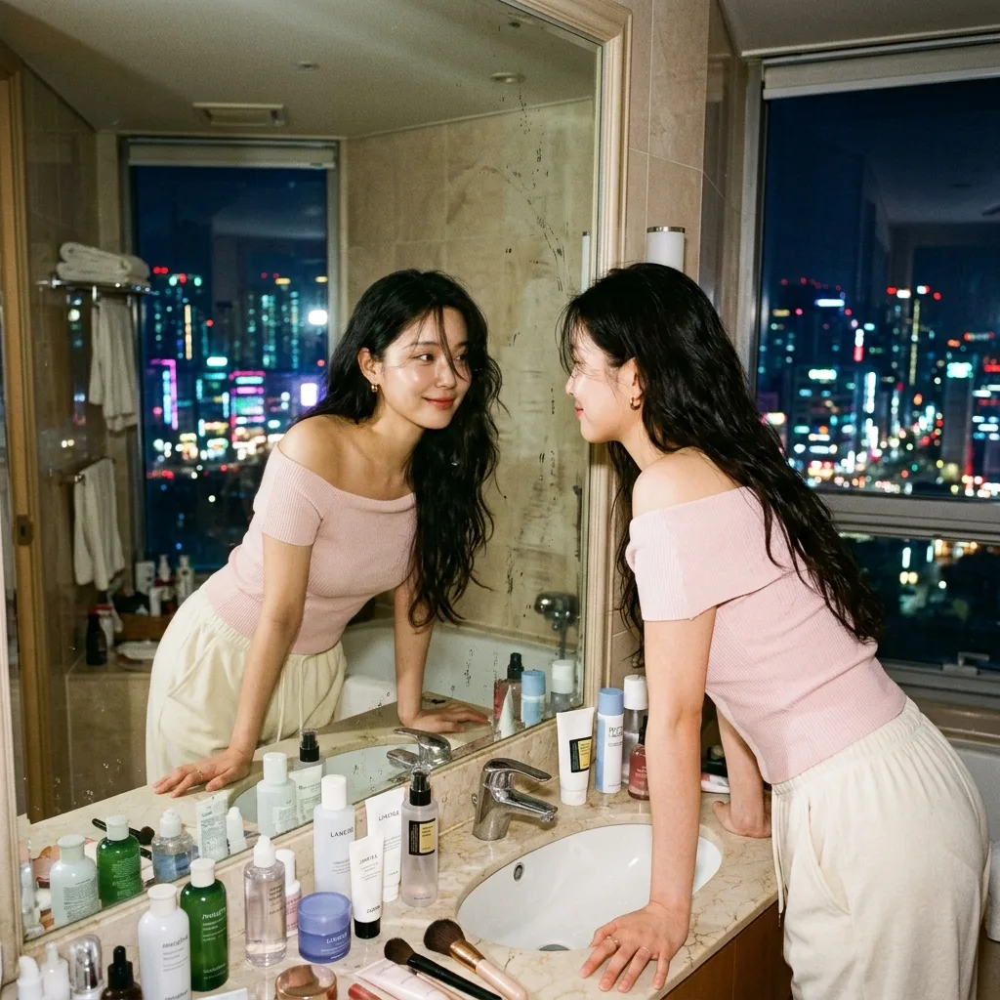

# Realistic, Portrait

[← Back to the collection](../../README.md) · Category: [Product & Brand](../../gallery/product-brand.md) · Model: `Vinano Image Pro` · ID: `vn-01773`

<a href="https://vinano.ai?utm_source=github&utm_medium=readme&utm_campaign=awesome-image-video-prompts-updating&utm_content=prompt-page-image"></a>

<sub>Preview generated with <a href="https://vinano.ai?utm_source=github&utm_medium=readme&utm_campaign=awesome-image-video-prompts-updating&utm_content=prompt-page-caption">vinano.ai</a></sub>

## Prompt

```text
Ultra-realistic candid film photography portrait of a young woman leaning over a bathroom sink and looking into a mirror at night, captured through a slightly dirty mirror natural reflections and subtle imperfections. She has long black hair partially covering her face, soft glowing skin, and a gentle mysterious smile. Wearing a light pink off-shoulder fitted top and loose cream-colored lounge pants, she poses casually both hands resting on the sink.
The scene is illuminated by direct on-camera flash, creating authentic Y2K disposable camera aesthetics, soft highlights, realistic skin texture, and natural shadows. A nighttime city skyline colorful neon lights and high-rise buildings is visible through a nearby window, adding an urban atmosphere. The bathroom countertop is filled skincare and cosmetic products, enhancing the lived-in, personal feel.
Shot from a close-up mirror perspective, cinematic composition, shallow depth of field, nostalgic 35mm film grain, subtle lens flare, reflections on glass, moody apartment ambiance, Korean lifestyle photography, intimate everyday moment, editorial fashion snapshot, raw candid energy, realistic colors, high detail, vertical composition, premium analog film aesthetic, trending Pinterest and Instagram photography style.

Keep edges clean and the overall composition balanced for a polished, gallery-ready result.
```

## Try it on vinano.ai

1. Copy the prompt above.
2. Open **[vinano.ai](https://vinano.ai?utm_source=github&utm_medium=readme&utm_campaign=awesome-image-video-prompts-updating&utm_content=prompt-page-try)**, paste it into the image generator and pick a model.
3. Swap any placeholders (brand, product, city, person…) for your own details, then generate.

More prompts like this: [Product & Brand gallery](../../gallery/product-brand.md) · [all categories](../../README.md#contents)
