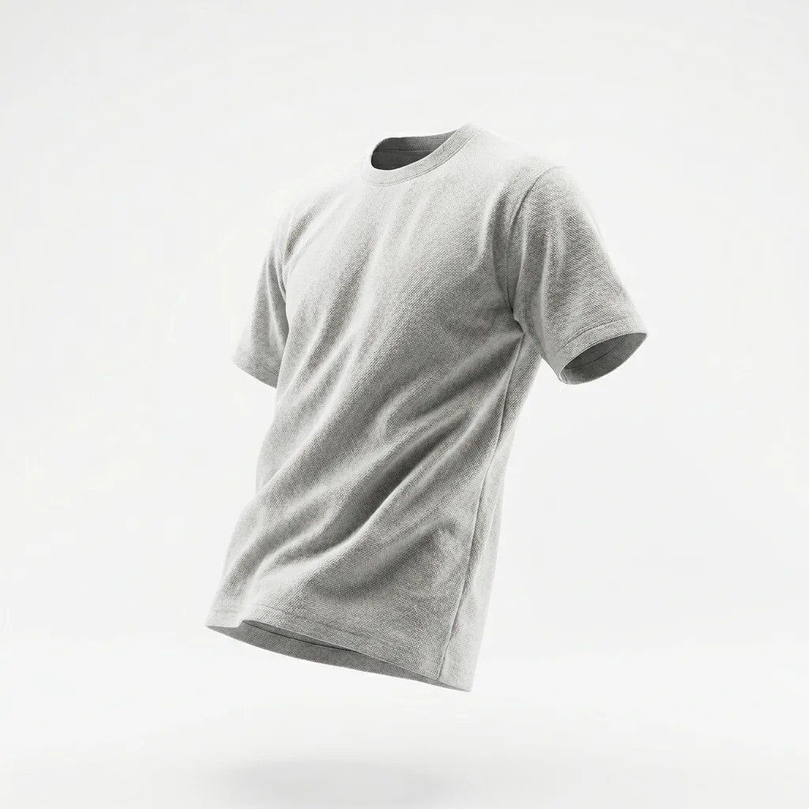

# Realistic, Minimalist

[← Back to the collection](../../README.md) · Category: [Product & Brand](../../gallery/product-brand.md) · Model: `Vinano Image Pro` · ID: `vn-01774`

<a href="https://vinano.ai?utm_source=github&utm_medium=readme&utm_campaign=awesome-image-video-prompts-updating&utm_content=prompt-page-image"></a>

<sub>Preview generated with <a href="https://vinano.ai?utm_source=github&utm_medium=readme&utm_campaign=awesome-image-video-prompts-updating&utm_content=prompt-page-caption">vinano.ai</a></sub>

## Prompt

```text
[BRAND NAME]. Act as a fashion photographer and creative director shooting a high-end editorial lookbook for a bespoke football jersey designed by this brand.
THE SUBJECT & COMPOSITION (FLOATING & ANGLED):
A single, premium custom football jersey is floating suspended in mid-air, centered in the frame. There is no hanger visible.
Crucial Angle: The jersey is NOT presented flatly frontal. It is rotated slightly (approximately 15 degrees angled view) to show depth, form, and a dynamic profile. Despite floating, the fabric must show realistic weight, deep gravity-defying folds, creases, and natural wrinkles. It must feel like a real, heavy garment frozen in time, not a stiff 3D model.
BRANDED DESIGN & AESTHETICS:
The jersey's design is a sophisticated interpretation of [BRAND NAME]'s visual identity.
Branding Placement: The official [BRAND NAME] logo is authentically applied as the main club crest on the chest (e.g., embroidered patch or premium-quality heat transfer).
MATERIALITY & TEXTURE (CRITICAL):
The focus remains on luxurious, tactile textures.
Fabric: A heavyweight, retro-inspired athletic cotton-blend or technical knit a visible, coarse weave structure.
ENVIRONMENT & BACKGROUND (WHITE STUDIO):
The jersey floats within an abstract, infinite white photo studio cyclorama space. The background is completely seamless, pure, clean white, and refined minimalist, absolutely zero distractions, placing total focus on the suspended garment.
LIGHTING & PHOTOGRAPHY STYLE:
Style: Hyper-realistic editorial fashion photography. Clean, high-key aesthetic.
Lighting: sophisticated studio lighting. Soft, diffused light that sculpts the folds of the fabric and highlights the texture against the pure white background. Subtle soft shadows might be cast on the jersey itself to define its form in the white space.

Emphasise material texture and natural light so the final frame feels tactile and premium.
```

## Try it on vinano.ai

1. Copy the prompt above.
2. Open **[vinano.ai](https://vinano.ai?utm_source=github&utm_medium=readme&utm_campaign=awesome-image-video-prompts-updating&utm_content=prompt-page-try)**, paste it into the image generator and pick a model.
3. Swap any placeholders (brand, product, city, person…) for your own details, then generate.

More prompts like this: [Product & Brand gallery](../../gallery/product-brand.md) · [all categories](../../README.md#contents)
