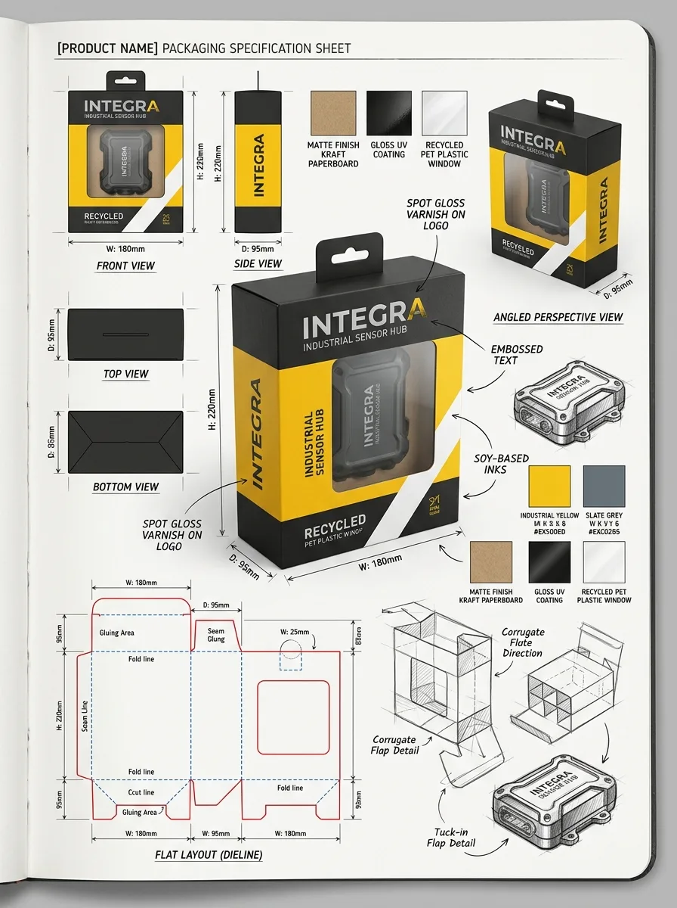

# Realistic, Ai Art

[← Back to the collection](../../README.md) · Category: [Product & Brand](../../gallery/product-brand.md) · Model: `Vinano Image Pro` · ID: `vn-01779`

<a href="https://vinano.ai?utm_source=github&utm_medium=readme&utm_campaign=awesome-image-video-prompts-updating&utm_content=prompt-page-image"></a>

<sub>Preview generated with <a href="https://vinano.ai?utm_source=github&utm_medium=readme&utm_campaign=awesome-image-video-prompts-updating&utm_content=prompt-page-caption">vinano.ai</a></sub>

## Prompt

```text
the attached image, create a professional industrial packaging design illustration sheet for the packaging of [PRODUCT NAME]

Feature a centered hero 3D render realistic materials, soft studio lighting, and commercial-grade finish quality.
Surround the hero render technical views: front, side, top, bottom, angled perspective, and flat layout.

Include structural construction sketches, fold lines, seam details, and dimension arrows measurements in millimeters.
Show materials and finishes (matte, glossy print, plastic, paper, glass, etc.) handwritten-style annotations.
Add color swatches, realistic product illustrations, and subtle shadows.

Background should resemble clean sketchbook paper, combining realistic rendering pencil sketch overlays.
Modern industrial design aesthetic, ultra-detailed, portfolio-ready presentation.

 settings:
CFG: 7–9
Steps: 30–40
Sampler: DPM++
Resolution: 1024×1280 or higher
Aspect Ratio: 3:4

Keep edges clean and the overall composition balanced for a polished, gallery-ready result.
```

## Try it on vinano.ai

1. Copy the prompt above.
2. Open **[vinano.ai](https://vinano.ai?utm_source=github&utm_medium=readme&utm_campaign=awesome-image-video-prompts-updating&utm_content=prompt-page-try)**, paste it into the image generator and pick a model.
3. Swap any placeholders (brand, product, city, person…) for your own details, then generate.

More prompts like this: [Product & Brand gallery](../../gallery/product-brand.md) · [all categories](../../README.md#contents)
