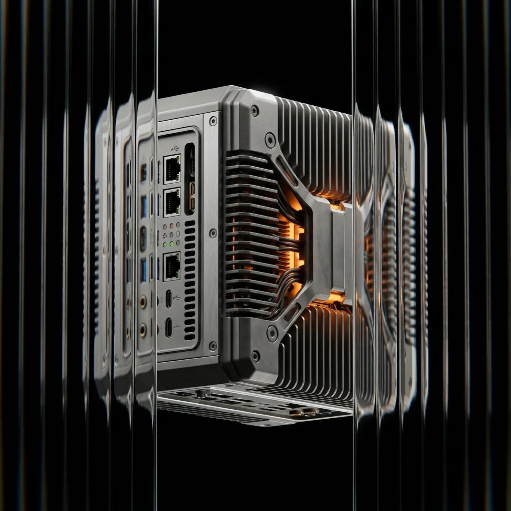

# Realistic, Cinematic

[← Back to the collection](../../README.md) · Category: [Product & Brand](../../gallery/product-brand.md) · Model: `Vinano Image Pro` · ID: `vn-01805`

<a href="https://vinano.ai?utm_source=github&utm_medium=readme&utm_campaign=awesome-image-video-prompts-updating&utm_content=prompt-page-image"></a>

<sub>Preview generated with <a href="https://vinano.ai?utm_source=github&utm_medium=readme&utm_campaign=awesome-image-video-prompts-updating&utm_content=prompt-page-caption">vinano.ai</a></sub>

## Prompt

```text
{
 "image_generation_request": {
 "subject": {
 "placeholder": "[INSERT PRODUCT HERE]",
 "position": "dead center, eye-level, perfectly centered in frame",
 "presentation": "levitating, floating in a weightless void, no stands, no platforms, no pedestals, no visible supports"
 },
 "environment": {
 "background": "absolute solid pitch black, hex code #000000, infinite void",
 "lighting": "rim lighting, cinematic chiaroscuro, high-contrast glints on metallic edges, soft orange glow from internal recesses"
 },
 "aesthetic_style": {
 "textures": ["shot-blasted matte titanium",
 "brushed aerospace-grade aluminum",
 "anodized dark grey metal",
 "ribbed industrial vertical cooling fins"],
 "optical_effects": "viewed through vertical fluted reeded glass, subtle chromatic distortion, refractive glass warping, radial motion blur on outer edges",
 "color_palette": {
 "primary_background": "#000000",
 "secondary_metal": "#8E8E8E",
 "accent_glow": "#FF8C00",
 "highlights": "#FFFFFF"
 }
 },
 "composition_constraints": {
 "framing": "ensure full product visibility, do not cut off edges, wide safety margins around the subject",
 "elements_to_exclude": ["text",
 "logos",
 "watermarks",
 "softboxes",
 "light stands",
 "floor",
 "horizon line",
 "props",
 "human hands",
 "shadows on surfaces"]
 },
 "technical_specs": {
 "focal_length": "85mm macro lens",
 "depth_of_field": "deep focus on product, blurred refractive foreground glass",
 "render_engine": "true-to-life photorealistic octane render, 8k resolution, ray-traced reflections"
 }
 }
}

Render with rich micro-detail while keeping the layout uncluttered and intentional.
```

## Try it on vinano.ai

1. Copy the prompt above.
2. Open **[vinano.ai](https://vinano.ai?utm_source=github&utm_medium=readme&utm_campaign=awesome-image-video-prompts-updating&utm_content=prompt-page-try)**, paste it into the image generator and pick a model.
3. Swap any placeholders (brand, product, city, person…) for your own details, then generate.

More prompts like this: [Product & Brand gallery](../../gallery/product-brand.md) · [all categories](../../README.md#contents)
