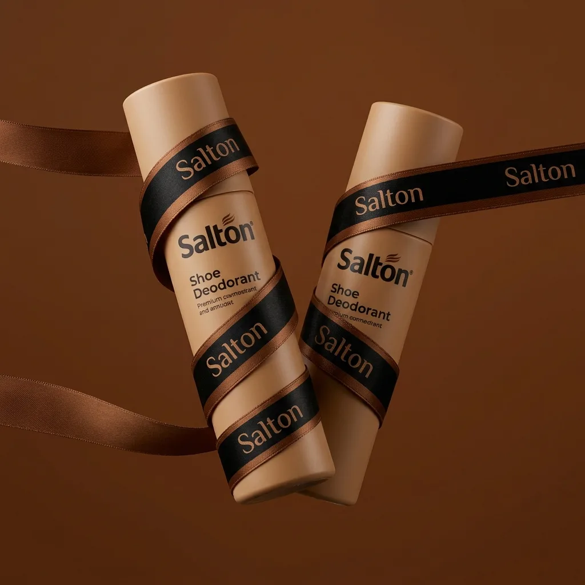

# Minimalist, Ai Art

[← Back to the collection](../../README.md) · Category: [Product & Brand](../../gallery/product-brand.md) · Model: `Vinano Image Pro` · ID: `vn-01846`

<a href="https://vinano.ai?utm_source=github&utm_medium=readme&utm_campaign=awesome-image-video-prompts-updating&utm_content=prompt-page-image"></a>

<sub>Preview generated with <a href="https://vinano.ai?utm_source=github&utm_medium=readme&utm_campaign=awesome-image-video-prompts-updating&utm_content=prompt-page-caption">vinano.ai</a></sub>

## Prompt

```text
A product photo in a premium advertising style. Two tall matte bottles of Salton Shoe Deodorant levitate in the air in a dynamic, balanced composition.
The bottles are positioned at an angle to each other, creating a striking diagonal composition. One bottle is slightly forward, the other is slightly behind, creating depth and hierarchy. Both bottles are elegantly wrapped a wide black and brown satin ribbon featuring the repeating "Salton" branding. The lettering is executed in a neat, contrasting font, legible without distortion, and is repeated evenly along the entire length of the ribbon. The ribbon flows smoothly between the bottles, uniting them into a single composition, without obscuring key messages on the packaging or clashing the main branding on the bottles. Shot from a slightly lower angle, the bottles are slightly tilted, enhancing a sense of confidence, strength, and premium quality. The background is a solid studio color, a deep warm shade (chocolate, dark caramel or soft terracotta), clean and refined minimalist, without distracting details.

Render with rich micro-detail while keeping the layout uncluttered and intentional.
```

## Try it on vinano.ai

1. Copy the prompt above.
2. Open **[vinano.ai](https://vinano.ai?utm_source=github&utm_medium=readme&utm_campaign=awesome-image-video-prompts-updating&utm_content=prompt-page-try)**, paste it into the image generator and pick a model.
3. Swap any placeholders (brand, product, city, person…) for your own details, then generate.

More prompts like this: [Product & Brand gallery](../../gallery/product-brand.md) · [all categories](../../README.md#contents)
