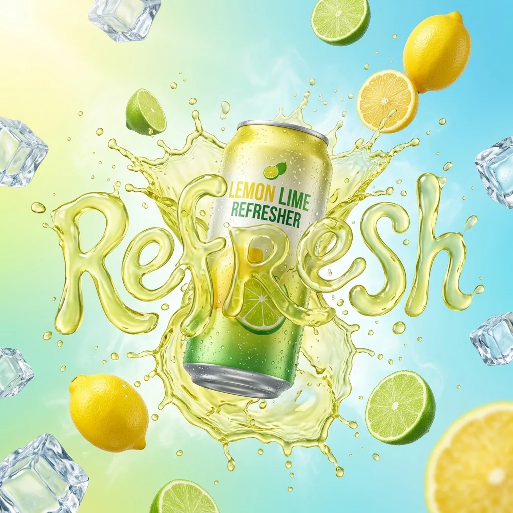

# Realistic, Ai Art

[← Back to the collection](../../README.md) · Category: [Product & Brand](../../gallery/product-brand.md) · Model: `Vinano Image Pro` · ID: `vn-01852`

<a href="https://vinano.ai?utm_source=github&utm_medium=readme&utm_campaign=awesome-image-video-prompts-updating&utm_content=prompt-page-image"></a>

<sub>Preview generated with <a href="https://vinano.ai?utm_source=github&utm_medium=readme&utm_campaign=awesome-image-video-prompts-updating&utm_content=prompt-page-caption">vinano.ai</a></sub>

## Prompt

```text
A vibrant, high-end advertising visual of a [PRODUCT NAME] can/bottle floating dynamically in the center. The background is a soft gradient inspired by the drink’s color, blending into fresh sky-blue tones for a refreshing summer feel. A powerful splash of [LIQUID TYPE] explodes around the product, forming the word ”[WORD]” in smooth, fluid, organic liquid typography. Crystal-clear ice cubes burst around the composition, fresh [FRUITS RELATED TO THE DRINK] (whole and sliced) flying in the air. Juicy splashes, droplets, light mist, and condensation create an intense refreshing atmosphere. Bright sunlight, glossy highlights, commercial lighting, premium brand look, dynamic motion, hyper-detailed, semi-realistic illustration style, ultra-clean, 4k, sharp focus. Maintain consistent colour harmony and crisp focus across the whole frame.
```

## Try it on vinano.ai

1. Copy the prompt above.
2. Open **[vinano.ai](https://vinano.ai?utm_source=github&utm_medium=readme&utm_campaign=awesome-image-video-prompts-updating&utm_content=prompt-page-try)**, paste it into the image generator and pick a model.
3. Swap any placeholders (brand, product, city, person…) for your own details, then generate.

More prompts like this: [Product & Brand gallery](../../gallery/product-brand.md) · [all categories](../../README.md#contents)
