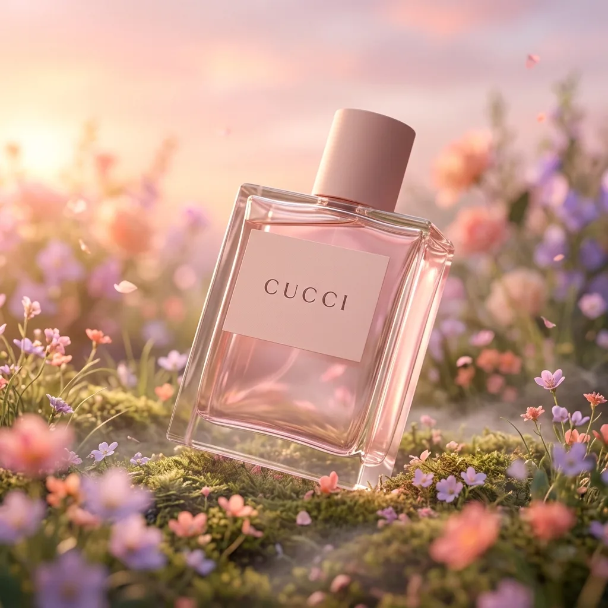

# Realistic, Cinematic

[← Back to the collection](../../README.md) · Category: [Product & Brand](../../gallery/product-brand.md) · Model: `Vinano Image Pro` · ID: `vn-01890`

<a href="https://vinano.ai?utm_source=github&utm_medium=readme&utm_campaign=awesome-image-video-prompts-updating&utm_content=prompt-page-image"></a>

<sub>Preview generated with <a href="https://vinano.ai?utm_source=github&utm_medium=readme&utm_campaign=awesome-image-video-prompts-updating&utm_content=prompt-page-caption">vinano.ai</a></sub>

## Prompt

```text
{
 "prompt": {
 "subject": "Hyper-realistic luxury perfume product photograph",
 "product": {
 "bottle": {
 "shape": "Rectangular",
 "material": "Transparent glass",
 "label": {
 "text": "CUCCI",
 "color": "Soft blush-pink",
 "texture": "Matte"
 },
 "cap": {
 "color": "Soft blush-pink",
 "texture": "Matte"
 },
 "placement": {
 "angle": "Gentle diagonal",
 "position": "Center"
 },
 "details": {
 "liquid": "Visible, soft reflections",
 "highlights": "Glowing on glass edges"
 }
 }
 },
 "environment": {
 "setting": "Lush miniature fantasy meadow",
 "ground": "Moss-covered",
 "flora": {
 "flowers": ["Delicate pink", "Lavender", "Coral wildflowers"],
 "grasses": "Soft green"
 },
 "atmosphere": {
 "air": "Tiny petals drifting",
 "mist": "Faint, floating low"
 }
 },
 "lighting": {
 "source": "Warm golden-pink light from upper left",
 "effect": "Dreamy sunset",
 "type": "Studio-grade subtle rim light"
 },
 "composition": {
 "depth_of_field": "Cinematic shallow",
 "focus": "Crisp on the brand name",
 "foreground": "Softly blurred blooms",
 "background": {
 "description": "Fading into a pastel bokeh haze",
 "elements": ["Florals", "Foliage"],
 "colors": ["Pink", "Peach", "Violet"]
 }
 },
 "style": {
 "aesthetic": "High-end editorial beauty",
 "mood": "Romantic and ethereal",
 "realism": "Premium realism",
 "quality": "8K",
 "textures": "Ultra-detailed (moss, petals, glass, label)"
 }
 }
}

Preserve realistic proportions and depth for a confident, professional finish.
```

## Try it on vinano.ai

1. Copy the prompt above.
2. Open **[vinano.ai](https://vinano.ai?utm_source=github&utm_medium=readme&utm_campaign=awesome-image-video-prompts-updating&utm_content=prompt-page-try)**, paste it into the image generator and pick a model.
3. Swap any placeholders (brand, product, city, person…) for your own details, then generate.

More prompts like this: [Product & Brand gallery](../../gallery/product-brand.md) · [all categories](../../README.md#contents)
