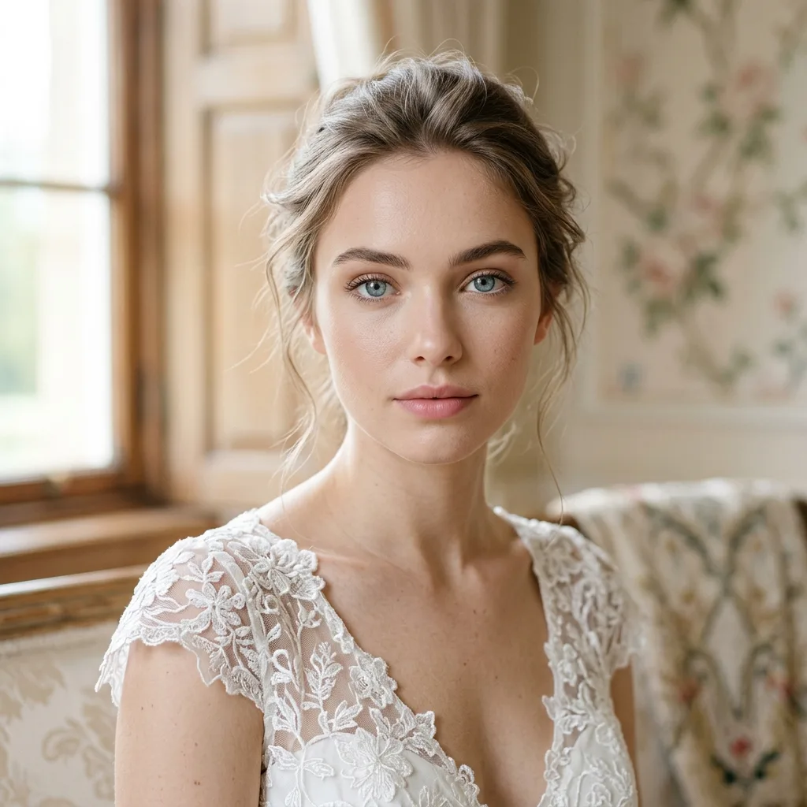

# Anime, Realistic

[← Back to the collection](../../README.md) · Category: [Product & Brand](../../gallery/product-brand.md) · Model: `Vinano Image Pro` · ID: `vn-01905`

<a href="https://vinano.ai?utm_source=github&utm_medium=readme&utm_campaign=awesome-image-video-prompts-updating&utm_content=prompt-page-image"></a>

<sub>Preview generated with <a href="https://vinano.ai?utm_source=github&utm_medium=readme&utm_campaign=awesome-image-video-prompts-updating&utm_content=prompt-page-caption">vinano.ai</a></sub>

## Prompt

```text
Ultra-realistic close-up portrait of a beautiful young woman, delicate facial features, mesmerizing light blue eyes, flawless fair skin, natural pink lips, soft makeup, elegant eyebrows, gentle neutral expression, looking directly at the camera. Hair styled in a loose romantic updo soft wispy strands framing the face. Wearing a luxurious white dress intricate floral lace embroidery on the shoulders and neckline, subtle vintage-inspired fashion. Soft natural daylight coming from a large window, creamy pastel interior background elegant wall art, shallow depth of field, dreamy bokeh, filmic, cinematic lighting, high-end fashion photography, extremely detailed skin texture, realistic eyes, soft color grading, fine hair details, ethereal atmosphere, masterpiece, true-to-life photorealistic, 85mm lens, f/1.4, ultra sharp focus, HDR, 8K quality, Vogue editorial style.

Negative Prompt:
low quality, blurry, noisy, extra fingers, deformed face, asymmetrical eyes, bad anatomy, cartoon, anime, overexposed, oversaturated, watermark, text, logo, duplicate features, distorted body, ugly, pixelated, low resolution, harsh shadows, unrealistic skin, exaggerated makeup.

Maintain consistent colour harmony and crisp focus across the whole frame.
```

## Try it on vinano.ai

1. Copy the prompt above.
2. Open **[vinano.ai](https://vinano.ai?utm_source=github&utm_medium=readme&utm_campaign=awesome-image-video-prompts-updating&utm_content=prompt-page-try)**, paste it into the image generator and pick a model.
3. Swap any placeholders (brand, product, city, person…) for your own details, then generate.

More prompts like this: [Product & Brand gallery](../../gallery/product-brand.md) · [all categories](../../README.md#contents)
