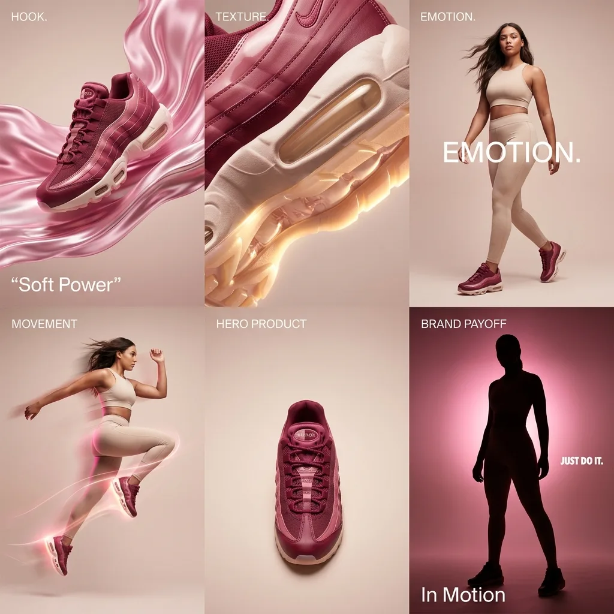

# Realistic, Product Photography

[← Back to the collection](../../README.md) · Category: [Product & Brand](../../gallery/product-brand.md) · Model: `Vinano Image Pro` · ID: `vn-01908`

<a href="https://vinano.ai?utm_source=github&utm_medium=readme&utm_campaign=awesome-image-video-prompts-updating&utm_content=prompt-page-image"></a>

<sub>Preview generated with <a href="https://vinano.ai?utm_source=github&utm_medium=readme&utm_campaign=awesome-image-video-prompts-updating&utm_content=prompt-page-caption">vinano.ai</a></sub>

## Prompt

```text
cinematic 6-frame grid (3x2), ultra-premium campaign for Nike Air Max 95 “Big Bubble” in deep berry pink + glossy rose tones

STRICT consistency across all frames:
same lighting setup, same color grading, same product color accuracy, same soft beige-pink gradient background, same luxury editorial tone
lighting: soft diffused studio lighting + glossy specular highlights + subtle pink glow accents
color palette: deep berry red, glossy pink, blush beige, warm ivory, soft gold reflections
texture emphasis: matte mesh + glossy leather + translucent air bubble

CAMPAIGN CONCEPT: “Soft Power in Motion”
MOOD: feminine strength, confident, bold, effortless luxury, streetwear meets beauty campaign

FRAME 1 — HOOK (surreal scroll stopper)
Nike Air Max 95 floating mid-air, surrounded by flowing liquid pink silk + glossy fluid waves, subtle motion distortion, dreamy yet powerful composition

FRAME 2 — TEXTURE (desire macro)
extreme macro close-up of air bubble + layered material textures, translucent sole glowing warm golden light, hyper-detailed reflections

FRAME 3 — EMOTION (identity)
confident female model wearing Nike Air Max 95, walking forward attitude, soft wind in hair, minimal neutral outfit, strong posture, empowered presence

FRAME 4 — MOVEMENT (performance)
dynamic mid-air jump shot, motion blur trails, glowing air sole emphasizing bounce, high-speed capture feel, energy lines

FRAME 5 — HERO PRODUCT (clean dominance)
perfectly centered product shot, symmetrical composition, ultra-clean background, premium minimal aesthetic, sharp detail

FRAME 6 — BRAND PAYOFF (iconic finish)
cinematic silhouette of female figure wearing the sneakers, strong pink backlight glow, dramatic shadows, bold Nike energy, powerful stance

STYLE:
high fashion editorial + luxury product photography + cinematic sports campaign
ultra-realistic, 4k, sharp focus, depth of field, premium finish, no distortion, no inconsistencies

OPTIONAL TEXT OVERLAY (minimal, clean typography):
“Soft Power” / “In Motion” / “Just Do It.”

Aim for an editorial, design-driven look with deliberate negative space.
```

## Try it on vinano.ai

1. Copy the prompt above.
2. Open **[vinano.ai](https://vinano.ai?utm_source=github&utm_medium=readme&utm_campaign=awesome-image-video-prompts-updating&utm_content=prompt-page-try)**, paste it into the image generator and pick a model.
3. Swap any placeholders (brand, product, city, person…) for your own details, then generate.

More prompts like this: [Product & Brand gallery](../../gallery/product-brand.md) · [all categories](../../README.md#contents)
