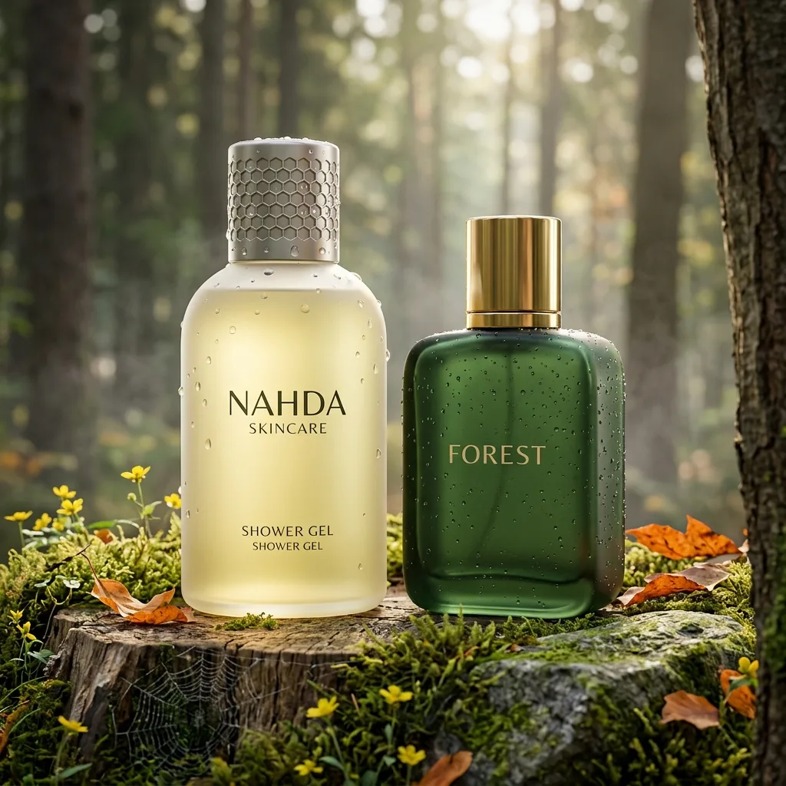

# Realistic, Portrait

[← Back to the collection](../../README.md) · Category: [Product & Brand](../../gallery/product-brand.md) · Model: `Vinano Image Pro` · ID: `vn-01921`

<a href="https://vinano.ai?utm_source=github&utm_medium=readme&utm_campaign=awesome-image-video-prompts-updating&utm_content=prompt-page-image"></a>

<sub>Preview generated with <a href="https://vinano.ai?utm_source=github&utm_medium=readme&utm_campaign=awesome-image-video-prompts-updating&utm_content=prompt-page-caption">vinano.ai</a></sub>

## Prompt

```text
{
 "master_prompt": {
 "global_settings": {
 "resolution": "8K",
 "aspect_ratio": "1:1",
 "image_type": "true-to-life photorealistic AI-generated product photography",
 "detail_level": "ultra-high detail, macro clarity",
 "noise": "none",
 "artifacts": "none",
 "focus": "sharp subject, controlled depth of field"
 },

 "module_1_image_1_style": {
 "subject": {
 "object_type": "cosmetic bottle",
 "label_text_visible": "NAHDA SKINCARE",
 "product_type_text": "SHOWER GEL / SHOWER GEL",
 "bottle_material": "frosted translucent glass",
 "liquid_color": "soft pale yellow",
 "shape": "cylindrical rounded shoulders",
 "cap": {
 "material": "metallic",
 "color": "silver",
 "surface_pattern": "hexagonal honeycomb texture",
 "finish": "matte"
 },
 "surface_details": "small and medium water droplets evenly distributed"
 },
 "environment": {
 "setting": "forest floor",
 "base_surface": "weathered tree stump",
 "surroundings": ["green moss",
 "small yellow wildflowers",
 "tree trunk to the right",
 "fine spider web attached to moss"],
 "background": "soft forest bokeh diffused sunlight",
 "atmosphere": "humid, natural, calm"
 },
 "lighting": {
 "type": "natural diffused light",
 "direction": "soft backlight and side illumination",
 "highlights": "gentle glow through liquid",
 "shadows": "soft, natural"
 },
 "camera": {
 "angle": "eye-level product shot",
 "lens_style": "macro product photography",
 "depth_of_field": "shallow"
 },
 "color_palette": ["pale yellow",
 "soft green",
 "natural brown",
 "muted gold"]
 },

 "module_2_image_2_style": {
 "subject": {
 "object_type": "perfume bottle",
 "label_text_visible": "FOREST",
 "bottle_color": "deep matte green",
 "material": "opaque glass",
 "shape": "rectangular rounded edges",
 "cap": {
 "material": "metallic",
 "color": "gold",
 "finish": "glossy cylindrical"
 },
 "surface_details": "dense fine water droplets covering bottle"
 },
 "environment": {
 "setting": "forest pathway",
 "base_surface": "moss-covered stone or log",
 "foreground_elements": ["orange autumn leaf",
 "fallen brown leaves"],
 "background": "tall trees fading into mist",
 "atmosphere": "misty, cool, forest depth"
 },
 "lighting": {
 "type": "warm ambient forest light",
 "direction": "top-front diffused",
 "effects": "soft glow and mist illumination"
 },
 "camera": {
 "angle": "straight-on centered composition",
 "lens_style": "portrait product lens",
 "depth_of_field": "moderate soft background blur"
 },
 "color_palette": ["forest green",
 "gold",
 "autumn orange",
 "earth brown"

Preserve realistic proportions and depth for a confident, professional finish.
```

## Try it on vinano.ai

1. Copy the prompt above.
2. Open **[vinano.ai](https://vinano.ai?utm_source=github&utm_medium=readme&utm_campaign=awesome-image-video-prompts-updating&utm_content=prompt-page-try)**, paste it into the image generator and pick a model.
3. Swap any placeholders (brand, product, city, person…) for your own details, then generate.

More prompts like this: [Product & Brand gallery](../../gallery/product-brand.md) · [all categories](../../README.md#contents)
