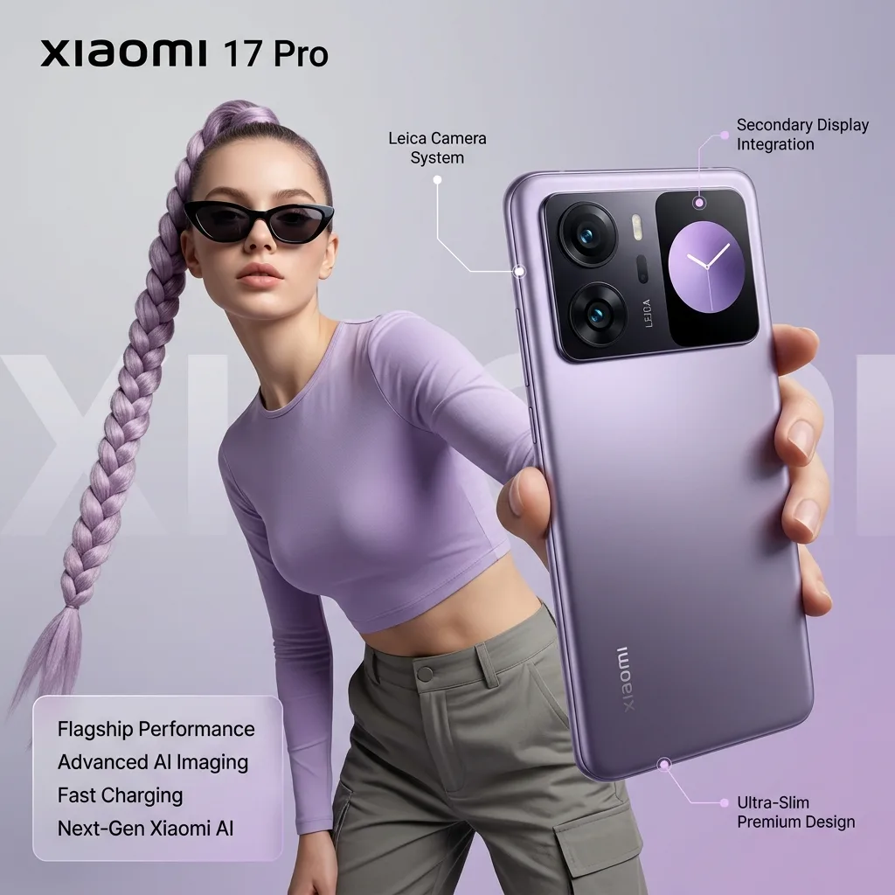

# Realistic, Product Photography

[← Back to the collection](../../README.md) · Category: [Product & Brand](../../gallery/product-brand.md) · Model: `Vinano Image Pro` · ID: `vn-01942`

<a href="https://vinano.ai?utm_source=github&utm_medium=readme&utm_campaign=awesome-image-video-prompts-updating&utm_content=prompt-page-image"></a>

<sub>Preview generated with <a href="https://vinano.ai?utm_source=github&utm_medium=readme&utm_campaign=awesome-image-video-prompts-updating&utm_content=prompt-page-caption">vinano.ai</a></sub>

## Prompt

```text
Ultra-realistic premium smartphone advertisement, featuring a confident young woman in her early 20s fair skin and sharp facial features, wearing sleek black cat-eye sunglasses. She has long, thick braided hair styled into an extended oversized braid, colored in soft lavender/purple tones matching the product theme.
She is captured in a dynamic low-angle cinematic pose, slightly twisting her torso while holding a Xiaomi 17 Pro smartphone toward the camera in a bold hero shot strong forced perspective, the phone dominating the foreground.
The smartphone features a matte metallic lavender/purple finish, minimalistic body rounded corners, and a large rectangular camera module. The module includes two large camera lenses on the left, a circular secondary display on the right showing a minimal purple gradient clock UI, Leica branding near the camera, a clean flash strip, and subtle Xiaomi branding at the bottom.
Outfit: fitted long-sleeve crop top in soft lavender/purple, paired high-waisted muted grey/olive cargo pants, modern tech-fashion aesthetic.
Background: clean minimal gradient transitioning from light grey to soft lavender/purple tones, subtle blurred large-scale typography for depth.
Lighting: soft studio lighting neutral-to-cool tones, smooth skin illumination, controlled highlights on the phone edges, glossy reflections on camera lenses and display, minimal shadows, premium product photography style.
Composition: low-angle shot for a powerful look, subject positioned slightly left, phone dominating the right foreground, clean negative space for branding.
Futuristic UI overlays: thin minimal white/purple lines and nodes pointing to features floating labels: “Leica Camera System” “Secondary Display Integration” “Ultra-Slim Premium Design”
Glassmorphism panel (bottom-left, soft purple tint) listing: “Flagship Performance” “Advanced AI Imaging” “Fast Charging” “Next-Gen Xiaomi AI”
Top corner text: “Xiaomi 17 Pro” in clean modern sans-serif typography.
Style: high-end flagship smartphone advertisement, futuristic, minimal, elegant.
Quality: 8K, ultra-detailed, sharp focus, HDR, cinematic commercial photography, realistic textures.

Emphasise material texture and natural light so the final frame feels tactile and premium.
```

## Try it on vinano.ai

1. Copy the prompt above.
2. Open **[vinano.ai](https://vinano.ai?utm_source=github&utm_medium=readme&utm_campaign=awesome-image-video-prompts-updating&utm_content=prompt-page-try)**, paste it into the image generator and pick a model.
3. Swap any placeholders (brand, product, city, person…) for your own details, then generate.

More prompts like this: [Product & Brand gallery](../../gallery/product-brand.md) · [all categories](../../README.md#contents)
