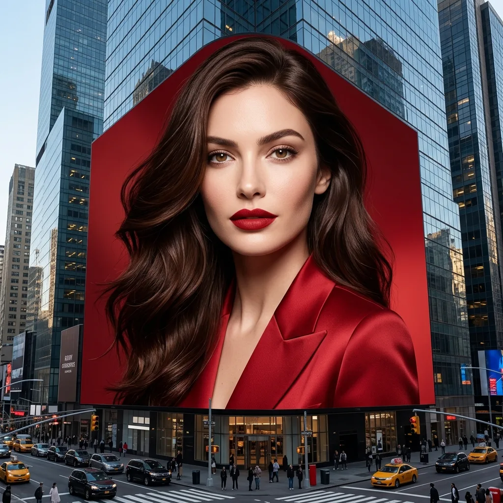

# Anime, Realistic

[← Back to the collection](../../README.md) · Category: [Product & Brand](../../gallery/product-brand.md) · Model: `Vinano Image Pro` · ID: `vn-01966`

<a href="https://vinano.ai?utm_source=github&utm_medium=readme&utm_campaign=awesome-image-video-prompts-updating&utm_content=prompt-page-image"></a>

<sub>Preview generated with <a href="https://vinano.ai?utm_source=github&utm_medium=readme&utm_campaign=awesome-image-video-prompts-updating&utm_content=prompt-page-caption">vinano.ai</a></sub>

## Prompt

```text
[Reference Image]
 the provided reference image, create an ultra-realistic mega-scale luxury beauty advertising campaign displayed on a massive 3D digital billboard wrapped around the corner of a modern skyscraper in Times Square, New York. The billboard dominates the city skyline and features a breathtaking high-fashion portrait of the same woman, styled like an iconic international cosmetics ambassador.
The model has long, glossy dark chocolate-brown hair voluminous waves, flawless porcelain skin, softly sculpted features, bold defined brows, warm hazel eyes, luxurious matte crimson lips, and a confident, elegant expression looking directly at the viewer. A subtle breeze lifts strands of her hair, adding cinematic movement.
She wears a tailored satin-finish crimson red blazer sharp lapels and sophisticated luxury styling. The billboard background is a rich monochromatic red gradient dramatic editorial lighting that makes the portrait appear larger than life.
The scene is photographed from street level a wide-angle perspective, showcasing towering glass skyscrapers, urban architecture, reflections, traffic, pedestrians, and the enormous LED display seamlessly integrated into the building façade. The billboard should resemble a world-class luxury cosmetics campaign premium branding aesthetics and polished commercial production quality.
Capture the image in true-to-life photorealistic 8K, ultra-detailed skin texture, premium hair rendering, cinematic daylight, high dynamic range, architectural realism, luxury fashion advertising, editorial beauty campaign, Times Square energy, hyper-realistic digital signage, and masterpiece-quality composition.
Style Keywords: mega billboard, Times Square advertising, luxury beauty campaign, high-fashion editorial, cinematic cityscape, global cosmetics ambassador, true-to-life photorealistic, premium commercial photography, architectural realism, 8K, ultra detailed.

Negative Prompt
low quality, blurry, pixelated billboard, distorted face, extra people on billboard, malformed anatomy, unrealistic proportions, duplicate subject, cartoon, anime, CGI look, poor lighting, watermark, random text, artifacts, noisy image, low resolution, oversaturated colors, plastic skin.

Emphasise material texture and natural light so the final frame feels tactile and premium.
```

## Try it on vinano.ai

1. Copy the prompt above.
2. Open **[vinano.ai](https://vinano.ai?utm_source=github&utm_medium=readme&utm_campaign=awesome-image-video-prompts-updating&utm_content=prompt-page-try)**, paste it into the image generator and pick a model.
3. Swap any placeholders (brand, product, city, person…) for your own details, then generate.

More prompts like this: [Product & Brand gallery](../../gallery/product-brand.md) · [all categories](../../README.md#contents)
