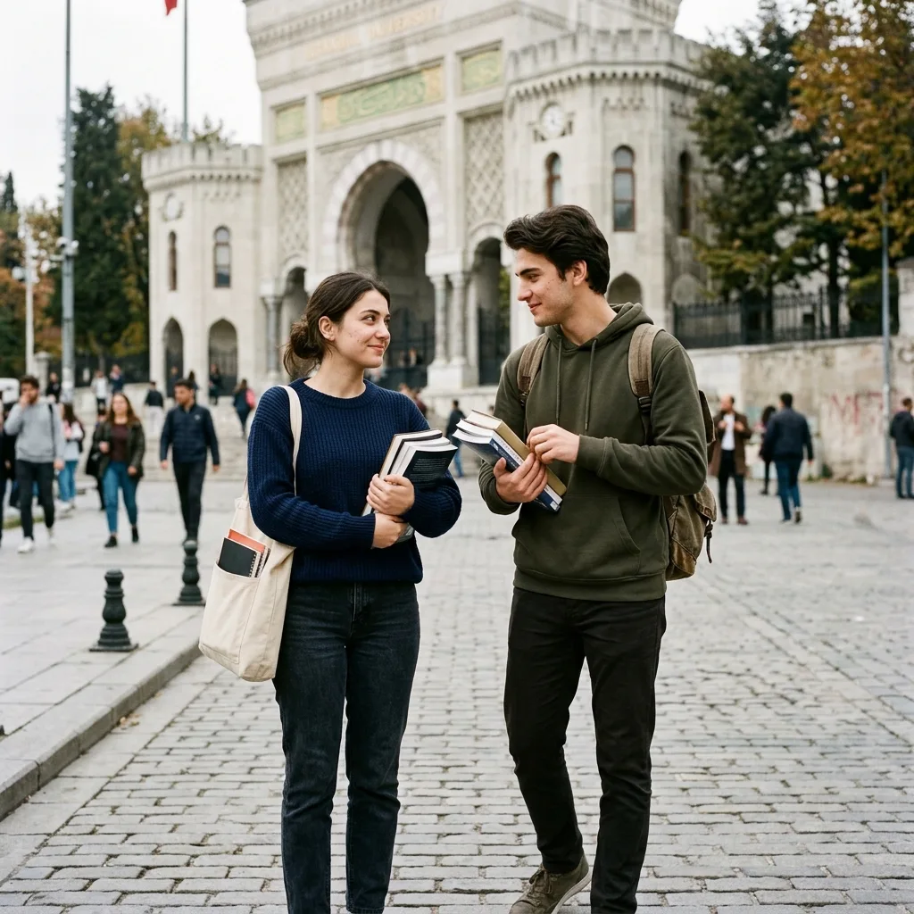

# Realistic, Portrait

[← Back to the collection](../../README.md) · Category: [Product & Brand](../../gallery/product-brand.md) · Model: `Vinano Image Pro` · ID: `vn-01969`

<a href="https://vinano.ai?utm_source=github&utm_medium=readme&utm_campaign=awesome-image-video-prompts-updating&utm_content=prompt-page-image"></a>

<sub>Preview generated with <a href="https://vinano.ai?utm_source=github&utm_medium=readme&utm_campaign=awesome-image-video-prompts-updating&utm_content=prompt-page-caption">vinano.ai</a></sub>

## Prompt

```text
{
 "generation_request": {
 "meta_data": {
 "tool": "",
 "task_type": "photoreal_candid_street_romance",
 "version": "v1.0_ISTANBUL_UNIVERSITY_FIRST_MEET_LOVE_EN",
 "priority": "highest"
 },

 "output_settings": {
 "aspect_ratio": "4:5",
 "orientation": "portrait",
 "resolution_target": "ultra_high_res",
 "render_style": "ultra_photoreal_candid_street_film_still",
 "sharpness": "crisp_but_natural",
 "film_grain": "subtle_35mm",
 "color_grade": "true_to_life_natural",
 "dynamic_range": "natural_not_hdr",
 "skin_rendering": "real_texture_no_retouch"
 },

 "global_rules": {
 "camera_language": "35mm lens equivalent, eye-level, imperfect framing, candid documentary feel, focus on eyes when people are present",
 "lighting_language": "motivated natural light only (overcast daylight or soft morning sun), deep but detailed shadows",
 "authenticity_markers": "no studio look, no HDR, no AI glow, natural colors, real street atmosphere"
 },

 "creative_prompt": {
 "scene_summary": "A quiet love story begins in Istanbul. Two university students meet for the first time at the main gate of Istanbul University. A candid, unposed moment — as if caught accidentally by a street photographer.",

 "subjects": {
 "count": 2,
 "description": "a young man and woman in their early 20s, university students, ordinary and real, not model-like",
 "expression": "subtle curiosity, shy eye contact, a small uncertain smile — restrained, natural",
 "skin_and_face": "natural skin texture, no beauty retouch, slight under-eye shadows, real imperfections"
 },

 "wardrobe_and_style": {
 "makeup": "very minimal, natural makeup only",
 "clothing": "simple everyday student clothing in neutral tones (beige, grey, navy, soft brown), slightly wrinkled fabric",
 "accessories": "backpacks or tote bags, books held naturally in arms — no logos"
 },

 "micro_action": "they pause briefly while passing each other; their eyes meet; one adjusts the books in their arms; a half-smile forms before words",

 "environment_details": {
 "location": "Istanbul University main entrance gate",
 "background": "historic stone gate, worn pavement, passing students softly out of focus, trees and campus walls",
 "street_elements": "subtle movement of people in the background, light breeze, everyday campus life"
 },

 "lighting": "soft natural daylight, slightly diffused, no dramatic contrast, realistic skin tones",

 "composition": "eye-level medium shot, slightly off-center framing, faces clearly visible and sharp, background gently receding, no symmetry",

 "mood": "quiet, human, intimate, observational — love as a small moment, not a performance"
 },

 "negative_prompt": ["studio lighting",
 "beauty retouch",
 "plastic skin",
 "model faces",
 "over-stylized fashion",
 "perfect symmetry",
 "HDR",
 "AI glow",
 "fake bokeh",
 "text",
 "logo",
 "watermark",
 "posed romance",
 "cinematic exaggeration"]
 }
}

Preserve realistic proportions and depth for a confident, professional finish.
```

## Try it on vinano.ai

1. Copy the prompt above.
2. Open **[vinano.ai](https://vinano.ai?utm_source=github&utm_medium=readme&utm_campaign=awesome-image-video-prompts-updating&utm_content=prompt-page-try)**, paste it into the image generator and pick a model.
3. Swap any placeholders (brand, product, city, person…) for your own details, then generate.

More prompts like this: [Product & Brand gallery](../../gallery/product-brand.md) · [all categories](../../README.md#contents)
