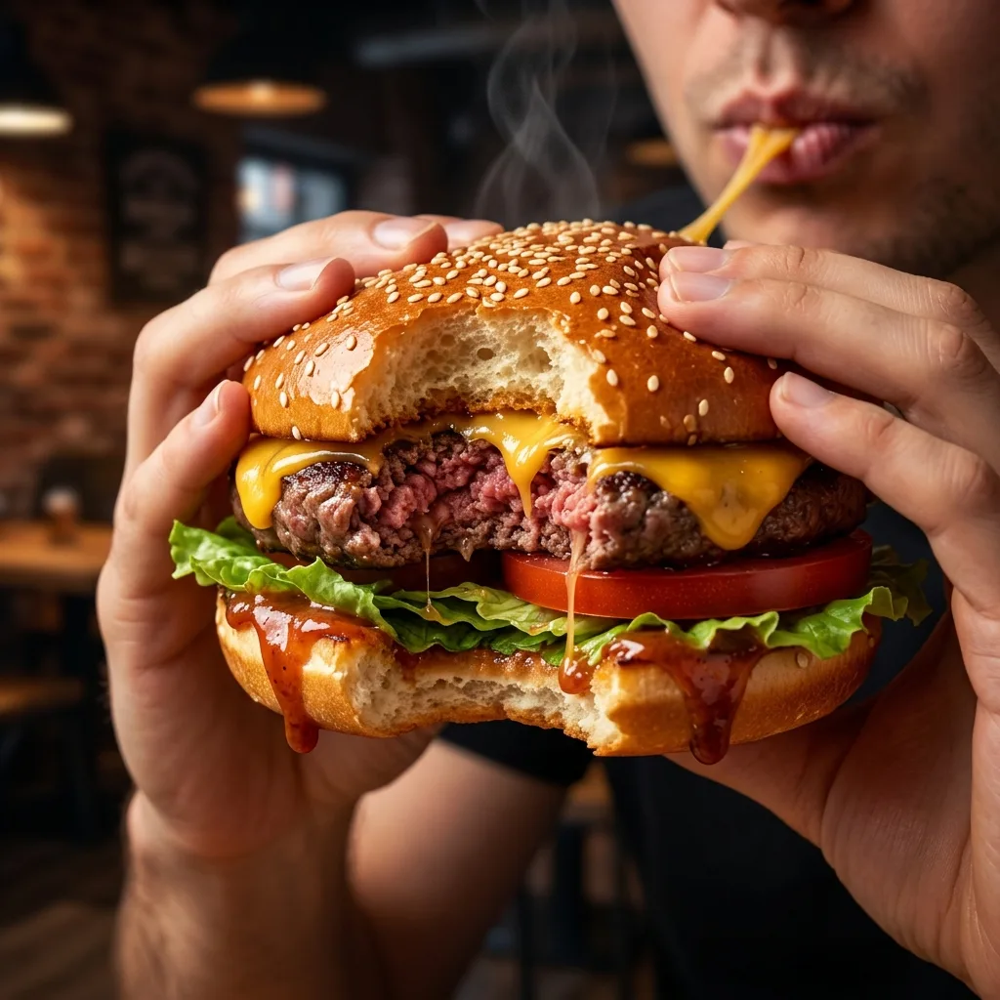

# Realistic, Food Photography

[← Back to the collection](../../README.md) · Category: [Product & Brand](../../gallery/product-brand.md) · Model: `Vinano Image Pro` · ID: `vn-01990`

<a href="https://vinano.ai?utm_source=github&utm_medium=readme&utm_campaign=awesome-image-video-prompts-updating&utm_content=prompt-page-image"></a>

<sub>Preview generated with <a href="https://vinano.ai?utm_source=github&utm_medium=readme&utm_campaign=awesome-image-video-prompts-updating&utm_content=prompt-page-caption">vinano.ai</a></sub>

## Prompt

```text
{
 "content_goal": "viral food visual extreme craving appeal",
 "image_type": "ultra-true-to-life photorealistic food action photography",
 "visual_style": {
 "aesthetic": "cinematic food editorial, hyper-real",
 "vibe": "juicy, indulgent, irresistible",
 "realism": "high-end commercial food realism"
 },
 "composition": {
 "framing": "tight close-up or medium close-up",
 "camera_angle": "slightly low or front-facing",
 "subject_position": "centered hero bite moment",
 "perspective": "depth-rich strong foreground focus"
 },
 "subject": {
 "description": "large gourmet burger captured mid-bite",
 "bite_action": "visible bite mark compressed layers",
 "ingredients": "juicy beef patty, melted cheese, fresh lettuce, tomato, sauce drip",
 "details": "cheese stretch, sauce gloss, steam rising"
 },
 "texture_details": {
 "bun": "soft toasted bun sesame seeds",
 "patty": "juicy visible meat fibers",
 "cheese": "melted, glossy, stretching",
 "sauce": "thick, dripping naturally"
 },
 "human_element": {
 "hands": "realistic hands holding burger",
 "bite_mark": "natural teeth impression",
 "skin_detail": "natural skin texture, clean nails"
 },
 "lighting": {
 "type": "dramatic food lighting",
 "quality": "warm, directional, high-contrast",
 "direction": "side or top-side light emphasizing gloss",
 "highlight_focus": "cheese melt and sauce texture",
 "shadow_style": "deep but controlled shadows"
 },
 "color_palette": {
 "primary": ["golden brown", "cheese yellow", "deep red"],
 "accent": ["lettuce green"],
 "mood": "rich, bold, indulgent"
 },
 "environment": {
 "location": "burger joint, café, or studio food setup",
 "background": "dark, blurred background to isolate burger",
 "atmosphere": "warm, indulgent, street-food luxury"
 },
 "camera_details": {
 "camera_type": "professional DSLR / mirrorless simulation",
 "lens": "85mm or macro food lens",
 "focus": "tack-sharp on bite area",
 "depth_of_field": "shallow for dramatic bokeh",
 "resolution": "advertising-grade clarity"
 },
 "quality_control": {
 "food_realism": "hyper-real textures, no plastic look",
 "bite_accuracy": "natural compression of ingredients",
 "ai_artifacts": "none",
 "professional_finish": "commercial food photography quality"
 },
 "overall_mood": "mouth-watering, bold, indulgent",
 "intended_use": {
 "primary": "viral food post on X",
 "secondary": "restaurant branding, food editorial, ads"
 }
}

Emphasise material texture and natural light so the final frame feels tactile and premium.
```

## Try it on vinano.ai

1. Copy the prompt above.
2. Open **[vinano.ai](https://vinano.ai?utm_source=github&utm_medium=readme&utm_campaign=awesome-image-video-prompts-updating&utm_content=prompt-page-try)**, paste it into the image generator and pick a model.
3. Swap any placeholders (brand, product, city, person…) for your own details, then generate.

More prompts like this: [Product & Brand gallery](../../gallery/product-brand.md) · [all categories](../../README.md#contents)
