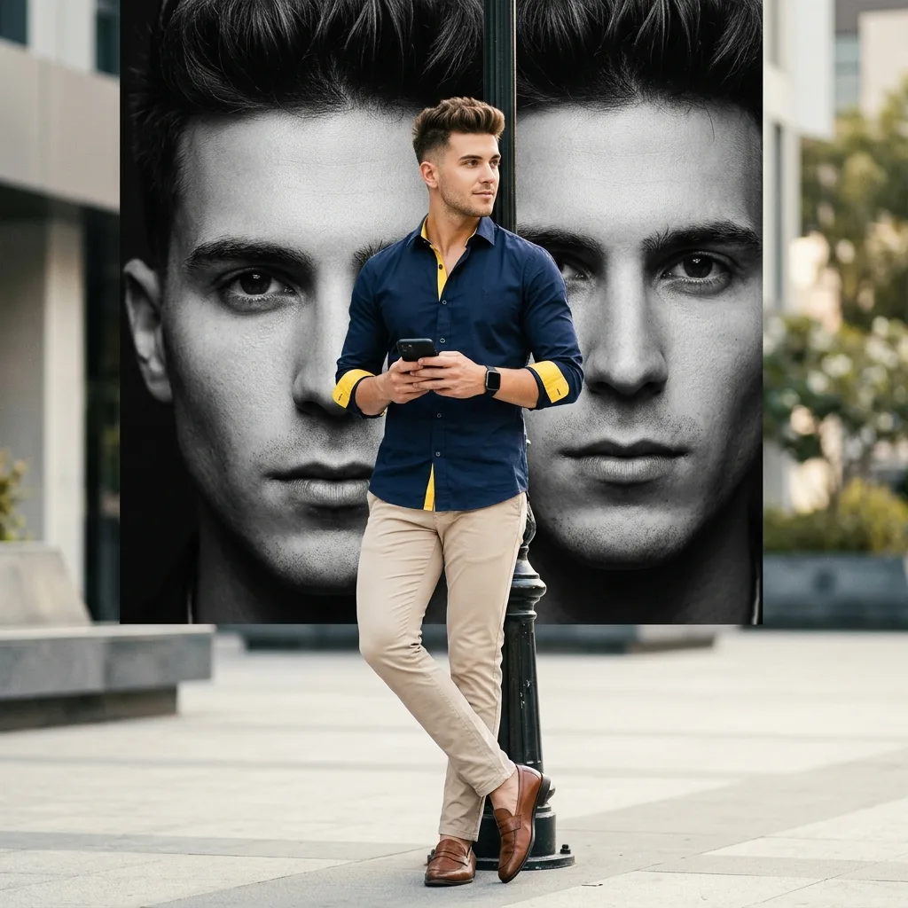

# Realistic, Portrait

[← Back to the collection](../../README.md) · Category: [Product & Brand](../../gallery/product-brand.md) · Model: `Vinano Image Pro` · ID: `vn-02005`

<a href="https://vinano.ai?utm_source=github&utm_medium=readme&utm_campaign=awesome-image-video-prompts-updating&utm_content=prompt-page-image"></a>

<sub>Preview generated with <a href="https://vinano.ai?utm_source=github&utm_medium=readme&utm_campaign=awesome-image-video-prompts-updating&utm_content=prompt-page-caption">vinano.ai</a></sub>

## Prompt

```text
[SUBJECT]
Stylish young man standing outdoors beside a black street lamp, holding a smartphone both hands and looking confidently to the side.

[APPEARANCE]
Well-groomed face, modern hairstyle, confident expression, fashionable urban look.

[OUTFIT]
Navy blue button-up shirt bright yellow inner collar and sleeve accents, beige slim-fit trousers, smartwatch, brown leather loafers.

[POSE]
Relaxed standing pose crossed legs, both hands holding a smartphone, confident side gaze, modern fashion-editorial posture.

[BACKGROUND]
Massive artistic black-and-white close-up portrait of the same man's face filling the background, creating a dramatic double-exposure style effect, clean urban outdoor environment, black street lamp beside the subject.

[COMPOSITION]
Full-body portrait in the foreground, oversized monochrome face portrait in the background, centered composition, strong depth, layered visual storytelling, fashion magazine cover aesthetic.

[LIGHTING]
Soft natural daylight, filmic, cinematic lighting, balanced highlights and shadows, professional portrait illumination.

[STYLE]
Luxury fashion photography, editorial portrait, contemporary lifestyle, premium urban fashion campaign, double-exposure aesthetic.

[CAMERA]
Eye-level shot, 85mm lens, shallow depth of field, ultra-sharp focus, professional photography.

[QUALITY]
Ultra-realistic, highly detailed, HDR, 8K resolution, masterpiece quality, crisp textures, professional color grading.

[ASPECT RATIO]
4:5 Portrait

[NEGATIVE PROMPT]
blurry, low quality, low resolution, bad anatomy, distorted face, extra fingers, extra limbs, duplicate subject, cropped body, overexposed, underexposed, noise, artifacts, watermark, logo, text, motion blur

Aim for an editorial, design-driven look with deliberate negative space.
```

## Try it on vinano.ai

1. Copy the prompt above.
2. Open **[vinano.ai](https://vinano.ai?utm_source=github&utm_medium=readme&utm_campaign=awesome-image-video-prompts-updating&utm_content=prompt-page-try)**, paste it into the image generator and pick a model.
3. Swap any placeholders (brand, product, city, person…) for your own details, then generate.

More prompts like this: [Product & Brand gallery](../../gallery/product-brand.md) · [all categories](../../README.md#contents)
