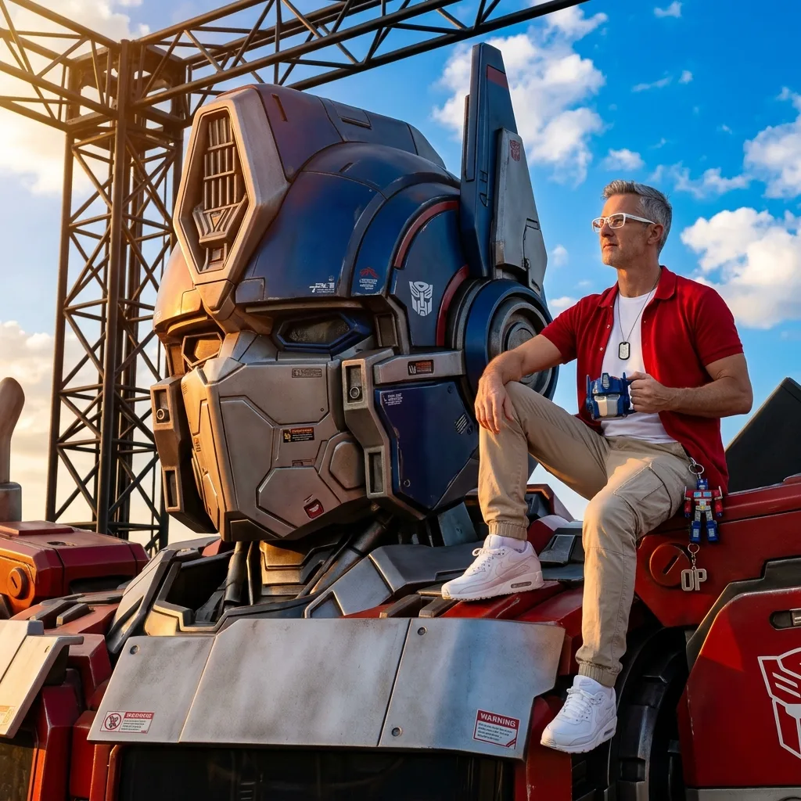

# Realistic, Cinematic

[← Back to the collection](../../README.md) · Category: [Product & Brand](../../gallery/product-brand.md) · Model: `Vinano Image Pro` · ID: `vn-02012`

<a href="https://vinano.ai?utm_source=github&utm_medium=readme&utm_campaign=awesome-image-video-prompts-updating&utm_content=prompt-page-image"></a>

<sub>Preview generated with <a href="https://vinano.ai?utm_source=github&utm_medium=readme&utm_campaign=awesome-image-video-prompts-updating&utm_content=prompt-page-caption">vinano.ai</a></sub>

## Prompt

```text
A realistic close-up of the giant Optimus Prime head, taken from a low right front angle, sharply highlights its mechanical details and color structure. The Optimus Prime has a sturdy and heroic appearance, soft morning lighting from the top left, creating natural light gradients on the sides of its helmet and armor plates. A man from the uploaded image 100% facial resemblance, somewhat athletic, wearing a red polo shirt over a plain white t-shirt, beige cargo pants, Optimus Prime toy keychain, a metal 'OP' letter keychain, rectangular white-framed glasses, gray hair, a dog tag necklace and white Nike Airmax sneakers, sits casually on the Optimus's right shoulder. His sitting position is calm, one leg dangling, the other bent, his hands resting on his knees, drinking coffee from a mug shaped like Optimus Prime robot head, he looks out to the horizon a look of awe and serenity. The man's scale appears much smaller compared to the dimensions of the Prime, emphasizing the robot's colossal size. The natural lighting of the setting sun creates warm reflections on the Prime's armor. Details such as panels, technical logos, and mechanical warnings are captured great clarity. The background features a black steel structure and a bright blue midday sky fluffy clouds. The composition of the image leads the eye from the diagonal line of the shoulders up to the Prime's head and to the man above it, creating an epic and cinematic feel, as if the man were a pilot enjoying the view from atop his legendary mecha. The aspect ratio is 9:16. no blur, no cgi, no cartoon Emphasise material texture and natural light so the final frame feels tactile and premium.
```

## Try it on vinano.ai

1. Copy the prompt above.
2. Open **[vinano.ai](https://vinano.ai?utm_source=github&utm_medium=readme&utm_campaign=awesome-image-video-prompts-updating&utm_content=prompt-page-try)**, paste it into the image generator and pick a model.
3. Swap any placeholders (brand, product, city, person…) for your own details, then generate.

More prompts like this: [Product & Brand gallery](../../gallery/product-brand.md) · [all categories](../../README.md#contents)
