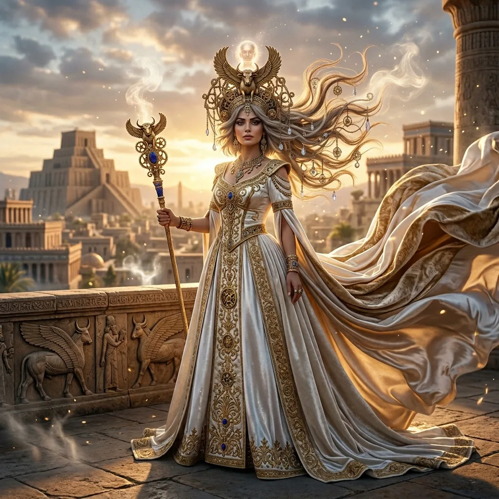

# Portrait, Character

[← Back to the collection](../../README.md) · Category: [Product & Brand](../../gallery/product-brand.md) · Model: `Vinano Image Pro` · ID: `vn-02021`

<a href="https://vinano.ai?utm_source=github&utm_medium=readme&utm_campaign=awesome-image-video-prompts-updating&utm_content=prompt-page-image"></a>

<sub>Preview generated with <a href="https://vinano.ai?utm_source=github&utm_medium=readme&utm_campaign=awesome-image-video-prompts-updating&utm_content=prompt-page-caption">vinano.ai</a></sub>

## Prompt

```text
Subject and action
A regal Mesopotamian empress captured in a cinematic fantasy portrait, her presence radiating divine authority and ethereal beauty. She stands a commanding posture, her neck-length dark hair styled in soft, flowing layers that dance in powerful high-altitude winds. Thousands of silky strands are individually rendered, catching the golden hour sunlight, intricately woven floating brass ornaments, delicate crystal pendants, and miniature kinetic clockwork accessories.

Composition and framing
Full-body portrait, shot on 85mm prime lens for high-end fashion editorial compression. The composition emphasizes the expansive, sweeping motion of her massive, layered royal train as it billows dynamically behind her. A low-angle shot to enhance her goddess-like stature and imperial majesty.

Lighting and atmosphere
filmic, cinematic lighting utilizing soft, diffused golden hour sunlight combined subtle volumetric rim lighting to highlight the metallic textures. The atmosphere is thick floating golden particles, glowing embers, magical dust, and wisps of luminous steam. Deep, rich shadows maintain a luxurious contrast, reminiscent of the cinematography of Christopher Doyle and the dramatic depth of Annie Leibovitz.

Material and texture
Haute couture craftsmanship featuring shimmering white silk and plush ivory velvet. The attire is adorned antique gold embroidery, polished brass filigree, and celestial clockwork patterns. Her headdress is a masterpiece of ancient Mesopotamian influence merged steampunk mechanics, featuring a central winged bull emblem a faintly glowing human head. Every fabric layer, ribbon, and decorative chain exhibits tangible, fluid motion.

Visual style
A fusion of ancient Mesopotamian royal aesthetics and intricate steampunk functionalism. The style is that of a high-end luxury fashion campaign, characterized by impossible detail, breathtaking realism, and award-winning fantasy photography. The aesthetic is sophisticated, opulent, and grand.

Constraints
No warrior armor, no combat gear, no military uniforms, no tactical outfits, no bulky protective plating. Hair must not appear stiff or static. No text, no watermarks, no logos, no distorted facial features.

Keep edges clean and the overall composition balanced for a polished, gallery-ready result.
```

## Try it on vinano.ai

1. Copy the prompt above.
2. Open **[vinano.ai](https://vinano.ai?utm_source=github&utm_medium=readme&utm_campaign=awesome-image-video-prompts-updating&utm_content=prompt-page-try)**, paste it into the image generator and pick a model.
3. Swap any placeholders (brand, product, city, person…) for your own details, then generate.

More prompts like this: [Product & Brand gallery](../../gallery/product-brand.md) · [all categories](../../README.md#contents)
