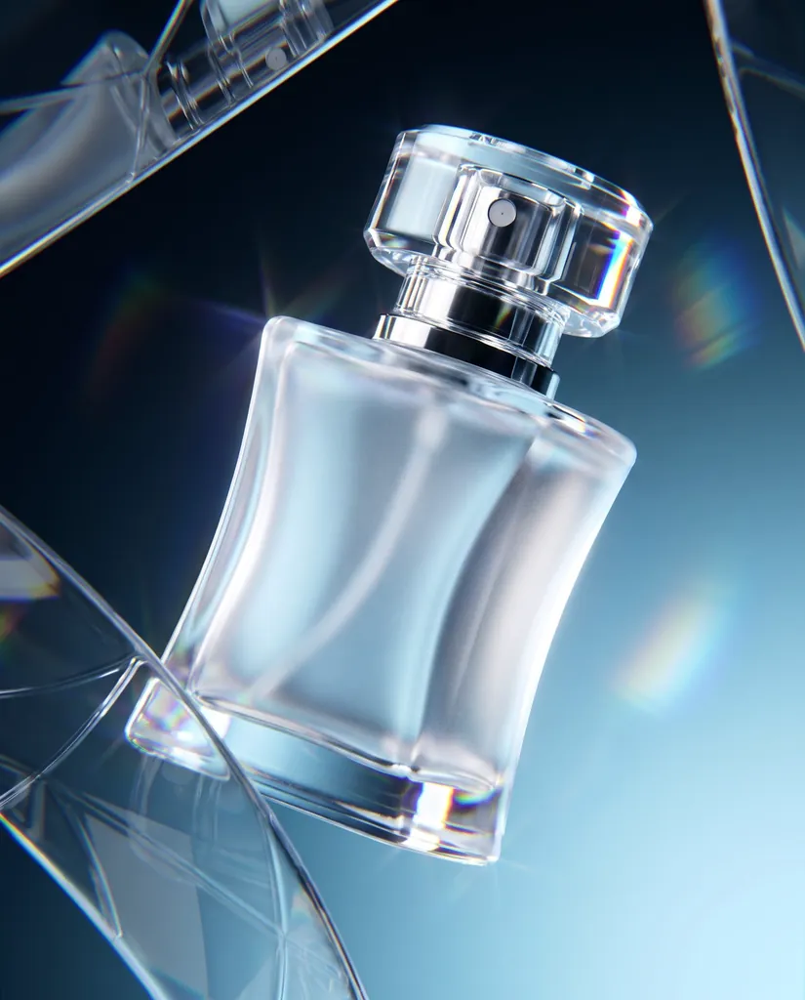

# Frosted glass perfume bottle

[← Back to the collection](../../README.md) · Category: [Product & Brand](../../gallery/product-brand.md) · Model: `Nano Banana Pro` · ID: `vn-02086`

<a href="https://vinano.ai?utm_source=github&utm_medium=readme&utm_campaign=awesome-image-video-prompts-updating&utm_content=prompt-page-image"></a>

<sub>Preview generated with <a href="https://vinano.ai?utm_source=github&utm_medium=readme&utm_campaign=awesome-image-video-prompts-updating&utm_content=prompt-page-caption">vinano.ai</a> · added 2026-11-18</sub>

## Prompt

```text
{
  "image_generation_request": {
    "subject": "a frosted glass perfume bottle",
    "environment": {
      "background": "A smooth, professional dual-tone gradient transition between #111B24 and #CAEFFF",
      "lighting": "High-contrast studio lighting with bright rim highlights to emphasize glossy textures"
    },
    "style_elements": {
      "aesthetic": "Y2K Frutiger Aero meets modern hyper-realism",
      "optical_effects": [
        "Dynamic glass refraction",
        "Prismatic chromatic aberration at the edges of transparent objects",
        "Iridescent lens flares",
        "Distorted glass overlays floating in the foreground"
      ],
      "composition": "Floating, gravity-defying arrangement with a wide-angle perspective",
      "textures": "Polished chrome, transparent acrylic, and high-gloss plastic"
    },
    "technical_specs": {
      "resolution": "8k UHD",
      "render_engine": "Octane Render style",
      "detailing": "Macro photography focus, hyper-detailed mechanical parts"
    }
  }
}
```

## Try it on vinano.ai

1. Copy the prompt above.
2. Open **[vinano.ai](https://vinano.ai?utm_source=github&utm_medium=readme&utm_campaign=awesome-image-video-prompts-updating&utm_content=prompt-page-try)**, paste it into the image generator and pick a model.
3. Swap any placeholders (brand, product, city, person…) for your own details, then generate.

More prompts like this: [Product & Brand gallery](../../gallery/product-brand.md) · [all categories](../../README.md#contents)
