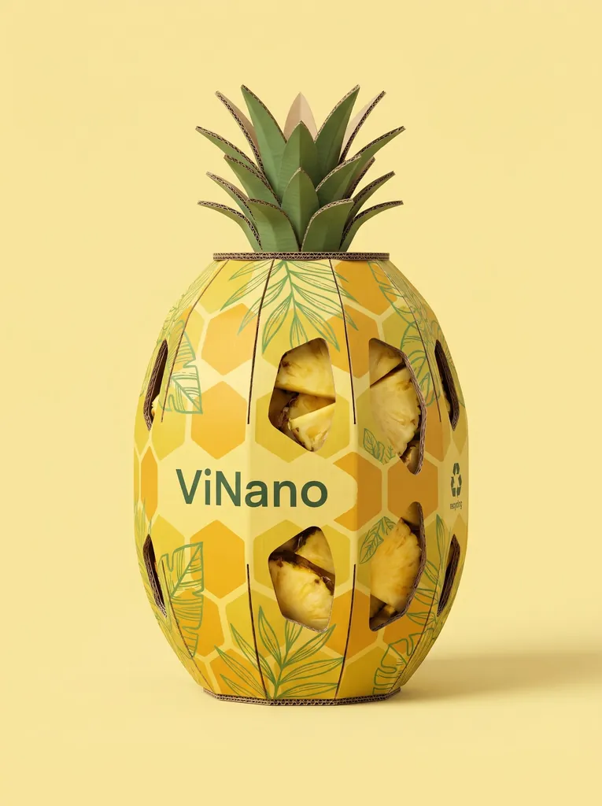

# Pineapple structural packaging design

[← Back to the collection](../../README.md) · Category: [Product & Brand](../../gallery/product-brand.md) · Model: `Nano Banana Pro` · ID: `vn-02087`

<a href="https://vinano.ai?utm_source=github&utm_medium=readme&utm_campaign=awesome-image-video-prompts-updating&utm_content=prompt-page-image"></a>

<sub>Preview generated with <a href="https://vinano.ai?utm_source=github&utm_medium=readme&utm_campaign=awesome-image-video-prompts-updating&utm_content=prompt-page-caption">vinano.ai</a> · added 2026-11-18</sub>

## Prompt

```text
A high-quality professional product photography of a creative structural packaging design for Pineapple. The packaging is made of premium corrugated cardboard, intricately crafted into the literal shape of a giant stylized elongated oval Pineapple.

The exterior surface features a vibrant and sophisticated printed pattern of minimalist [Pattern Description e.g. geometric hexagons, organic wavy lines, dotted stippling, botanical line-art, or horizontal ridges], mimicking the Natural Skin of the Fruit in a duo-tone palette of golden yellow and leaf green.

Features clever die-cut windows that reveal the actual fresh pineapple slices stored inside. Minimalist modern typography on the side saying "ViNano". Includes eco-friendly details like a small recycling logo and a a 3D corrugated cardboard leafy crown on top. Soft studio lighting with gentle shadows, placed on a clean solid pastel soft butter yellow background. 8k resolution, photorealistic, cinematic composition, industrial design aesthetic.
```

## Try it on vinano.ai

1. Copy the prompt above.
2. Open **[vinano.ai](https://vinano.ai?utm_source=github&utm_medium=readme&utm_campaign=awesome-image-video-prompts-updating&utm_content=prompt-page-try)**, paste it into the image generator and pick a model.
3. Swap any placeholders (brand, product, city, person…) for your own details, then generate.

More prompts like this: [Product & Brand gallery](../../gallery/product-brand.md) · [all categories](../../README.md#contents)
