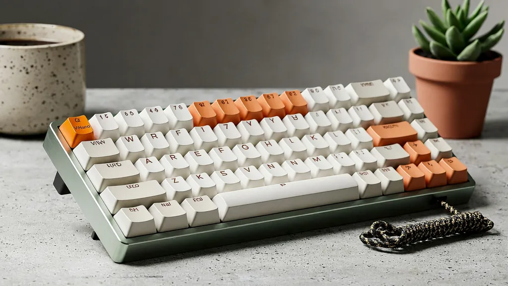

# Retro Mechanical Keyboard Hero

[← Back to the collection](../../README.md) · Category: [Product & Brand](../../gallery/product-brand.md) · Model: `MiniMax H3 Image` · ID: `vn-02157`

<a href="https://vinano.ai?utm_source=github&utm_medium=readme&utm_campaign=awesome-image-video-prompts-updating&utm_content=prompt-page-image"></a>

<sub>Preview generated with <a href="https://vinano.ai?utm_source=github&utm_medium=readme&utm_campaign=awesome-image-video-prompts-updating&utm_content=prompt-page-caption">vinano.ai</a> · added 2026-11-23</sub>

## Prompt

```text
A hero product photo of a compact 75% mechanical keyboard with an aluminum case in sage green, cream and orange keycaps, a single orange escape key engraved "ViNano", a coiled cable curling off to the side. Shot from a low three-quarter angle on a light concrete desk, soft studio key light with a gentle rim highlight, a ceramic mug and a small succulent blurred in the background, crisp detail on the legends and machining.
```

## Try it on vinano.ai

1. Copy the prompt above.
2. Open **[vinano.ai](https://vinano.ai?utm_source=github&utm_medium=readme&utm_campaign=awesome-image-video-prompts-updating&utm_content=prompt-page-try)**, paste it into the image generator and pick a model.
3. Swap any placeholders (brand, product, city, person…) for your own details, then generate.

More prompts like this: [Product & Brand gallery](../../gallery/product-brand.md) · [all categories](../../README.md#contents)
