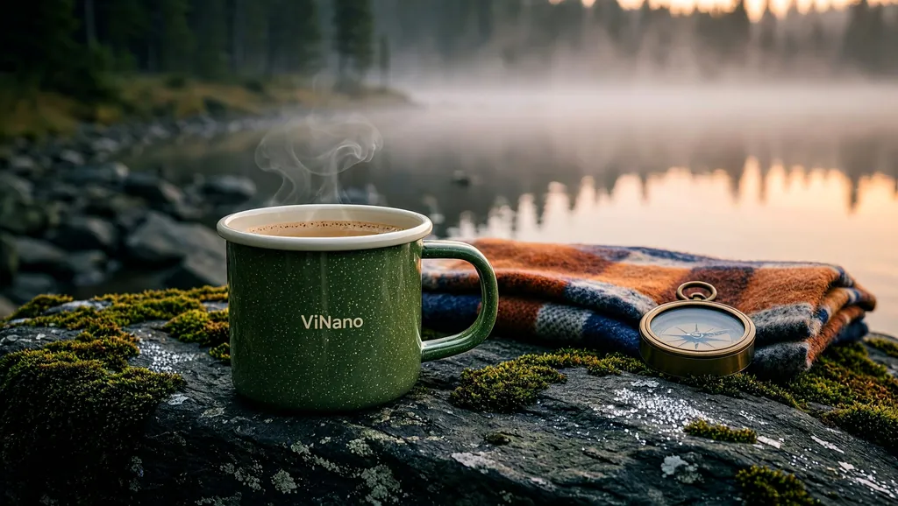

# Enamel Camping Mug at Sunrise

[← Back to the collection](../../README.md) · Category: [Product & Brand](../../gallery/product-brand.md) · Model: `MiniMax H3 Image` · ID: `vn-02177`

<a href="https://vinano.ai?utm_source=github&utm_medium=readme&utm_campaign=awesome-image-video-prompts-updating&utm_content=prompt-page-image"></a>

<sub>Preview generated with <a href="https://vinano.ai?utm_source=github&utm_medium=readme&utm_campaign=awesome-image-video-prompts-updating&utm_content=prompt-page-caption">vinano.ai</a> · added 2026-11-25</sub>

## Prompt

```text
Product photograph of a speckled forest-green enamel camping mug with a cream rim, the word "ViNano" printed in small cream letters on its side. The mug sits on a flat mossy rock beside a lake, steam curling up from hot coffee, a folded plaid wool blanket and a brass compass placed just behind it. Background: misty pine shoreline and soft orange sunrise light reflecting on still water, heavily out of focus. Low camera angle, crisp focus on the mug, tiny dew drops on the rock, natural outdoor brand lifestyle look, warm and cool color contrast.
```

## Try it on vinano.ai

1. Copy the prompt above.
2. Open **[vinano.ai](https://vinano.ai?utm_source=github&utm_medium=readme&utm_campaign=awesome-image-video-prompts-updating&utm_content=prompt-page-try)**, paste it into the image generator and pick a model.
3. Swap any placeholders (brand, product, city, person…) for your own details, then generate.

More prompts like this: [Product & Brand gallery](../../gallery/product-brand.md) · [all categories](../../README.md#contents)
