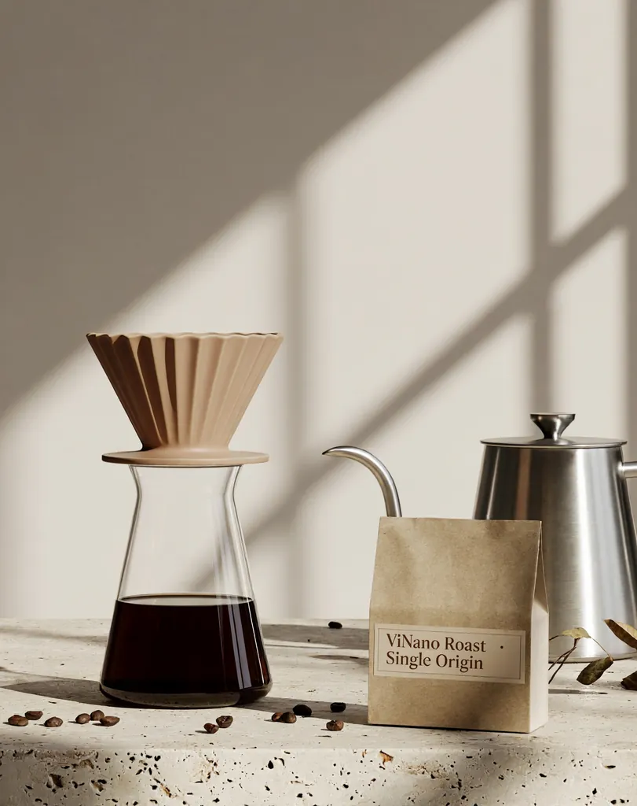

# Ceramic Pour-Over Coffee Set Product Shot

[← Back to the collection](../../README.md) · Category: [Product & Brand](../../gallery/product-brand.md) · Model: `MiniMax H3 Image` · ID: `vn-02187`

<a href="https://vinano.ai?utm_source=github&utm_medium=readme&utm_campaign=awesome-image-video-prompts-updating&utm_content=prompt-page-image"></a>

<sub>Preview generated with <a href="https://vinano.ai?utm_source=github&utm_medium=readme&utm_campaign=awesome-image-video-prompts-updating&utm_content=prompt-page-caption">vinano.ai</a> · added 2026-11-26</sub>

## Prompt

```text
Studio product photograph of a minimalist ceramic pour-over coffee set: a matte sand-colored dripper on a slim glass carafe half filled with coffee, a gooseneck kettle in brushed steel and a small paper bag of beans with a kraft label printed "ViNano Roast · Single Origin". Arranged on a pale travertine slab with a few loose coffee beans, soft beige backdrop, a single diagonal shadow from a window frame, warm soft light, crisp textures, premium lifestyle catalog look.
```

## Try it on vinano.ai

1. Copy the prompt above.
2. Open **[vinano.ai](https://vinano.ai?utm_source=github&utm_medium=readme&utm_campaign=awesome-image-video-prompts-updating&utm_content=prompt-page-try)**, paste it into the image generator and pick a model.
3. Swap any placeholders (brand, product, city, person…) for your own details, then generate.

More prompts like this: [Product & Brand gallery](../../gallery/product-brand.md) · [all categories](../../README.md#contents)
