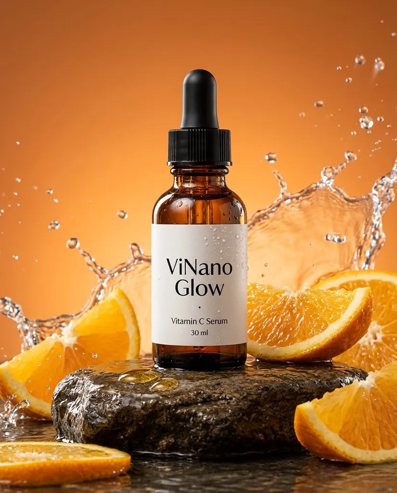

# Vitamin C Serum Bottle with Orange Splash

[← Back to the collection](../../README.md) · Category: [Product & Brand](../../gallery/product-brand.md) · Model: `Nano Banana 2.1` · ID: `vn-02196`

<a href="https://vinano.ai?utm_source=github&utm_medium=readme&utm_campaign=awesome-image-video-prompts-updating&utm_content=prompt-page-image"></a>

<sub>Preview generated with <a href="https://vinano.ai?utm_source=github&utm_medium=readme&utm_campaign=awesome-image-video-prompts-updating&utm_content=prompt-page-caption">vinano.ai</a> · added 2026-11-27</sub>

## Prompt

```text
Premium product photograph of an amber glass skincare serum bottle with a black dropper, the minimal white label reading "ViNano Glow · Vitamin C Serum 30 ml". The bottle stands on a wet stone pedestal surrounded by sliced oranges, a few drops of golden serum and splashes of clear water frozen mid-air. Warm orange gradient backdrop, crisp studio lighting with a soft highlight along the glass, tiny condensation droplets, sharp label text, luxury beauty campaign look.
```

## Try it on vinano.ai

1. Copy the prompt above.
2. Open **[vinano.ai](https://vinano.ai?utm_source=github&utm_medium=readme&utm_campaign=awesome-image-video-prompts-updating&utm_content=prompt-page-try)**, paste it into the image generator and pick a model.
3. Swap any placeholders (brand, product, city, person…) for your own details, then generate.

More prompts like this: [Product & Brand gallery](../../gallery/product-brand.md) · [all categories](../../README.md#contents)
