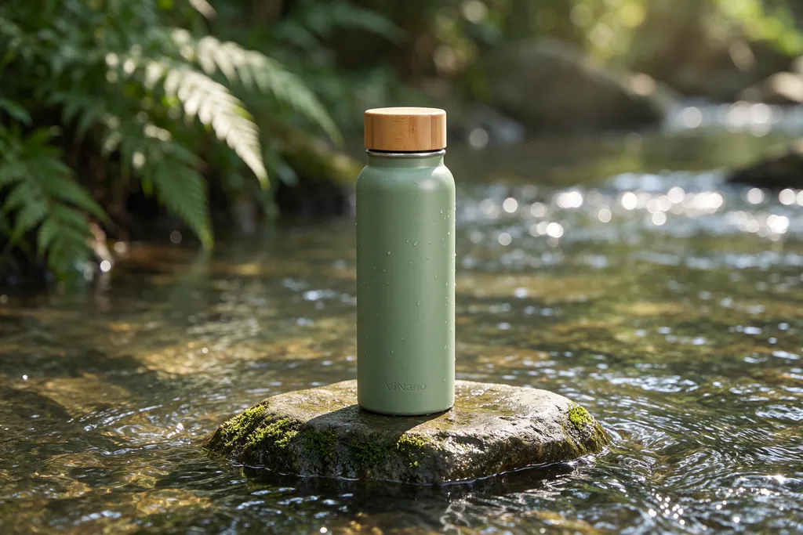

# Sage Green Water Bottle by a Mountain Stream

[← Back to the collection](../../README.md) · Category: [Product & Brand](../../gallery/product-brand.md) · Model: `Seedream 5.5` · ID: `vn-02208`

<a href="https://vinano.ai?utm_source=github&utm_medium=readme&utm_campaign=awesome-image-video-prompts-updating&utm_content=prompt-page-image"></a>

<sub>Preview generated with <a href="https://vinano.ai?utm_source=github&utm_medium=readme&utm_campaign=awesome-image-video-prompts-updating&utm_content=prompt-page-caption">vinano.ai</a> · added 2026-11-28</sub>

## Prompt

```text
Outdoor lifestyle product photograph of a matte sage-green insulated stainless steel water bottle with a bamboo lid, standing on a flat mossy river stone beside a clear mountain stream. The bottle has a small debossed wordmark "ViNano" near the base and beads of cold condensation. Background of blurred ferns and sunlit water sparkles, early morning light filtering through trees, natural greens and soft golden highlights, shallow depth of field, premium outdoor gear catalog style.
```

## Try it on vinano.ai

1. Copy the prompt above.
2. Open **[vinano.ai](https://vinano.ai?utm_source=github&utm_medium=readme&utm_campaign=awesome-image-video-prompts-updating&utm_content=prompt-page-try)**, paste it into the image generator and pick a model.
3. Swap any placeholders (brand, product, city, person…) for your own details, then generate.

More prompts like this: [Product & Brand gallery](../../gallery/product-brand.md) · [all categories](../../README.md#contents)
