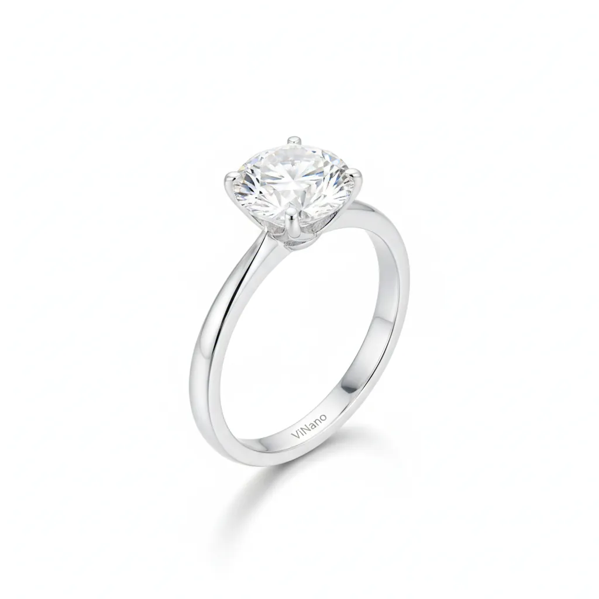

# Platinum Solitaire Ring on Pure White

[← Back to the collection](../../README.md) · Category: [Product & Brand](../../gallery/product-brand.md) · Model: `Nano Banana` · ID: `vn-02217`

<a href="https://vinano.ai?utm_source=github&utm_medium=readme&utm_campaign=awesome-image-video-prompts-updating&utm_content=prompt-page-image"></a>

<sub>Preview generated with <a href="https://vinano.ai?utm_source=github&utm_medium=readme&utm_campaign=awesome-image-video-prompts-updating&utm_content=prompt-page-caption">vinano.ai</a> · added 2026-11-28</sub>

## Prompt

```text
Pure white seamless background (#FFFFFF), professional jewelry product photography of a single round brilliant diamond solitaire ring in platinum, standing upright at a three-quarter angle, no props, no cushion, soft diffused studio lighting from both sides, a faint natural contact shadow under the band, crisp facet detail with sparkle highlights and visible fire, the inside of the band engraved with the tiny word "ViNano", the ring fills about 85 percent of the frame, e-commerce main image, commercial grade.
```

## Try it on vinano.ai

1. Copy the prompt above.
2. Open **[vinano.ai](https://vinano.ai?utm_source=github&utm_medium=readme&utm_campaign=awesome-image-video-prompts-updating&utm_content=prompt-page-try)**, paste it into the image generator and pick a model.
3. Swap any placeholders (brand, product, city, person…) for your own details, then generate.

More prompts like this: [Product & Brand gallery](../../gallery/product-brand.md) · [all categories](../../README.md#contents)
