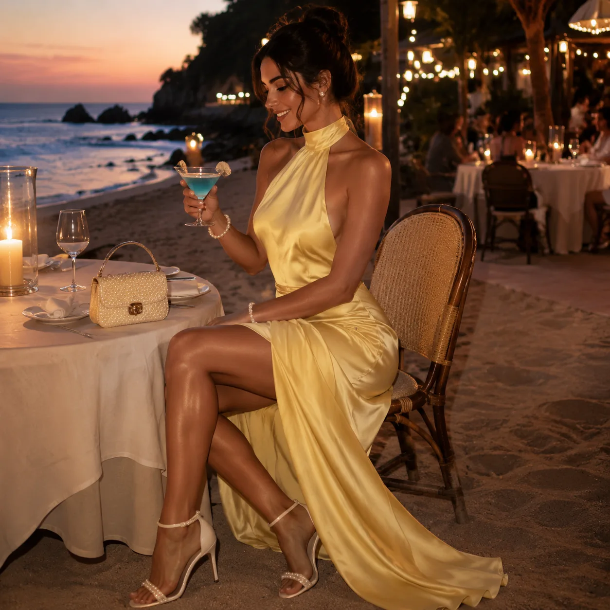

# , task type

[← Back to the collection](../../README.md) · Category: [UI & Graphic](../../gallery/ui-graphic.md) · Model: `Vinano Studio` · ID: `vn-00250`

<a href="https://vinano.ai?utm_source=github&utm_medium=readme&utm_campaign=awesome-image-video-prompts-updating&utm_content=prompt-page-image"></a>

<sub>Preview generated with <a href="https://vinano.ai?utm_source=github&utm_medium=readme&utm_campaign=awesome-image-video-prompts-updating&utm_content=prompt-page-caption">vinano.ai</a></sub>

## Prompt

```text
{
 "generation_request": {
 "meta_data": {
 "tool": "",
 "task_type": "luxury_fashion_moodboard_editorial",
 "language": "en",
 "priority": "highest",
 "version": "v2.5_DAY1_YELLOW_HALTER_SATIN_MINIMAL_ITEMS_GOLD_TEXT"
 },
 "input": {
 "mode": "image_to_image",
 "reference_image_usage": "high",
 "notes": "Use the uploaded reference only as a layout and visual styling guide. Create a clean, elegant luxury fashion moodboard the editorial feeling: soft ivory background, large refined 'DAY 1' title at the top, one pinned seaside restaurant photo, one hero yellow satin halter-neck evening dress an open back, and only a minimal number of supporting elements. Show only one pair of pearl-white heels, only one matching luxury evening bag, only one jewelry item, and only one sea-inspired martini cocktail. Do not include extra accessories, extra bags, extra shoes, or extra jewelry. The composition must feel minimal, expensive, balanced, and professionally art directed, strong hierarchy and generous negative space. The dress should be the main focal point, a sleek modern silhouette, fluid satin drape, and premium fashion-house finish. The seaside restaurant photo should show an upscale evening dinner setup directly on the sand, candlelight and romantic luxury atmosphere. The cocktail should be one elegant sea-inspired martini ocean-blue or sea-glass tones. Add one short motivational quote near the bottom in a refined handwritten or script style. All visible typography, including the 'DAY 1' title and the quote, should be rendered in elegant metallic gold tones a luxurious editorial finish."
 },
 "output_settings": {
 "aspect_ratio": "4:5",
 "orientation": "portrait",
 "resolution_target": "ultra_high_res",
 "num_images": 1,
 "render_style": "luxury_editorial_collage_realism",
 "sharpness": "ultra_crisp",
 "grain": "subtle_print_texture",
 "dynamic_range": "soft_high_end",
 "color_grade": "sunset_gold_pearl_coastal_luxury"
 },
 "layout": {
 "background": "soft warm ivory or premium matte neutral tone",
 "composition": "large DAY 1 title at the top, one pinned seaside photo, one central hero dress, one pair of shoes, one bag, one jewelry item, one cocktail, one short quote",
 "design_feel": "minimal luxury editorial board balanced spacing and no clutter"
 },
 "fashion_story": {
 "hero_dress": "yellow satin halter-neck backless evening dress, sleek modern silhouette, elegant drape, luxurious reflections",
 "shoes": "one pair of pearl-white heels delicate pearl-thread detailing",
 "bag": "one small luxury evening bag in pearl white, ivory, champagne, or soft gold tone",
 "jewelry": "one elegant pearl bracelet or one refined pearl jewelry piece only"
 },
 "lifestyle_element": {
 "date_setting": "luxury beachside evening restaurant directly on the sand, candlelight, elegant table setting, romantic atmosphere",
 "cocktail": "one sea-inspired martini ocean-toned blue-green color and premium garnish"
 },
 "text_element": {
 "title": "DAY 1",
 "title_style": "large elegant editorial serif in metallic gold",
 "quote_examples": ["Softness can still make an entrance.",
 "Choose the night that feels like you.",
 "Elegance is how you arrive."],
 "quote_style": "one short refined handwritten or script quote in metallic gold",
 "instruction": "use only one short quote"
 },
 "must_have": ["reference-inspired clean luxury layout",
 "large DAY 1 title in gold",
 "yellow satin halter-neck backless dress",
 "one pair of pearl-white heels",
 "one matching luxury bag",
 "one jewelry item only",
 "one sea-inspired martini",
 "one seaside dinner photo",
 "one short motivational quote in gold",
 "minimal elegant composition"],
 "negative_prompt": ["extra bag",
 "extra shoes",
 "extra jewelry",
 "extra accessories",
 "too many objects",
 "messy collage",
 "cheap styling",
 "too much text",
 "wrong dress color",
 "flat uninspired layout",
 "cartoon",
 "low detail",
 "logo",
 "watermark"]
 }
}
Prompt(right):
{
 "generation_request": {
 "meta_data": {
 "tool": "",
 "task_type": "reference_locked_fashion_editorial_scene",
 "language": "en",
 "priority": "highest",
 "version": "v1.1_REFERENCE_WOMAN_IN_DAY1_LOOK_MORE_NATURAL"
 },
 "references": {
 "reference_image_style": {
 "source": "UPLOAD_MOODBOARD_IMAGE",
 "purpose": "OUTFIT_ACCESSORIES_STYLING_SCENE_GUIDE",
 "strict_lock": false,
 "preserve_palette": true,
 "preserve_vibe": true,
 "preserve_outfit_details": true,
 "preserve_accessories": true,
 "preserve_scene_direction": true,
 "affect_face": false
 },
 "reference_image_face": {
 "source": "UPLOAD_WOMAN_REFERENCE_IMAGE",
 "purpose": "FACE_IDENTITY_LOCK",
 "strict_lock": true,
 "face_similarity_priority": "MAX",
 "identity_lock_strength": 0.97,
 "no_identity_blending": true,
 "no_age_shift": true,
 "preserve_skin_texture": true
 }
 },
 "input": {
 "mode": "image_to_image",
 "notes": "Use the uploaded woman reference as the identity base. Dress her in a look closely matching the moodboard: yellow satin halter-neck backless evening dress, pearl-white heels, matching luxury evening bag, and minimal pearl jewelry. Do not make the woman look overly perfect, mannequin-like, or artificial. She must feel like a real elegant woman photographed during a luxury seaside dinner, not a fashion doll. Keep natural skin texture, subtle facial asymmetry, believable posture, relaxed shoulders, real body weight, and candid human presence. Show her seated at a luxury beachside restaurant directly on the sand during evening golden hour into night, naturally holding or reaching for a sea-inspired martini cocktail. The dress, shoes, bag, and jewelry should remain clearly visible and strongly matched to the moodboard, but the overall image should feel lived-in, cinematic, and natural rather than overly staged."
 },
 "output_settings": {
 "aspect_ratio": "4:5",
 "orientation": "portrait",
 "resolution_target": "ultra_high_res",
 "num_images": 1,
 "render_style": "natural_luxury_realism",
 "sharpness": "clean_natural",
 "grain": "subtle_film",
 "dynamic_range": "soft_high_end",
 "color_grade": "sunset_gold_pearl_coastal_natural"
 },
 "scene": {
 "environment": "luxury beachside restaurant directly on the sand at evening golden hour fading into night",
 "details": "candlelit table, elegant place setting, warm ambient lights, sea view, refined romantic atmosphere",
 "pose": "woman seated naturally, slightly turned, relaxed and elegant, interacting casually the cocktail, not stiff, not overly posed",
 "mood": "romantic, upscale, warm, feminine, cinematic, believable"
 },
 "subject": {
 "identity": "uploaded woman reference strong but natural resemblance",
 "outfit": "yellow satin halter-neck backless evening dress closely matching the moodboard",
 "shoes": "pearl-white heels clearly visible",
 "bag": "matching evening bag clearly visible",
 "jewelry": "minimal pearl jewelry",
 "beauty": "natural luxury beauty, realistic skin texture, soft evening glam, human and believable"
 },
 "camera": {
 "framing": "three-quarter seated fashion portrait wide enough to show shoes, bag, and dress shape",
 "angle": "natural editorial angle, slightly observational rather than overly staged",
 "focus": "sharp on face, dress texture, shoes, bag, cocktail, and table details",
 "depth_of_field": "soft cinematic background separation"
 },
 "lighting": {
 "type": "natural luxury evening lighting",
 "quality": "warm sunset and candlelit ambience soft fill, realistic facial shadows, elegant satin highlights, no overexposure",
 "skin_rendering": "realistic skin texture, no plastic effect, no beauty filter look"
 },
 "must_have": ["realistic human presence",
 "natural face",
 "no mannequin look",
 "strong resemblance to uploaded woman",
 "yellow satin halter dress",
 "visible pearl-white heels",
 "visible matching bag",
 "minimal pearl jewelry",
 "luxury seaside date setting",
 "sea-inspired martini",
 "photoreal quality"],
 "negative_prompt": ["mannequin look",
 "fashion doll look",
 "plastic skin",
 "over-smoothed face",
 "beauty filter",
 "stiff pose",
 "unnatural symmetry",
 "different outfit",
 "different shoes",
 "different bag",
 "identity mismatch",
 "blurry face",
 "bad anatomy",
 "extra fingers",
 "deformed hands",
 "cartoon",
 "logo",
 "watermark",
 "text"]
 }
}

Maintain consistent colour harmony and crisp focus across the whole frame.
```

## Try it on vinano.ai

1. Copy the prompt above.
2. Open **[vinano.ai](https://vinano.ai?utm_source=github&utm_medium=readme&utm_campaign=awesome-image-video-prompts-updating&utm_content=prompt-page-try)**, paste it into the image generator and pick a model.
3. Swap any placeholders (brand, product, city, person…) for your own details, then generate.

More prompts like this: [UI & Graphic gallery](../../gallery/ui-graphic.md) · [all categories](../../README.md#contents)
