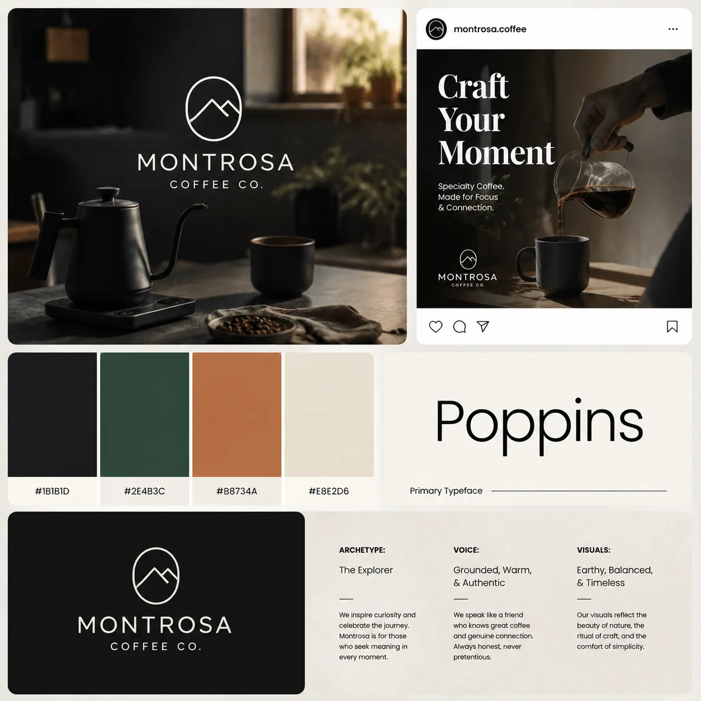

# UI & Graphic prompt #571

[← Back to the collection](../../README.md) · Category: [UI & Graphic](../../gallery/ui-graphic.md) · Model: `Vinano Studio` · ID: `vn-00571`

<a href="https://vinano.ai?utm_source=github&utm_medium=readme&utm_campaign=awesome-image-video-prompts-updating&utm_content=prompt-page-image"></a>

<sub>Preview generated with <a href="https://vinano.ai?utm_source=github&utm_medium=readme&utm_campaign=awesome-image-video-prompts-updating&utm_content=prompt-page-caption">vinano.ai</a></sub>

## Prompt

```text
[BRAND NAME]
({INDUSTRY}).

Act as a Lead Brand Designer creating a comprehensive "Brand Identity System" presentation (Bento-Grid Layout).

**THE TASK:**
Generate a single, high-resolution bento-grid board containing **6 distinct modules** that define the visual identity for [BRAND NAME].

---

**PHASE 1: VISUAL STRATEGY (AUTONOMOUS)**
1. **Analyze the Brand:** Determine the archetype and visual vibe.
2. **Define the Palette:** Select 4 distinct colors.
3. **Select Typography:** Choose ONE specific Google Font (Serif, Sans-Serif, or Display) relevant to the industry.

**PHASE 2: THE LAYOUT (6-MODULE GRID)**
The image must be a clean, gap-separated grid featuring these specific blocks:

* **Block 1 (The Hero):** A high-end **Key Visual** photography showing the product/service in context. filmic, cinematic lighting, true-to-life photorealistic. Overlay the brand logo in white.
* **Block 2 (Social Media):** A mockup of an **Instagram Post**. It features a bold headline the brand font and a lifestyle image.
* **Block 3 (The Palette & HEX):** A clean design block displaying **4 Vertical Color Swatches**.
 * *Crucial Detail:* Inside or below each color swatch, simulate distinct text looking like **HEX Codes** (e.g., "#1A2B3C").
* **Block 4 (Typography Spec):** A refined minimalist block dedicated to the **Brand Font**.
 * *CRITICAL CONSTRAINT:* Do NOT show the alphabet (Aa Bb Cc).
 * *The Content:* The block must display ONLY the **Name of the Font** (e.g., "Montserrat", "Lato", "Oswald") written in large, crisp characters that specific font style. This acts as the visual specimen.
 * *Subtext:* Tiny text at the bottom reading "Primary Typeface".
* **Block 5 (The Logo):** A solid background block featuring the **Final Logo** (clean, vector style, NO construction lines/grids). refined minimalist and iconic.
* **Block 6 (Brand DNA):** A text-heavy "Manifesto Card". It simulates a layout three short paragraphs titled:
 * **ARCHETYPE:** (e.g., "The Innovator")
 * **VOICE:** (e.g., "Confident, Direct")
 * **VISUALS:** (e.g., "Cinematic, High-Contrast")

**PHASE 3: AESTHETIC & FINISH**
* **Style:** Behance Trend / Awwwards Winner.
* **Quality:** 8k resolution, razor-sharp vector graphics mixed high-end photography.
* **Lighting:** Soft studio lighting across the whole grid to make it look like a cohesive presentation board.

Emphasise material texture and natural light so the final frame feels tactile and premium.
```

## Try it on vinano.ai

1. Copy the prompt above.
2. Open **[vinano.ai](https://vinano.ai?utm_source=github&utm_medium=readme&utm_campaign=awesome-image-video-prompts-updating&utm_content=prompt-page-try)**, paste it into the image generator and pick a model.
3. Swap any placeholders (brand, product, city, person…) for your own details, then generate.

More prompts like this: [UI & Graphic gallery](../../gallery/ui-graphic.md) · [all categories](../../README.md#contents)
