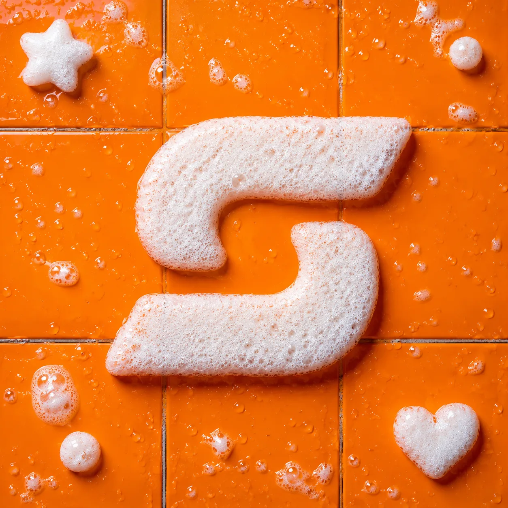

# Soap foam sculpture in the exact shape

[← Back to the collection](../../README.md) · Category: [UI & Graphic](../../gallery/ui-graphic.md) · Model: `Vinano Studio` · ID: `vn-00647`

<a href="https://vinano.ai?utm_source=github&utm_medium=readme&utm_campaign=awesome-image-video-prompts-updating&utm_content=prompt-page-image"></a>

<sub>Preview generated with <a href="https://vinano.ai?utm_source=github&utm_medium=readme&utm_campaign=awesome-image-video-prompts-updating&utm_content=prompt-page-caption">vinano.ai</a></sub>

## Prompt

```text
Create a soap foam sculpture in the exact shape of the uploaded logo, made entirely of white soap bubbles and foam realistic bubble textures. Place it on wet bathroom tiles in the brand’s signature color (match the color from the uploaded logo). Top-down view, centered composition. The tiles should be glossy and wet water droplets scattered across the surface. Add smaller foam bubbles and soap suds around the main logo shape. Grout lines visible between tiles. Additional small foam shapes in corners. Product photography style, clean and vibrant lighting. Aim for an editorial, design-driven look with deliberate negative space.
```

## Try it on vinano.ai

1. Copy the prompt above.
2. Open **[vinano.ai](https://vinano.ai?utm_source=github&utm_medium=readme&utm_campaign=awesome-image-video-prompts-updating&utm_content=prompt-page-try)**, paste it into the image generator and pick a model.
3. Swap any placeholders (brand, product, city, person…) for your own details, then generate.

More prompts like this: [UI & Graphic gallery](../../gallery/ui-graphic.md) · [all categories](../../README.md#contents)
