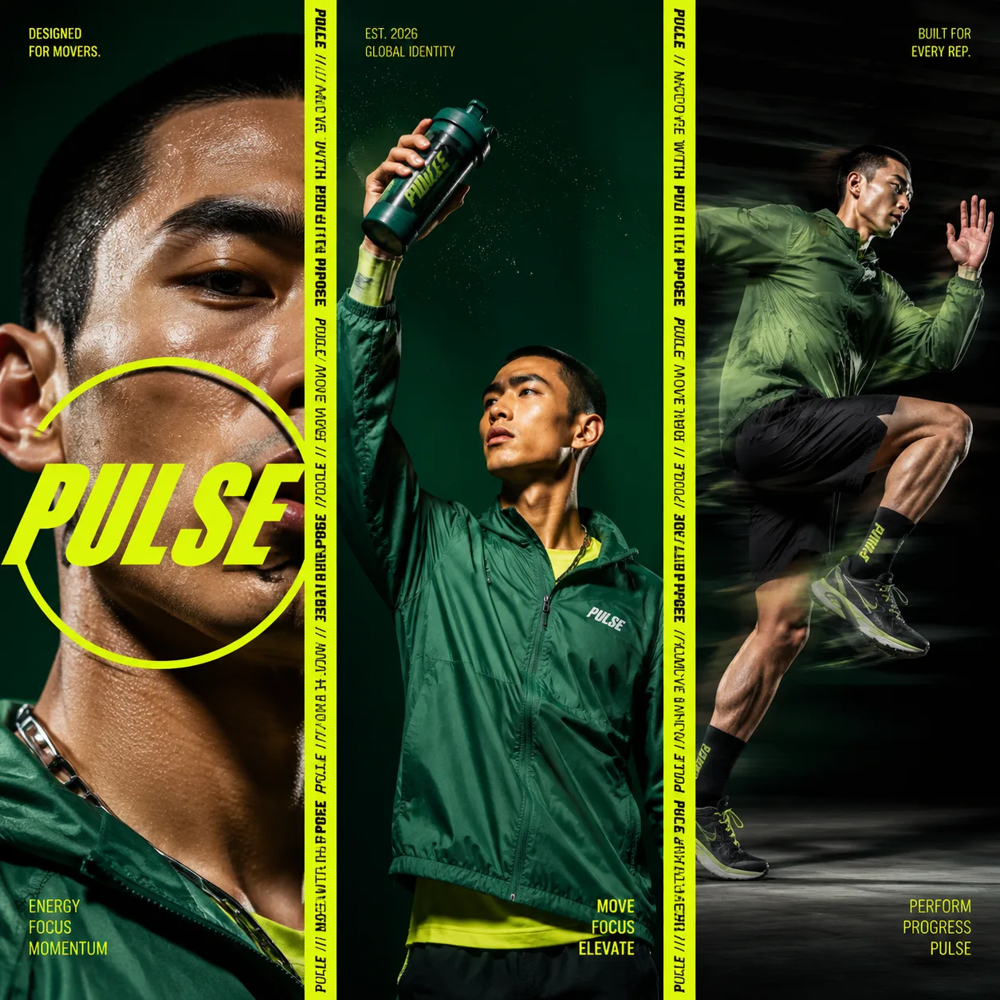

# UI & Graphic prompt #656

[← Back to the collection](../../README.md) · Category: [UI & Graphic](../../gallery/ui-graphic.md) · Model: `Vinano Studio` · ID: `vn-00656`

<a href="https://vinano.ai?utm_source=github&utm_medium=readme&utm_campaign=awesome-image-video-prompts-updating&utm_content=prompt-page-image"></a>

<sub>Preview generated with <a href="https://vinano.ai?utm_source=github&utm_medium=readme&utm_campaign=awesome-image-video-prompts-updating&utm_content=prompt-page-caption">vinano.ai</a></sub>

## Prompt

```text
[BRAND NAME]. Act as a Senior AI Visual Strategist & Creative Director.
Goal: Generate a high-motion triptych editorial where every visual element (color, text, props) is a direct semantic derivative of the brand name.
PHASE 1: SEMANTIC BRAND ANALYSIS (AUTONOMOUS)
[INSTRUCTIONS FOR]:
Core Identity: Analyze "[BRAND NAME]". Define its industry, soul, and "vibe" (e.g., Kinetic, Organic, Brutalist, Ethereal).
Color Psychology: Select a triadic palette based on brand associations:
 - BACKGROUND: The "Mood" color (e.g., Deep Forest for 'GAIA', Neon Amber for 'FUSE').
 - ACCENTS/TYPOGRAPHY: The "Energy" color. Must have high contrast/readability against the background.
 - APPAREL: The "Statement" color. Completes the brand's visual signature.
Copywriting: Generate 2-3 short, punchy slogans or keywords that resonate the brand's mission to be used as background micro-text.
PHASE 2: COMPOSITION (THE DYNAMIC TRIPTYCH)
Layout: A single horizontal image split into three vertical editorial panels.
- PANEL 1 (The Portrait): Extreme close-up. Bold [BRAND NAME] wordmark inside a geometric frame (circle or rectangle) overlapping the model's face or neck.
- PANEL 2 (The Elevate): Medium shot. A model (gender determined by brand target audience) holds a primary brand-representative object above their head in a triumphant or symbolic gesture.
- PANEL 3 (The Kinetic): Full-body shot. High-speed motion blur or an aggressive "power pose" interacting the brand's core element.
PHASE 3: GRAPHIC OVERLAYS & TEXTURES
- Main Typography: Large, slanted (italic) heavy sans-serif in [ACCENT COLOR].
- Dynamic Ribbons: Vertical yellow or contrast tapes crossing the panels repeating text: "[BRAND NAME] // [ASSOCIATED KEYWORD] // [BRAND NAME]".
- Micro-Copy: Scattered small text in corners like "DESIGNED FOR [TARGET AUDIENCE]" or "EST. 2026 // GLOBAL IDENTITY".
PHASE 4: LIGHTING & ESTHETIC STANDARDS
- High-End Editorial (Vogue/Hypebeast style).
- Global Illumination crisp, sharp edges.
- Realistic skin textures (pores, subtle sweat/shine) and high-fidelity fabric weaves.
- No "AI-plastic" artifacts.
PHASE 5: TECH SPECS
8K Resolution. Render: Octane. Subtle film grain. Ray-traced reflections on eyes and surfaces.

Preserve realistic proportions and depth for a confident, professional finish.
```

## Try it on vinano.ai

1. Copy the prompt above.
2. Open **[vinano.ai](https://vinano.ai?utm_source=github&utm_medium=readme&utm_campaign=awesome-image-video-prompts-updating&utm_content=prompt-page-try)**, paste it into the image generator and pick a model.
3. Swap any placeholders (brand, product, city, person…) for your own details, then generate.

More prompts like this: [UI & Graphic gallery](../../gallery/ui-graphic.md) · [all categories](../../README.md#contents)
