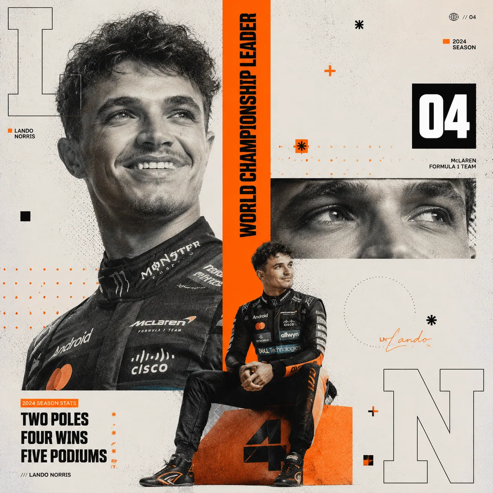

# Complex, multi-layered Swiss-style collage poster for PERSONE

[← Back to the collection](../../README.md) · Category: [UI & Graphic](../../gallery/ui-graphic.md) · Model: `Vinano Studio` · ID: `vn-00748`

<a href="https://vinano.ai?utm_source=github&utm_medium=readme&utm_campaign=awesome-image-video-prompts-updating&utm_content=prompt-page-image"></a>

<sub>Preview generated with <a href="https://vinano.ai?utm_source=github&utm_medium=readme&utm_campaign=awesome-image-video-prompts-updating&utm_content=prompt-page-caption">vinano.ai</a></sub>

## Prompt

```text
[PERSONE]. Act as a Senior Editorial Designer and Graphic Artist.
Goal: Generate a complex, multi-layered Swiss-style collage poster for [PERSONE].
PHASE 1: SEMANTIC INTELLIGENCE (AUTONOMOUS)
[INSTRUCTIONS]:
Analyze "[PERSONE]". Determine their primary field (e.g., Elite Sports, Cyber-Engineering, Cinema, History).
Select an "Iconic Accent Color" based on their identity (e.g., Racing Orange for a driver, Neon Cyan for a hacker, Crimson for a hero).
Generate 3 key statistics or milestones (e.g., "7 TITLES", "98% ACCURACY") and a short professional title.
PHASE 2: COMPOSITIONAL STRUCTURE (THE GRID)
The image is a single vertical composition overlapping geometric frames and segments:
- MAIN SUBJECT (Top Left): A large, high-grain grayscale or color portrait of [PERSONE], smiling or looking confident.
- DETAIL SHOT (Center Right): A zoomed-in, cropped rectangle showing only the eyes or a specific detail of [PERSONE].
- FULL BODY SHOT (Bottom Center): [PERSONE] sitting on a geometric box or podium in a relaxed but powerful pose.
- BACKGROUND: Light gray a heavy, tactile film grain/noise texture.
PHASE 3: GRAPHIC ELEMENTS & TYPOGRAPHY
- Initials: Large, outlined capital letters of the first and last name placed in opposite corners.
- Vertical Ribbon: A solid color strip the text "WORLD CHAMPIONSHIP LEADER" or a relevant title running vertically through the center.
- Data Blocks:
 - A specific number (ID or rank) in a bold sans-serif block.
 - A "Statistics" block in the bottom-left corner 3 lines of text (e.g., "TWO POLES / FOUR WINS / FIVE PODIUMS").
- Accents: Scatter orange and black squares, dotted circles, and small asterisks throughout the grid for visual complexity.
PHASE 4: LIGHTING & TEXTURE
- Texture: High-contrast, gritty, and grainy. The overall image should look like a printed high-end magazine or a vintage poster.
- Lighting: Professional studio lighting on the subjects, but processed a "risograph" or "halftone" feel.
PHASE 5: TECH SPECS
8K Resolution. Swiss Modernism aesthetic. Flat vector shapes combined hyper-realistic photography.

Aim for an editorial, design-driven look with deliberate negative space.
```

## Try it on vinano.ai

1. Copy the prompt above.
2. Open **[vinano.ai](https://vinano.ai?utm_source=github&utm_medium=readme&utm_campaign=awesome-image-video-prompts-updating&utm_content=prompt-page-try)**, paste it into the image generator and pick a model.
3. Swap any placeholders (brand, product, city, person…) for your own details, then generate.

More prompts like this: [UI & Graphic gallery](../../gallery/ui-graphic.md) · [all categories](../../README.md#contents)
