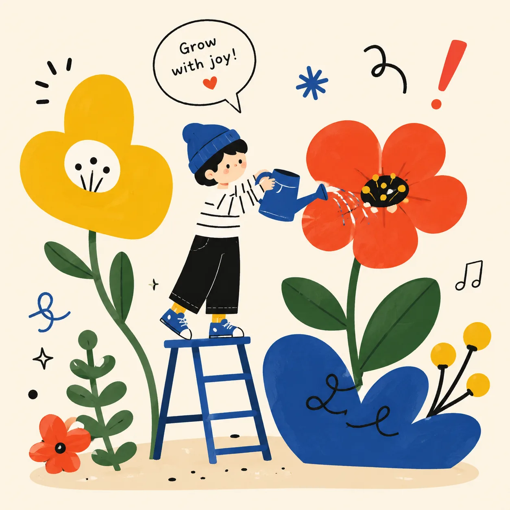

# Whimsical, playful illustration featuring CHARACTER / SUBJECT as

[← Back to the collection](../../README.md) · Category: [UI & Graphic](../../gallery/ui-graphic.md) · Model: `Vinano Studio` · ID: `vn-00864`

<a href="https://vinano.ai?utm_source=github&utm_medium=readme&utm_campaign=awesome-image-video-prompts-updating&utm_content=prompt-page-image"></a>

<sub>Preview generated with <a href="https://vinano.ai?utm_source=github&utm_medium=readme&utm_campaign=awesome-image-video-prompts-updating&utm_content=prompt-page-caption">vinano.ai</a></sub>

## Prompt

```text
Create a whimsical, playful illustration featuring [CHARACTER / SUBJECT] as the central focus.
The character is drawn simplified features, a small rounded head, and minimal facial detail, wearing [HEADWEAR / CLOTHING DESCRIPTION].

They are positioned among oversized abstract shapes and organic elements such as [FLORAL / SYMBOLIC OBJECTS], creating a sense of imaginative scale. The character is interacting [OBJECT / ACTION], adding narrative interest.

Decorative graphic elements like [SYMBOLS: exclamation points, speech bubbles, scribbles, notes, etc.] float around the subject to enhance expression and energy.

Use clean, simple linework and a limited color palette of [PRIMARY COLORS], keeping the illustration bold and cohesive. The background is a soft neutral tone such as beige or off-white. The overall style is modern, flat, and illustrative, a lively, creative, and slightly abstract atmosphere.

Preserve realistic proportions and depth for a confident, professional finish.
```

## Try it on vinano.ai

1. Copy the prompt above.
2. Open **[vinano.ai](https://vinano.ai?utm_source=github&utm_medium=readme&utm_campaign=awesome-image-video-prompts-updating&utm_content=prompt-page-try)**, paste it into the image generator and pick a model.
3. Swap any placeholders (brand, product, city, person…) for your own details, then generate.

More prompts like this: [UI & Graphic gallery](../../gallery/ui-graphic.md) · [all categories](../../README.md#contents)
