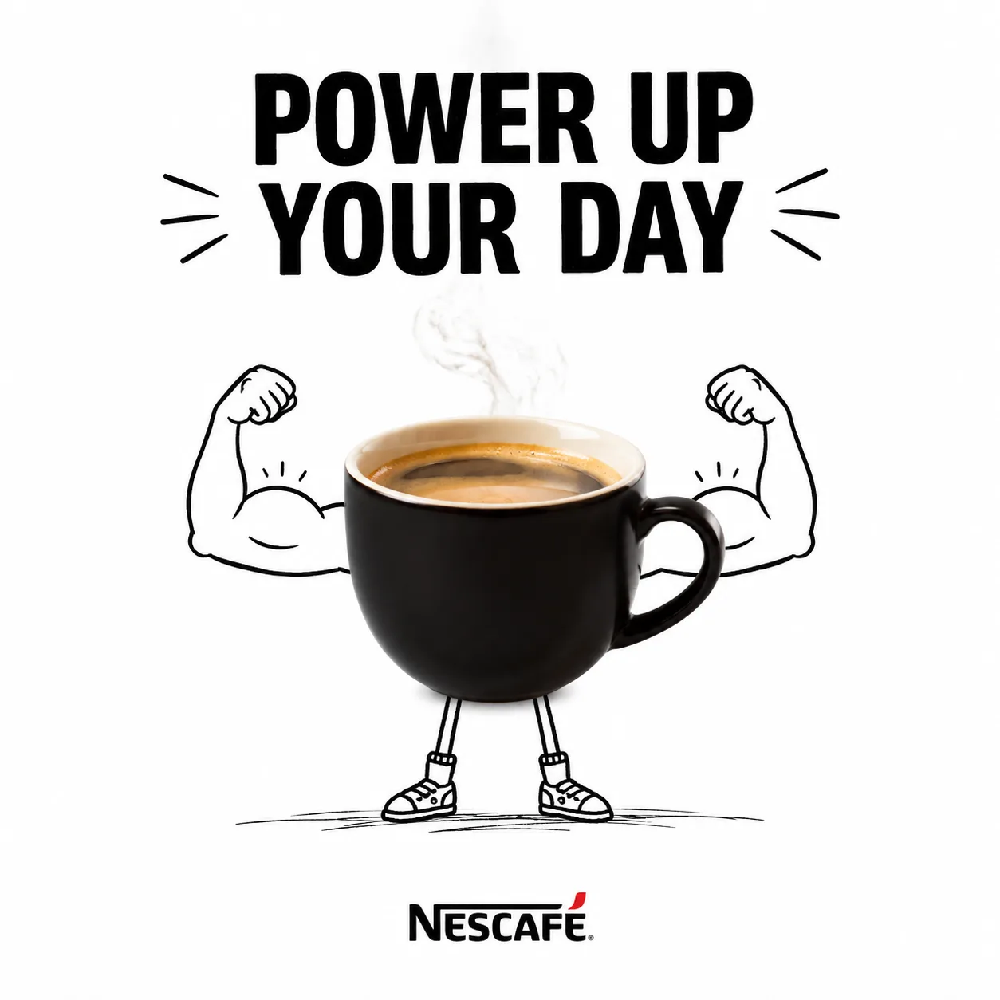

# Refined minimalist and creative advertisement set on a pure

[← Back to the collection](../../README.md) · Category: [UI & Graphic](../../gallery/ui-graphic.md) · Model: `Vinano Studio` · ID: `vn-00892`

<a href="https://vinano.ai?utm_source=github&utm_medium=readme&utm_campaign=awesome-image-video-prompts-updating&utm_content=prompt-page-image"></a>

<sub>Preview generated with <a href="https://vinano.ai?utm_source=github&utm_medium=readme&utm_campaign=awesome-image-video-prompts-updating&utm_content=prompt-page-caption">vinano.ai</a></sub>

## Prompt

```text
A refined minimalist and creative advertisement set on a pure white background. A real photographic [Real Object] is integrated into a simple hand-drawn black ink doodle loose, playful lines. The [Doodle Concept] interacts directly and cleverly the real object, making the object part of the illustrated scene. Include bold uppercase black “[Ad Copy]” text at the top. Place the official [Brand Logo] clearly centered at the bottom. Clean layout, high contrast between realistic object and flat doodle drawing, lots of negative space, smart visual metaphor, print-ready poster design Render with rich micro-detail while keeping the layout uncluttered and intentional.
```

## Try it on vinano.ai

1. Copy the prompt above.
2. Open **[vinano.ai](https://vinano.ai?utm_source=github&utm_medium=readme&utm_campaign=awesome-image-video-prompts-updating&utm_content=prompt-page-try)**, paste it into the image generator and pick a model.
3. Swap any placeholders (brand, product, city, person…) for your own details, then generate.

More prompts like this: [UI & Graphic gallery](../../gallery/ui-graphic.md) · [all categories](../../README.md#contents)
