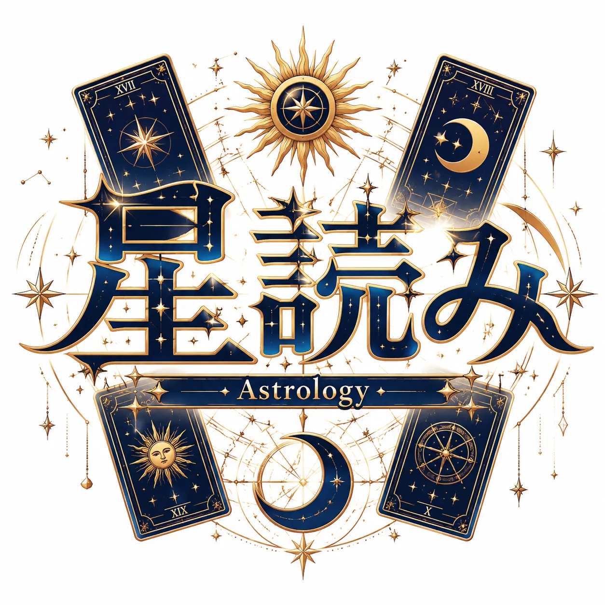

# UI & Graphic prompt #896

[← Back to the collection](../../README.md) · Category: [UI & Graphic](../../gallery/ui-graphic.md) · Model: `Vinano Studio` · ID: `vn-00896`

<a href="https://vinano.ai?utm_source=github&utm_medium=readme&utm_campaign=awesome-image-video-prompts-updating&utm_content=prompt-page-image"></a>

<sub>Preview generated with <a href="https://vinano.ai?utm_source=github&utm_medium=readme&utm_campaign=awesome-image-video-prompts-updating&utm_content=prompt-page-caption">vinano.ai</a></sub>

## Prompt

```text
style_preset: "Zodiac Astrology VTuber Logo Aesthetics (Celestial Ver.)"
global_settings:
 vibe: "Mystical, celestial, cosmic wisdom, divination, stargazing"
 background: "Pure white background (for isolation)"
 rendering:
 - "Elegant, celestial vector-style finish"
 - "Deep midnight blue and shining gold palette"
 - "Thin elegant layered outlines star accents"
 - "Glowing star effects and celestial glow"
drawing_rules:
 line_quality: "Thin, elegant curves constellation line art accents."
 character_design:
 - "Integrated constellation and tarot motifs woven into the letters"
 - "Custom stylized font: elegant, celestial shapes star dot accents"
 typography_style:
 - "Main Title: Large, stylized Japanese constellation dot patterns"
 - "Subtitle: Smaller English text in an elegant celestial font"
 ornament_rule:
 - "Strictly follow the 'ornaments_selection' provided in the USER INPUT SECTION"
 - "Distribute ornaments to create a 'celestial reading' visual impact"
visual_parameters:
 color_palette:
 primary: "Deep midnight blue and shining gold gradient"
 secondary: "Thin gold inner border + Midnight blue outer stroke"
 accents: "Constellation lines, zodiac symbols, and star glow"

# ----------------------------------------------------------
# USER INPUT SECTION (下記を自由に編集してね)
# ----------------------------------------------------------
request:
 input_text: "星読み" # ← ここを好きな名前に変更
 subtitle: "Astrology" # ← 小さく表示したい文字
 motif_concept: "星座図とタロットカード" # ← ここを好きな動物やモノに変更

 custom_colors: "ミッドナイトブルーとシャイニングゴールド" # ← 好きな色を指定

 ornaments_selection:
 - "星座線 (Zodiac constellation lines)"
 - "タロットカード (Tarot card borders)"
 - "三日月 (Crescent moon)"
 - "太陽 (Radiant sun)"
 - "魔法陣 (Mystical magic circle)"

Aim for an editorial, design-driven look with deliberate negative space.
```

## Try it on vinano.ai

1. Copy the prompt above.
2. Open **[vinano.ai](https://vinano.ai?utm_source=github&utm_medium=readme&utm_campaign=awesome-image-video-prompts-updating&utm_content=prompt-page-try)**, paste it into the image generator and pick a model.
3. Swap any placeholders (brand, product, city, person…) for your own details, then generate.

More prompts like this: [UI & Graphic gallery](../../gallery/ui-graphic.md) · [all categories](../../README.md#contents)
