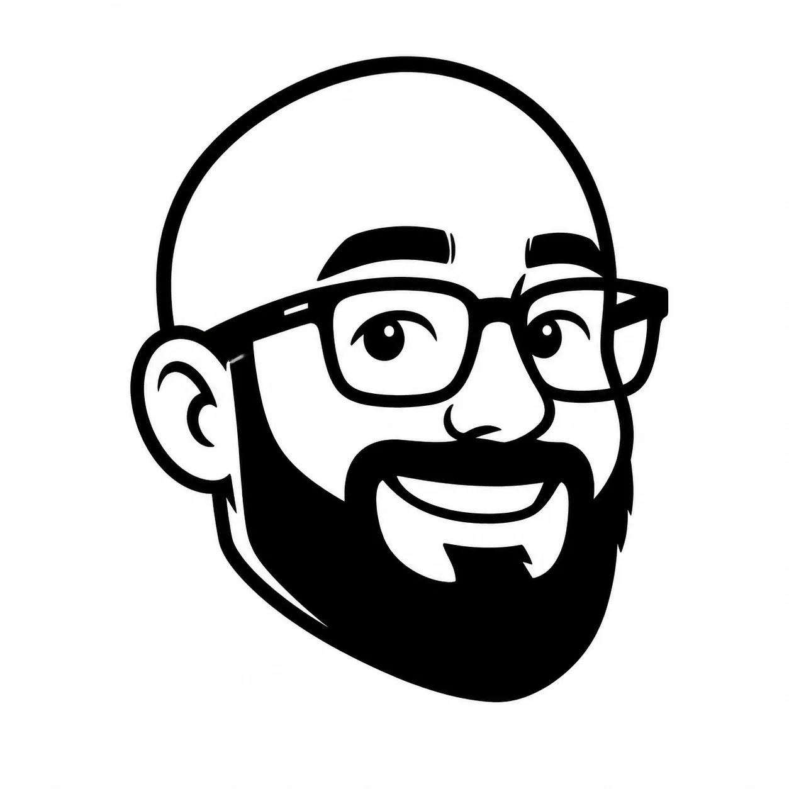

# Clean high-contrast vector mascot icon in Notion-style artwork based

[← Back to the collection](../../README.md) · Category: [UI & Graphic](../../gallery/ui-graphic.md) · Model: `Vinano Studio` · ID: `vn-00911`

<a href="https://vinano.ai?utm_source=github&utm_medium=readme&utm_campaign=awesome-image-video-prompts-updating&utm_content=prompt-page-image"></a>

<sub>Preview generated with <a href="https://vinano.ai?utm_source=github&utm_medium=readme&utm_campaign=awesome-image-video-prompts-updating&utm_content=prompt-page-caption">vinano.ai</a></sub>

## Prompt

```text
Create a clean high-contrast vector mascot icon in Notion-style artwork based on [person description]. Show only the head in a 3/4 view. Use very thick bold black outer outlines and slightly thinner inner detail lines. Flat monochrome fill. Simplify facial features into strong geometric shapes while preserving recognizable traits such as bald head or hairstyle, beard shape, glasses shape, eyebrows, and smile. Expression should be friendly and slightly exaggerated. Teeth are simplified into clean flat blocks. pure white background. Modern startup mascot logo aesthetic, clean SVG vector look, crisp edges, black and white only, high contrast, symmetrical balance, square composition, 1:1 aspect ratio Preserve realistic proportions and depth for a confident, professional finish.
```

## Try it on vinano.ai

1. Copy the prompt above.
2. Open **[vinano.ai](https://vinano.ai?utm_source=github&utm_medium=readme&utm_campaign=awesome-image-video-prompts-updating&utm_content=prompt-page-try)**, paste it into the image generator and pick a model.
3. Swap any placeholders (brand, product, city, person…) for your own details, then generate.

More prompts like this: [UI & Graphic gallery](../../gallery/ui-graphic.md) · [all categories](../../README.md#contents)
