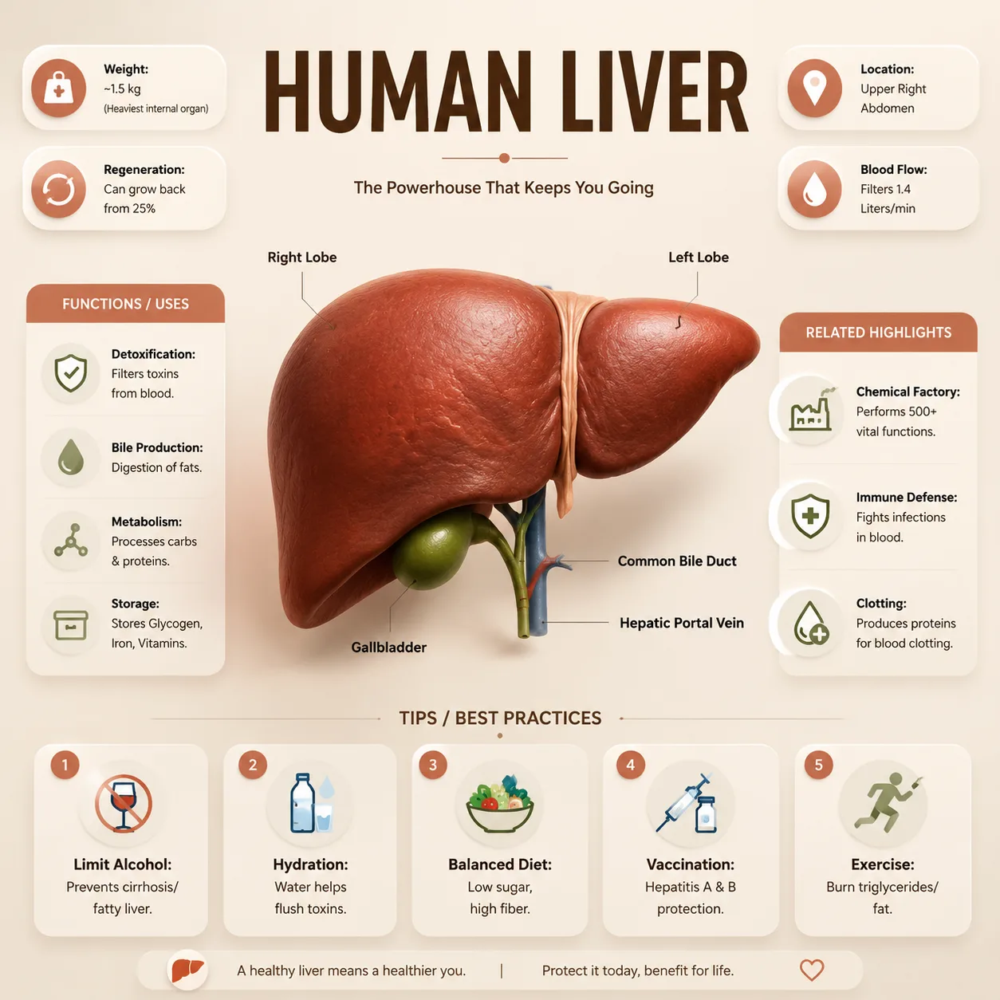

# UI & Graphic prompt #989

[← Back to the collection](../../README.md) · Category: [UI & Graphic](../../gallery/ui-graphic.md) · Model: `Vinano Studio` · ID: `vn-00989`

<a href="https://vinano.ai?utm_source=github&utm_medium=readme&utm_campaign=awesome-image-video-prompts-updating&utm_content=prompt-page-image"></a>

<sub>Preview generated with <a href="https://vinano.ai?utm_source=github&utm_medium=readme&utm_campaign=awesome-image-video-prompts-updating&utm_content=prompt-page-caption">vinano.ai</a></sub>

## Prompt

```text
Ultra-clean modern editorial infographic poster (1080x1080), premium magazine layout meets lifestyle photography/illustration.

**TITLE:**
Large, bold sans-serif text at top center: "HUMAN LIVER"

**CENTRAL VISUAL:**
A realistic, high-fidelity 3D illustration of the Human Liver (showing Right/Left lobes and Gallbladder). Color palette: Terracotta, deep brownish-red, and soft coral, set against a clean soft beige/off-white background. Lighting is studio-soft.

**LAYOUT SECTIONS (Matching the reference):**

* **Section 1 - Quick Facts (Top Left/Right floating bubbles):**
 * "Weight: ~1.5 kg (Heaviest internal organ)"
 * "Regeneration: Can grow back from 25%"
 * "Location: Upper Right Abdomen"
 * "Blood Flow: Filters 1.4 Liters/min"

* **Section 2 - Core Parts / Systems (Labels pointing to central organ):**
 * Right Lobe
 * Left Lobe
 * Gallbladder (Greenish sac underneath)
 * Common Bile Duct
 * Hepatic Portal Vein

* **Section 4 - Functions / Uses (Left side list minimal icons):**
 * **Detoxification:** Filters toxins from blood.
 * **Bile Production:** Digestion of fats.
 * **Metabolism:** Processes carbs & proteins.
 * **Storage:** Stores Glycogen, Iron, Vitamins.

* **Section 5 - Related Highlights (Right side list minimal icons):**
 * **Chemical Factory:** Performs 500+ vital functions.
 * **Immune Defense:** Fights infections in blood.
 * **Clotting:** Produces proteins for blood clotting.

* **Section 6 - Tips / Best Practices (Bottom row, card style icons):**
 1. **Limit Alcohol:** Prevents cirrhosis/fatty liver.
 2. **Hydration:** Water helps flush toxins.
 3. **Balanced Diet:** Low sugar, high fiber.
 4. **Vaccination:** Hepatitis A & B protection.
 5. **Exercise:** Burn triglycerides/fat.

**STYLE:**
Glassmorphism effects on text boxes, soft drop shadows, medical accuracy mixed high-end graphic design aesthetics.

Emphasise material texture and natural light so the final frame feels tactile and premium.
```

## Try it on vinano.ai

1. Copy the prompt above.
2. Open **[vinano.ai](https://vinano.ai?utm_source=github&utm_medium=readme&utm_campaign=awesome-image-video-prompts-updating&utm_content=prompt-page-try)**, paste it into the image generator and pick a model.
3. Swap any placeholders (brand, product, city, person…) for your own details, then generate.

More prompts like this: [UI & Graphic gallery](../../gallery/ui-graphic.md) · [all categories](../../README.md#contents)
