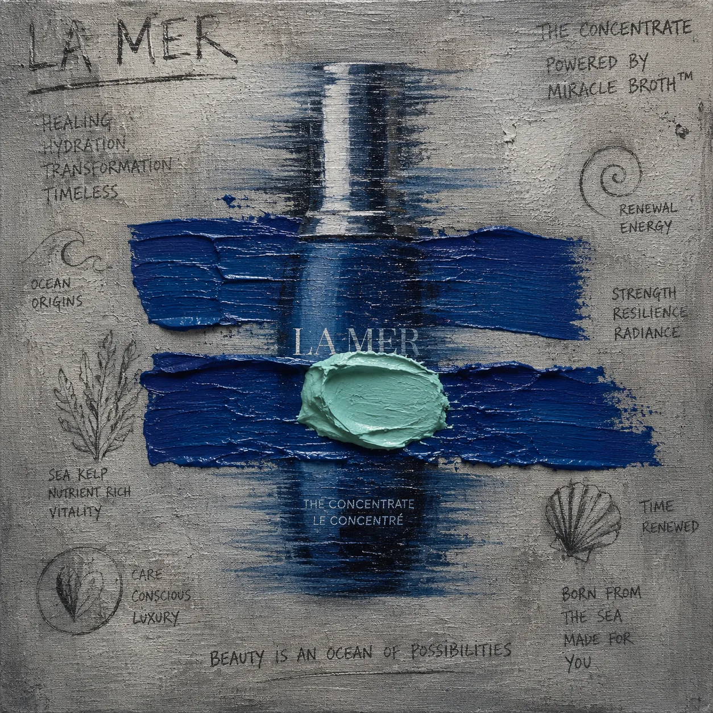

# UI & Graphic prompt #1029

[← Back to the collection](../../README.md) · Category: [UI & Graphic](../../gallery/ui-graphic.md) · Model: `Vinano Studio` · ID: `vn-01029`

<a href="https://vinano.ai?utm_source=github&utm_medium=readme&utm_campaign=awesome-image-video-prompts-updating&utm_content=prompt-page-image"></a>

<sub>Preview generated with <a href="https://vinano.ai?utm_source=github&utm_medium=readme&utm_campaign=awesome-image-video-prompts-updating&utm_content=prompt-page-caption">vinano.ai</a></sub>

## Prompt

```text
[BRAND NAME].
Goal: Generate a professional mixed-media oil painting on textured canvas where the color palette and graphics are dynamically adapted to the brand identity.

1. BRAND COLOR ADAPTATION
- Analyze the visual identity of [BRAND NAME].
- Use the primary brand color for the two main horizontal impasto strokes.
- Use a contrasting secondary brand color for the thick, raised central dollop of paint.
- Replace the original red and yellow this new adaptive color scheme.

2. PAINTED SUBJECT & MOTION
- Object: A central, vertically oriented product related to [BRAND NAME], rendered as a cohesive OIL PAINTING directly on the canvas.
- Technique: Apply a "motion blur" oil painting effect visible horizontal brushstrokes to create a sense of dynamic movement.
- Integration: The object must be part of the painted layer, sharing the same heavy-grain canvas texture as the background, not an overlay.
- Branding: Paint the "[BRAND NAME]" logo distressed, semi-transparent oil paint layers within the object's silhouette.

3. ADAPTIVE IMPASTO & TEXTURE
- Primary Strokes: Two thick, physical, horizontal impasto oil paint strokes applied over the painted object in the brand's primary color.
- Detail: One heavily textured, raised dollop of the brand's secondary color oil paint placed precisely on the center stroke.
- Surface: Background is a raw, heavy-grain grey textured canvas visible weave, charcoal smudges, and gesso dabs.

4. BRAND-CENTRIC GRAPHICS
- Handwriting: Use charcoal and graphite to scribble keywords, slogans, and values associated [BRAND NAME] across the canvas.
- Symbols: Replace the original $ and doodles hand-drawn, messy abstract icons representing [BRAND NAME].
- Execution: All text and symbols must look like they were scratched or drawn graphite over the dried oil paint layers.

5. STYLE
- Contemporary mixed-media pop-art. 8K macro photography focusing on the physical thickness of oil paint and the raw canvas grain.

Emphasise material texture and natural light so the final frame feels tactile and premium.
```

## Try it on vinano.ai

1. Copy the prompt above.
2. Open **[vinano.ai](https://vinano.ai?utm_source=github&utm_medium=readme&utm_campaign=awesome-image-video-prompts-updating&utm_content=prompt-page-try)**, paste it into the image generator and pick a model.
3. Swap any placeholders (brand, product, city, person…) for your own details, then generate.

More prompts like this: [UI & Graphic gallery](../../gallery/ui-graphic.md) · [all categories](../../README.md#contents)
