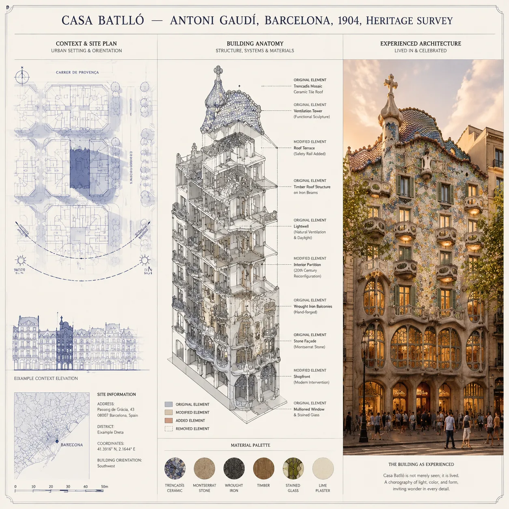

# Preservation architect's survey board for BUILDING / STRUCTURE

[← Back to the collection](../../README.md) · Category: [UI & Graphic](../../gallery/ui-graphic.md) · Model: `Vinano Studio` · ID: `vn-01038`

<a href="https://vinano.ai?utm_source=github&utm_medium=readme&utm_campaign=awesome-image-video-prompts-updating&utm_content=prompt-page-image"></a>

<sub>Preview generated with <a href="https://vinano.ai?utm_source=github&utm_medium=readme&utm_campaign=awesome-image-video-prompts-updating&utm_content=prompt-page-caption">vinano.ai</a></sub>

## Prompt

```text
A preservation architect's survey board for [BUILDING / STRUCTURE] — [STYLE / ARCHITECT / PERIOD]. Left section: site plan and context, showing the structure in its urban or landscape setting orientation, shadows, and neighboring relationships mapped. Center section: the building dissected, a cutaway axonometric revealing structural system, material layers, hidden infrastructure, callouts identifying original versus modified elements. Right section: the building as experienced, photographed from the canonical viewpoint in ideal light, human figures for scale and life, the architecture inhabited. Visual style transitions from technical survey blue-line through neutral analytical greys to golden-hour warmth. Title block reading "[BUILDING NAME] — [ARCHITECT], [CITY], [YEAR], HERITAGE SURVEY". Keep edges clean and the overall composition balanced for a polished, gallery-ready result.
```

## Try it on vinano.ai

1. Copy the prompt above.
2. Open **[vinano.ai](https://vinano.ai?utm_source=github&utm_medium=readme&utm_campaign=awesome-image-video-prompts-updating&utm_content=prompt-page-try)**, paste it into the image generator and pick a model.
3. Swap any placeholders (brand, product, city, person…) for your own details, then generate.

More prompts like this: [UI & Graphic gallery](../../gallery/ui-graphic.md) · [all categories](../../README.md#contents)
