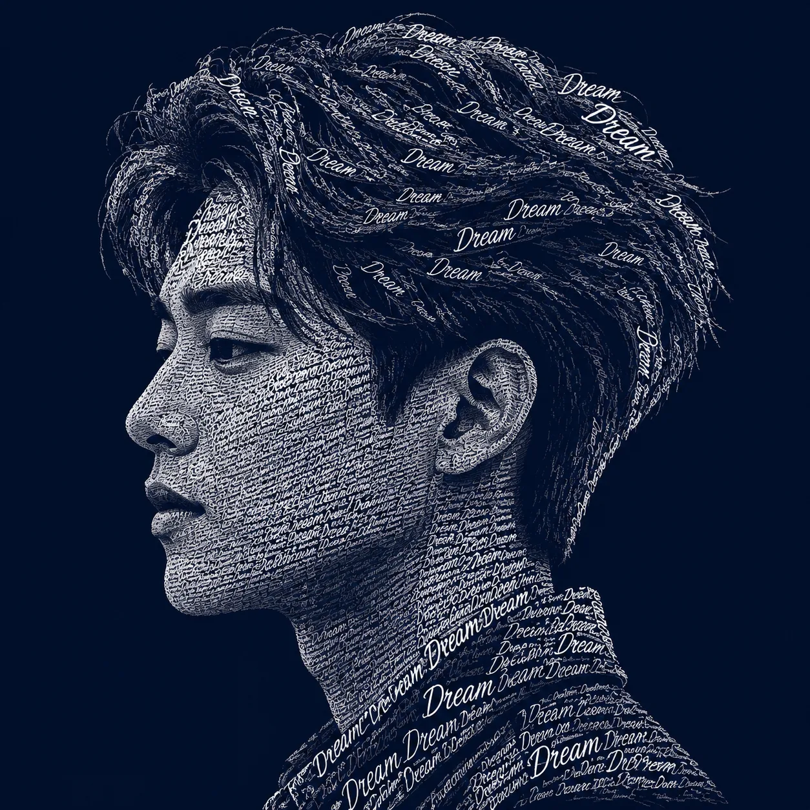

# Typographic art portrait the uploaded photo of a person

[← Back to the collection](../../README.md) · Category: [UI & Graphic](../../gallery/ui-graphic.md) · Model: `Vinano Studio` · ID: `vn-01106`

<a href="https://vinano.ai?utm_source=github&utm_medium=readme&utm_campaign=awesome-image-video-prompts-updating&utm_content=prompt-page-image"></a>

<sub>Preview generated with <a href="https://vinano.ai?utm_source=github&utm_medium=readme&utm_campaign=awesome-image-video-prompts-updating&utm_content=prompt-page-caption">vinano.ai</a></sub>

## Prompt

```text
Create a typographic art portrait the uploaded photo of a person as reference. Display a left-facing side profile portrait. The entire image--including the face. hair. and facial features--must be formed exclusively from repeated white calligraphic text the words: "[PUT WHATEVER WORDS YOU WANT HERE]" The text should follow the natural contours of the face and hair, clearly shaping the person's profile silhouette. Use a deep navy blue background high contrast The stvle should be clean vector art sharp edges. Output in high-resolution 8K quality. Do not alter the person's facial identity. No additional colors. no textures. and no watermark. Dimension 4:5 Render with rich micro-detail while keeping the layout uncluttered and intentional.
```

## Try it on vinano.ai

1. Copy the prompt above.
2. Open **[vinano.ai](https://vinano.ai?utm_source=github&utm_medium=readme&utm_campaign=awesome-image-video-prompts-updating&utm_content=prompt-page-try)**, paste it into the image generator and pick a model.
3. Swap any placeholders (brand, product, city, person…) for your own details, then generate.

More prompts like this: [UI & Graphic gallery](../../gallery/ui-graphic.md) · [all categories](../../README.md#contents)
