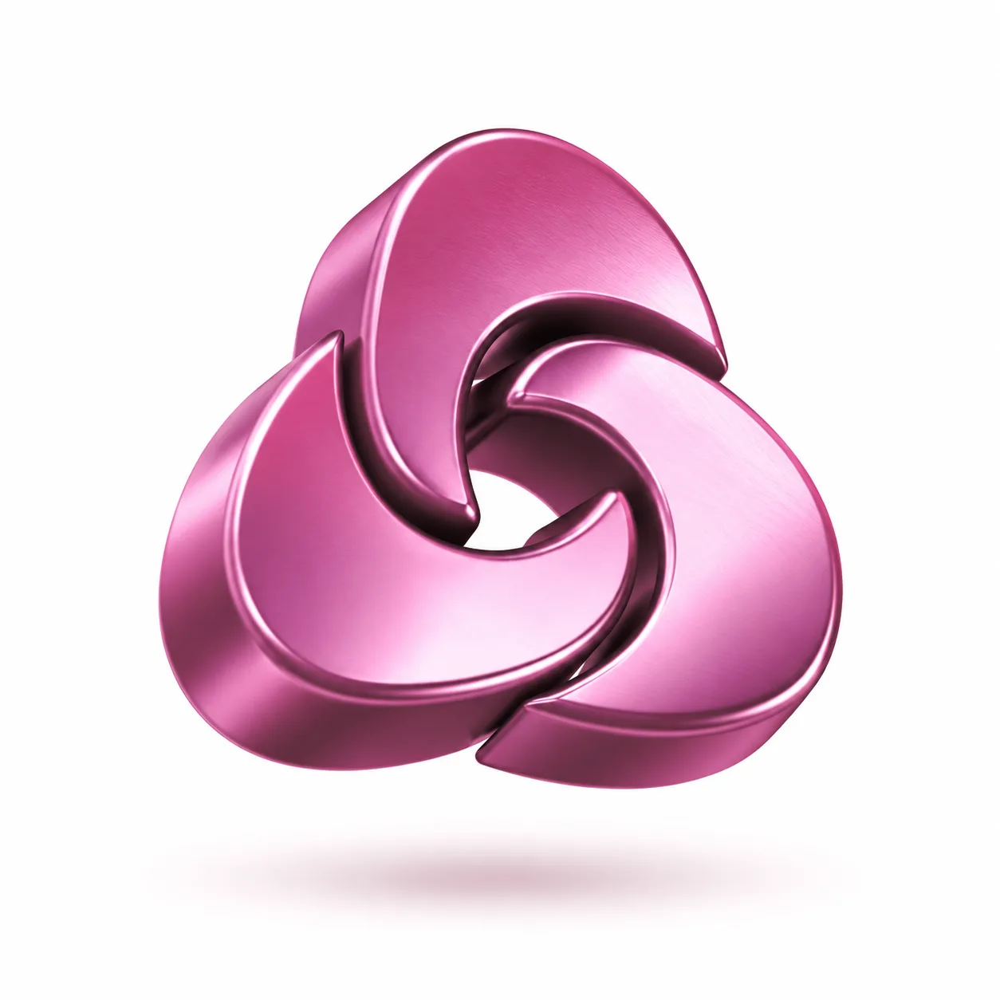

# UI & Graphic prompt #1114

[← Back to the collection](../../README.md) · Category: [UI & Graphic](../../gallery/ui-graphic.md) · Model: `Vinano Studio` · ID: `vn-01114`

<a href="https://vinano.ai?utm_source=github&utm_medium=readme&utm_campaign=awesome-image-video-prompts-updating&utm_content=prompt-page-image"></a>

<sub>Preview generated with <a href="https://vinano.ai?utm_source=github&utm_medium=readme&utm_campaign=awesome-image-video-prompts-updating&utm_content=prompt-page-caption">vinano.ai</a></sub>

## Prompt

```text
[BRAND NAME]. Act as a 3D Product Visualization Artist.

PHASE 1: LOGO TO 3D OBJECT

Take the [BRAND NAME] logo and transform it into a thick 3D sculptural form. Simplify to core shape, add rounded edges (8-12mm fillet), make it one solid piece 40-60mm depth. Keep it recognizable.

PHASE 2: PINK METALLIC MATERIAL

- Color: Pink metallic (#C85A8E to #8B4A6F range)

- Finish: Glossy brushed metal fine grain

- Highlights: Light pink (#E89BB8)

- Shadows: Deep plum (#6B3854)

- Roughness: 0.2 (shiny but not mirror)

- NO copper, NO gold, NO silver

PHASE 3: LIGHTING

Soft studio lighting from top-left creating smooth gradient across the object. Light pink on highlights, deep plum in shadows. No hard shadows.

PHASE 4: BACKGROUND & FLOATING

- Pure white background (#FFFFFF)

- Object levitating in white void

- Soft blurred shadow underneath (90% transparent)

- NO pedestals, NO stands, NO supports

PHASE 5: CAMERA

Slight 3/4 angle, looking down 10°, object centered, filling 60% of frame.

TECH SPECS:

- premium-quality 3D render (Octane/Cycles)

- 4K resolution

- Full object in focus

- Subtle bloom on highlights

CRITICAL:

- Must be PINK metallic only

- Must float in pure white space

- Must have thick 3D volume smooth surfaces

- Must look like luxury product photography

Render with rich micro-detail while keeping the layout uncluttered and intentional.
```

## Try it on vinano.ai

1. Copy the prompt above.
2. Open **[vinano.ai](https://vinano.ai?utm_source=github&utm_medium=readme&utm_campaign=awesome-image-video-prompts-updating&utm_content=prompt-page-try)**, paste it into the image generator and pick a model.
3. Swap any placeholders (brand, product, city, person…) for your own details, then generate.

More prompts like this: [UI & Graphic gallery](../../gallery/ui-graphic.md) · [all categories](../../README.md#contents)
