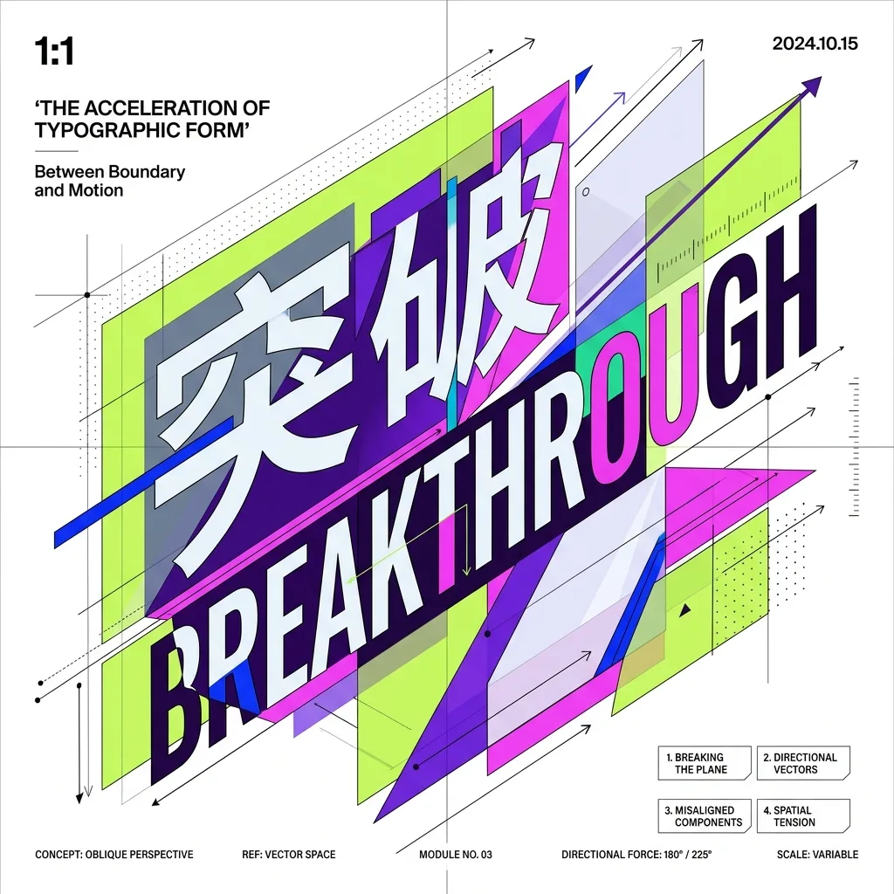

# 请基于用户输入的【核心文字 / 单词

[← Back to the collection](../../README.md) · Category: [UI & Graphic](../../gallery/ui-graphic.md) · Model: `Vinano Image Pro` · ID: `vn-01179`

<a href="https://vinano.ai?utm_source=github&utm_medium=readme&utm_campaign=awesome-image-video-prompts-updating&utm_content=prompt-page-image"></a>

<sub>Preview generated with <a href="https://vinano.ai?utm_source=github&utm_medium=readme&utm_campaign=awesome-image-video-prompts-updating&utm_content=prompt-page-caption">vinano.ai</a></sub>

## Prompt

```text
请基于用户输入的【核心文字 / 单词 / 词组 / 短句 / 字母】，创作一张高完成度的「斜向透视平面字体概念海报 / Oblique Planar Perspective Typographic Poster」。

用户输入：[主题文字]；
文字语言：[中文 / 英文 / 中英混排]；
可选补充语境：[____]；
可选情绪倾向：[____]；
可选禁用元素：[____]。

这不是普通插画，不是简单把文字放大后的字效海报，也不是传统正面平铺式平面排版，而是一张以“文字为主视觉核心”的现代实验性字体海报。整体必须采用「斜向透视平面字体构成 / Oblique Planar Perspective Typography」的方式来设计：文字不应完全贴在正面平面上，而应像被放置在不同倾斜角度的二维平面中，通过斜向基准线、透视压缩、平面偏转、角度切入、错位构成、向量指向、方向线条、半透明几何平面与模块化色块，共同建立一种“仍然是平面设计，但具有明显角度感、空间方向感、视觉张力和向量关系”的字体构成效果。

请先真正理解用户输入内容的字面含义、情绪气质、隐含象征、文化联想、心理感受与语义张力，再把这些理解转译成一个具有“方向性、倾斜关系、平面透视感和视觉对抗 / 连接关系”的字体海报系统。如果主题偏情绪型，请重点通过斜向文字平面的距离关系、重心偏移、留白方向、线条走势、模块密度变化和色块压迫 / 释放来表达；如果主题偏动作型，请重点通过倾斜推进、速度线、方向箭头、透视切片、错位平面和向量轨迹来表达；如果主题偏关系型，请重点通过多个文字主体、几何平面和图形模块之间的角度差、相交、重叠、对峙、包裹、切割和中介结构来表达；如果主题偏抽象概念型，请先找到一个简洁但具有视觉转译潜力的抽象隐喻，再通过斜向透视字体、向量辅助系统、局部遮挡、层级偏移、模块重复和变形网格来构建画面。

整体画面必须呈现为一张现代、锐利、清亮、时尚、有实验性、有传播力、有视觉记忆点的高完成度字体海报。用户输入的文字必须成为第一视觉主体，是整个海报的核心内容。文字可以横排、竖排、拆分、错位、分组、重组、局部裁切、局部遮挡、嵌套、倾斜、透视压缩、斜向旋转，甚至分别放置在不同角度的二维平面中，但必须始终保持较高识别度与清晰可读性。画面中至少要让观众明显感受到：文字不再是正面贴平，而是进入了一个由多个倾斜平面和方向关系组成的平面空间系统中。

请重点强化以下风格特征：文字有斜向角度感、近大远小的平面透视感、不同方向的向量关系、倾斜基准线、辅助箭头、几何切面、模块推进、局部框线、数据感标注、小型目录式辅助说明、少量点阵与路径线。可以让不同的文字或文字组处在不同倾斜平面中，形成彼此之间的视角差、方向冲突、视觉对话或张力关系。图形元素必须围绕文字构建，而不是独立装饰；它们应该支撑文字、切割文字、包裹文字、延伸文字的方向、强化文字的倾斜动势，并与文字共同构成一个完整的视觉句子。

视觉语言上，请采用 modern graphic design、oblique planar perspective typography、experimental typography、bold typographic composition、flat vector aesthetics、high-contrast graphic layout、contemporary editorial poster、crisp vector-like precision 的方向。整体不是写实，不是摄影，不是复古文学封面，不是包豪斯旧海报感，不是厚重肌理风，不是暗沉艺术海报，也不是普通 PPT 封面。它应当是更当代、更清亮、更锋利、更数字化、更具有设计公司提案感与展览海报感的视觉结果。

【新版配色要求】
配色必须鲜亮、透亮、清亮、艳丽、高对比，但不要固定使用蓝色与橙色组合，也不要默认落入常见的蓝橙撞色方案。请根据主题语义、情绪气质和视觉隐喻，自动生成一组更大胆、更有想象力、更有新鲜感的现代高对比配色。允许使用非常规组合、跳跃性色彩、强烈撞色、冷暖冲突、霓虹感、数码感、未来感或艺术化配色，但整体必须仍然有秩序、有审美控制、有设计感，不能杂乱失控。

请优先采用“2 个主色 + 1 到 2 个高亮点缀色 + 留白 / 结构支点色”的配色组织方式。可以探索但不限于以下方向：荧光绿 + 品红 + 冷白、亮黄 + 紫罗兰 + 黑色、酸橙绿 + 深紫 + 青蓝、玫红 + 青绿 + 银白、樱桃红 + 湖蓝 + 纯白、薄荷青 + 亮红 + 深蓝、荧光黄 + 桃红 + 紫色、珊瑚橙 + 青蓝 + 白色、多彩数码拼接配色等。每次生成时，请尽量形成一套独立的色彩记忆点，不要重复单一固定主配色，不要让作品系列都长得像同一张图换字。

文字颜色不要全部使用纯黑，可以根据构图关系，让不同文字主体使用不同高饱和色，或在同一组大字中形成主次色分配。允许少量深色作为结构支点，但整体画面应以鲜亮、清透、醒目、前卫的色彩印象为主。色彩应服务于语义表达，而不是仅仅为了热闹；要让观众觉得颜色是“被设计过的”，而不是随机堆砌的。

构图应大胆、倾斜、具有推进感和方向感，但同时要控制画面秩序。建议采用 1 组核心标题主体、1 组斜向透视文字平面系统、1 组几何向量与色块结构、少量辅助标注信息与点线符号。画面需要保留足够留白，让高饱和色与倾斜文字更有呼吸感和展览海报感。可以加入少量小字说明、标签、编号、英文关键词、极简副标题或短句，用来强化概念，但必须克制，不要抢夺主标题的视觉权重。辅助信息可模拟视觉识别系统或编辑设计中的注释语言，例如短词、参数、索引、方向说明、概念标签等。

字体与排版必须现代、清晰、醒目、有力量，并且具有一定实验性。中文适合使用几何无衬线、现代设计感强的标题字、窄长字形或有切面感的字形；英文适合使用 bold grotesk、condensed sans、geometric sans、editorial sans 等。允许局部拉伸、压缩、斜切、透视变形、切片错位，但不要把文字做成真实 3D 挤出字，不要厚重投影，不要真实立体建模，不要金属字，不要玻璃字，不要浮雕字。重点是“平面中的空间感”，而不是“物理三维立体感”。

图形元素可使用：斜向矩形、倾斜平面框、三角切角、圆点系统、箭头、路径线、细线辅助网格、透视边框、方向向量、点阵模块、数据感短线、色块面片、半透明几何切片、局部环形线、分区标签、小尺寸索引信息等。这些元素都必须服务主题语义和字体构成，不应沦为纯装饰。

请避免以下问题：不要做成普通正面平铺字体海报、不要做成传统极简主义排版封面、不要做成写实摄影或插画、不要做成厚重 3D 字、不要做成复古低饱和或米灰色调海报、不要堆砌无关图形、不要过度装饰、不要让文字不可读、不要让画面脏乱拥挤、不要让图形与主题词脱节、不要反复默认同一套主配色。

如果适合，请自动生成一句极短的副标题或概念短句，用来辅助解释主题，例如 “Between ____ and ____”、“The tension of ____”、“A state of ____”、“Where ____ begins”，或根据中文语境生成一句更简洁的中文短句，但必须保持简短、克制、设计化。

最终输出应是一张：高完成度、现代、鲜亮、高对比、平面、锐利、实验性强、具有斜向透视字体构成感、可读且有设计感、并且在配色上更大胆自由、更有想象力、更不落入固定蓝橙套路的现代字体概念海报。

整体保持边缘干净、构图均衡，呈现可直接使用的精致成品感。
```

## Try it on vinano.ai

1. Copy the prompt above.
2. Open **[vinano.ai](https://vinano.ai?utm_source=github&utm_medium=readme&utm_campaign=awesome-image-video-prompts-updating&utm_content=prompt-page-try)**, paste it into the image generator and pick a model.
3. Swap any placeholders (brand, product, city, person…) for your own details, then generate.

More prompts like this: [UI & Graphic gallery](../../gallery/ui-graphic.md) · [all categories](../../README.md#contents)
