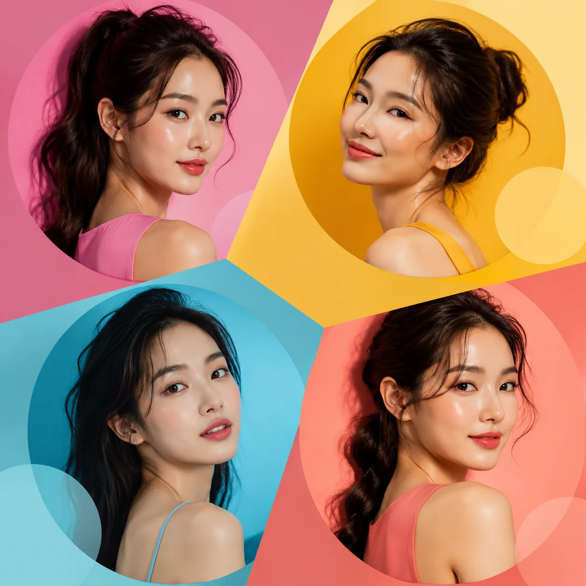

# Ultra-modern high-end skincare advertising collage featuring four beautiful young

[← Back to the collection](../../README.md) · Category: [UI & Graphic](../../gallery/ui-graphic.md) · Model: `Vinano Studio` · ID: `vn-01193`

<a href="https://vinano.ai?utm_source=github&utm_medium=readme&utm_campaign=awesome-image-video-prompts-updating&utm_content=prompt-page-image"></a>

<sub>Preview generated with <a href="https://vinano.ai?utm_source=github&utm_medium=readme&utm_campaign=awesome-image-video-prompts-updating&utm_content=prompt-page-caption">vinano.ai</a></sub>

## Prompt

```text
Ultra-modern high-end skincare advertising collage featuring four beautiful young Asian women, each portrait styled in a separate geometric section of a dynamic diagonal layout. Clean editorial beauty photography soft natural skin texture, glowing healthy complexion, and subtle makeup. Bright vibrant color blocking design pink, yellow, cyan, and coral tones. Minimal abstract background shapes, smooth gradients, and modern graphic design composition. Studio-quality lighting, fashion magazine aesthetic, premium cosmetic campaign feel. Each woman posed confidently in different angles, smiling softly, fresh and youthful vibe. Balanced symmetry sharp diagonal divisions and circular portrait frames. Highly polished commercial beauty branding style, filmic, cinematic lighting, ultra-detailed, 4k resolution.

IMPORTANT NEGATIVE PROMPT:
No text, no typography, no logos, no brand names, no product bottles, no packaging, no watermark, no labels, no written elements.

Aim for an editorial, design-driven look with deliberate negative space.
```

## Try it on vinano.ai

1. Copy the prompt above.
2. Open **[vinano.ai](https://vinano.ai?utm_source=github&utm_medium=readme&utm_campaign=awesome-image-video-prompts-updating&utm_content=prompt-page-try)**, paste it into the image generator and pick a model.
3. Swap any placeholders (brand, product, city, person…) for your own details, then generate.

More prompts like this: [UI & Graphic gallery](../../gallery/ui-graphic.md) · [all categories](../../README.md#contents)
