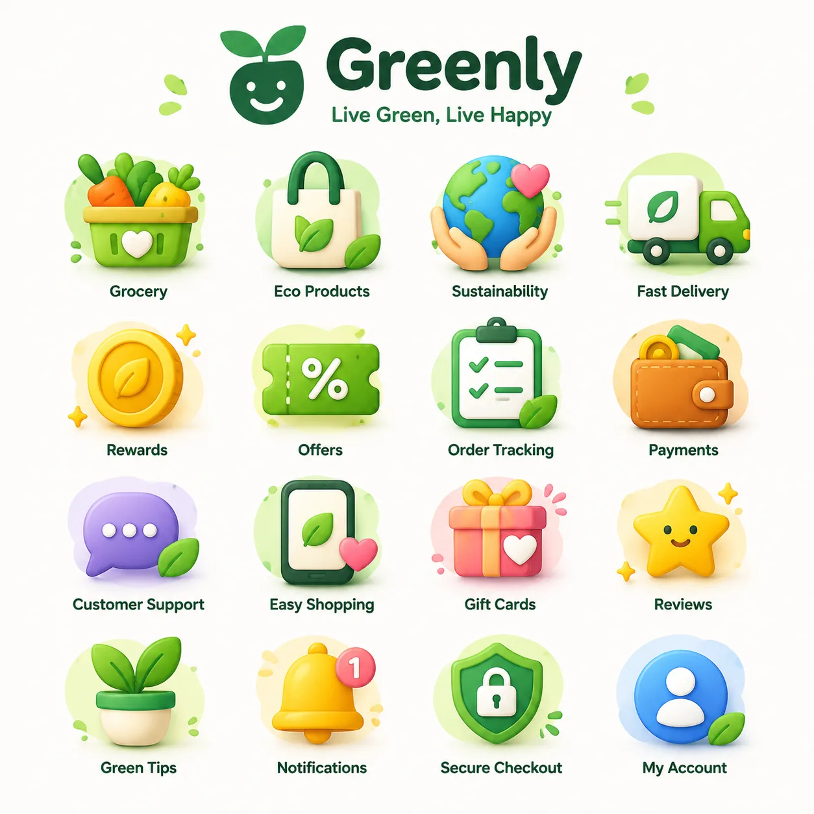

# Cohesive collection of playful icons for BRAND NAME

[← Back to the collection](../../README.md) · Category: [UI & Graphic](../../gallery/ui-graphic.md) · Model: `Vinano Studio` · ID: `vn-01209`

<a href="https://vinano.ai?utm_source=github&utm_medium=readme&utm_campaign=awesome-image-video-prompts-updating&utm_content=prompt-page-image"></a>

<sub>Preview generated with <a href="https://vinano.ai?utm_source=github&utm_medium=readme&utm_campaign=awesome-image-video-prompts-updating&utm_content=prompt-page-caption">vinano.ai</a></sub>

## Prompt

```text
Create a cohesive collection of playful icons for [BRAND NAME], a [BRAND TYPE/INDUSTRY] brand. Style should be [STYLE KEYWORDS: e.g., rounded, 3D, flat, hand-drawn, minimal] a [COLOR STYLE: vibrant, pastel, gradient, monochrome] palette. Use [DESIGN TRAITS: soft shadows, bold outlines, subtle textures, glow, etc.] to give a friendly and modern feel. Maintain consistency across all icons a unified grid, proportions, and visual language. Icons should represent [LIST OF FEATURES/FUNCTIONS]. Ensure high clarity, balanced spacing, and scalable design suitable for UI, apps, and branding. Maintain consistent colour harmony and crisp focus across the whole frame.
```

## Try it on vinano.ai

1. Copy the prompt above.
2. Open **[vinano.ai](https://vinano.ai?utm_source=github&utm_medium=readme&utm_campaign=awesome-image-video-prompts-updating&utm_content=prompt-page-try)**, paste it into the image generator and pick a model.
3. Swap any placeholders (brand, product, city, person…) for your own details, then generate.

More prompts like this: [UI & Graphic gallery](../../gallery/ui-graphic.md) · [all categories](../../README.md#contents)
