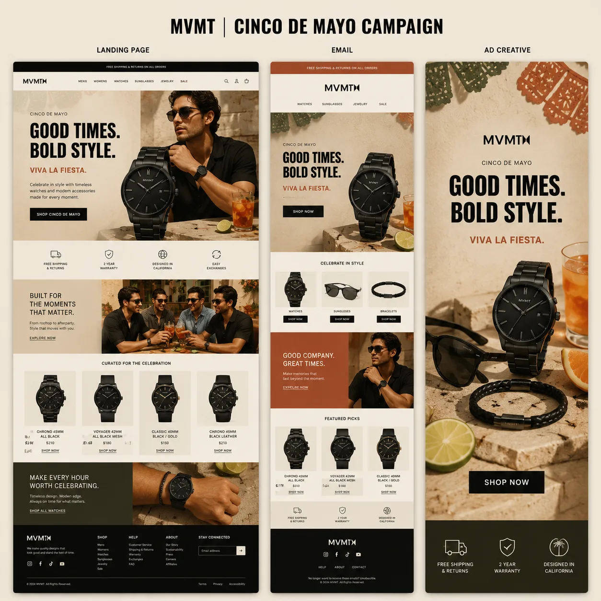

# Premium presentation-style campaign board for MVMT’s Cinco de Mayo

[← Back to the collection](../../README.md) · Category: [UI & Graphic](../../gallery/ui-graphic.md) · Model: `Vinano Studio` · ID: `vn-01226`

<a href="https://vinano.ai?utm_source=github&utm_medium=readme&utm_campaign=awesome-image-video-prompts-updating&utm_content=prompt-page-image"></a>

<sub>Preview generated with <a href="https://vinano.ai?utm_source=github&utm_medium=readme&utm_campaign=awesome-image-video-prompts-updating&utm_content=prompt-page-caption">vinano.ai</a></sub>

## Prompt

```text
Create a premium presentation-style campaign board for MVMT’s Cinco de Mayo campaign on a soft warm neutral background.

At the top, add the title:
“MVMT | CINCO DE MAYO CAMPAIGN”

Below it, show three clearly labeled vertical panels side by side subtle shadows:
“LANDING PAGE”
“EMAIL”
“AD CREATIVE”

Overall style:
Clean, premium, masculine-leaning, modern DTC design. The image should feel like a polished creative review board, not a collage. All three panels should clearly belong to the same campaign, shared typography, colors, product styling, and seasonal details.

Use a warm, elevated palette:
cream, sand, stone, black, charcoal, dark olive, terracotta, muted green, and warm golden accents.

Cinco de Mayo direction:
Tasteful and refined, not cheesy. Use subtle festive touches like papel picado-inspired accents, citrus, warm stone textures, celebratory drinks, and sunlit lifestyle styling.

Shared headline direction:
“GOOD TIMES. BOLD STYLE.”
Optional secondary line:
“VIVA LA FIESTA.”

Panel 1 — Landing Page:
Create the widest and most detailed panel as a tall desktop ecommerce landing page.
Include:
- MVMT site header
- hero bold headline
- premium black watch as hero product
- stylish male lifestyle model
- CTA button
- icon/value prop row
- supporting lifestyle banner
- curated product grid
- realistic footer

Panel 2 — Email:
Create a slimmer tall ecommerce email mockup.
Include:
- promo bar
- MVMT logo and header
- hero section same campaign art direction
- curated category or product row
- supporting lifestyle block
- featured products section
- compact footer

Panel 3 — Ad Creative:
Create a bold vertical Facebook ad.
Include:
- strong headline
- premium product composition black watch, sunglasses, and bracelet
- citrus and celebratory props
- CTA button
- compact benefit strip at the bottom messages like:
“FREE SHIPPING & RETURNS”
“2 YEAR WARRANTY”
“DESIGNED IN CALIFORNIA”

Important:
- landing page should feel broader and more layered
- email should feel modular and structured
- ad should feel bold, simple, and conversion-focused
- labels above each panel should be clearly visible
- text should be mostly legible
- everything should feel premium, realistic, and cohesive

Avoid:
cheesy fiesta graphics, bright rainbow colors, clutter, generic templates, messy collage styling, or cartoonish holiday visuals.

Output:
A highly realistic single-image campaign board showing a landing page, email, and ad creative for MVMT’s Cinco de Mayo campaign, all clearly labeled and designed as one cohesive system.

Emphasise material texture and natural light so the final frame feels tactile and premium.
```

## Try it on vinano.ai

1. Copy the prompt above.
2. Open **[vinano.ai](https://vinano.ai?utm_source=github&utm_medium=readme&utm_campaign=awesome-image-video-prompts-updating&utm_content=prompt-page-try)**, paste it into the image generator and pick a model.
3. Swap any placeholders (brand, product, city, person…) for your own details, then generate.

More prompts like this: [UI & Graphic gallery](../../gallery/ui-graphic.md) · [all categories](../../README.md#contents)
