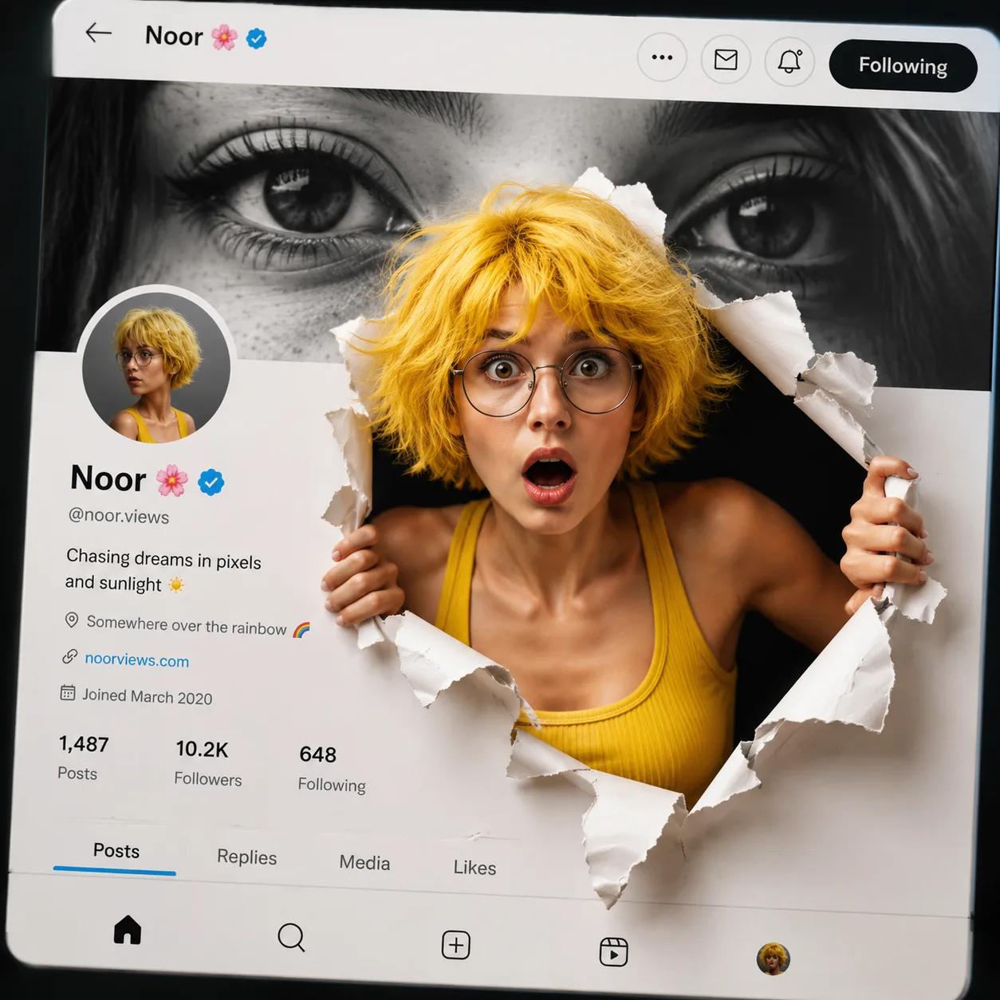

# Creative 3D photo manipulation of a social media profile

[← Back to the collection](../../README.md) · Category: [UI & Graphic](../../gallery/ui-graphic.md) · Model: `Vinano Studio` · ID: `vn-01304`

<a href="https://vinano.ai?utm_source=github&utm_medium=readme&utm_campaign=awesome-image-video-prompts-updating&utm_content=prompt-page-image"></a>

<sub>Preview generated with <a href="https://vinano.ai?utm_source=github&utm_medium=readme&utm_campaign=awesome-image-video-prompts-updating&utm_content=prompt-page-caption">vinano.ai</a></sub>

## Prompt

```text
A creative 3D photo manipulation of a social media profile interface, featuring a surprised young woman short messy yellow hair, round glasses, and expressive wide eyes, wearing a sleeveless yellow top. She is breaking through a torn paper effect from the screen, holding the ripped edges both hands. The tear reveals a dark background behind her, adding depth. The UI resembles a modern social media profile page profile picture, username “Noor 🌸”, verified badge, bio text, and follower stats. Top banner shows a black-and-white close-up of eyes. Clean minimal layout, soft shadows, realistic lighting, high detail, depth-of-field, ultra-realistic textures, cinematic composition, vibrant color contrast, trending AI art style, 4K resolution. Emphasise material texture and natural light so the final frame feels tactile and premium.
```

## Try it on vinano.ai

1. Copy the prompt above.
2. Open **[vinano.ai](https://vinano.ai?utm_source=github&utm_medium=readme&utm_campaign=awesome-image-video-prompts-updating&utm_content=prompt-page-try)**, paste it into the image generator and pick a model.
3. Swap any placeholders (brand, product, city, person…) for your own details, then generate.

More prompts like this: [UI & Graphic gallery](../../gallery/ui-graphic.md) · [all categories](../../README.md#contents)
