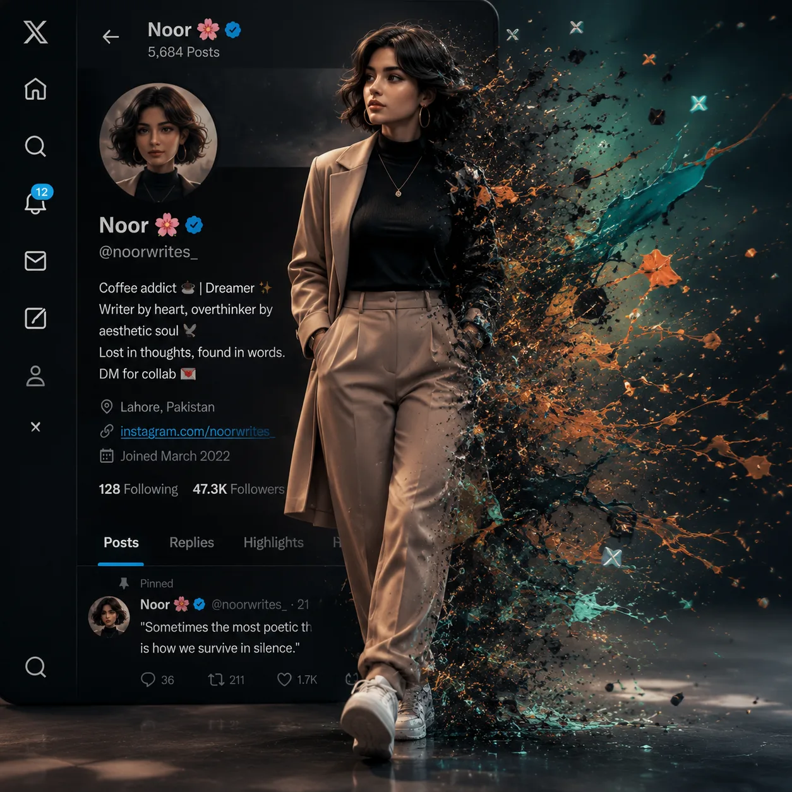

# Digital artwork of a stylish animated girl walking out

[← Back to the collection](../../README.md) · Category: [UI & Graphic](../../gallery/ui-graphic.md) · Model: `Vinano Studio` · ID: `vn-01335`

<a href="https://vinano.ai?utm_source=github&utm_medium=readme&utm_campaign=awesome-image-video-prompts-updating&utm_content=prompt-page-image"></a>

<sub>Preview generated with <a href="https://vinano.ai?utm_source=github&utm_medium=readme&utm_campaign=awesome-image-video-prompts-updating&utm_content=prompt-page-caption">vinano.ai</a></sub>

## Prompt

```text
A cinematic digital artwork of a stylish animated girl walking out of a modern X (Twitter) profile interface. The background shows a real mobile UI profile screen the name "Noor 🌸", verified badge, username, and detailed bio.
The girl matches the profile picture — soft aesthetic illustration style, short wavy black hair, gold hoop earrings, minimal makeup, wearing a black turtleneck and beige coat matching pants and sneakers.
She is stepping forward confidently from the screen into real space. The right half of her body dissolves into dynamic particles — a mix of black dust, teal, and orange energy splashes, flowing outward like liquid + digital fragments.
crisp composition: left side = structured UI, right side = abstract particle explosion. Soft filmic, cinematic lighting, depth of field, ultra-detailed textures, smooth shadows, 4K render, octane render, Unreal Engine 5 style, trending on ArtStation.

Preserve realistic proportions and depth for a confident, professional finish.
```

## Try it on vinano.ai

1. Copy the prompt above.
2. Open **[vinano.ai](https://vinano.ai?utm_source=github&utm_medium=readme&utm_campaign=awesome-image-video-prompts-updating&utm_content=prompt-page-try)**, paste it into the image generator and pick a model.
3. Swap any placeholders (brand, product, city, person…) for your own details, then generate.

More prompts like this: [UI & Graphic gallery](../../gallery/ui-graphic.md) · [all categories](../../README.md#contents)
