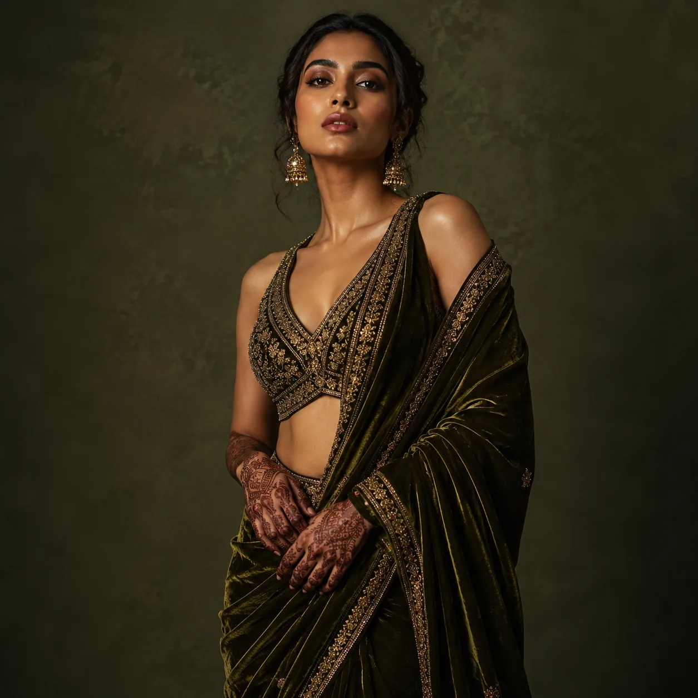

# High-fashion studio photograph of a woman posing gracefully

[← Back to the collection](../../README.md) · Category: [UI & Graphic](../../gallery/ui-graphic.md) · Model: `Vinano Studio` · ID: `vn-01453`

<a href="https://vinano.ai?utm_source=github&utm_medium=readme&utm_campaign=awesome-image-video-prompts-updating&utm_content=prompt-page-image"></a>

<sub>Preview generated with <a href="https://vinano.ai?utm_source=github&utm_medium=readme&utm_campaign=awesome-image-video-prompts-updating&utm_content=prompt-page-caption">vinano.ai</a></sub>

## Prompt

```text
A detailed, high-fashion studio photograph of a woman posing gracefully, wearing a luxurious olive green velvet saree draped elegantly over her shoulder, paired a matching heavily embroidered sleeveless blouse that highlights her midriff. The lighting is moody and dramatic, accentuating the rich texture of the velvet and giving her skin a subtle, dewy sheen. Her hands are adorned intricate, dark henna (mehndi) designs, and she is wearing traditional gold earrings, looking directly into the camera a confident expression. Aim for an editorial, design-driven look with deliberate negative space.
```

## Try it on vinano.ai

1. Copy the prompt above.
2. Open **[vinano.ai](https://vinano.ai?utm_source=github&utm_medium=readme&utm_campaign=awesome-image-video-prompts-updating&utm_content=prompt-page-try)**, paste it into the image generator and pick a model.
3. Swap any placeholders (brand, product, city, person…) for your own details, then generate.

More prompts like this: [UI & Graphic gallery](../../gallery/ui-graphic.md) · [all categories](../../README.md#contents)
