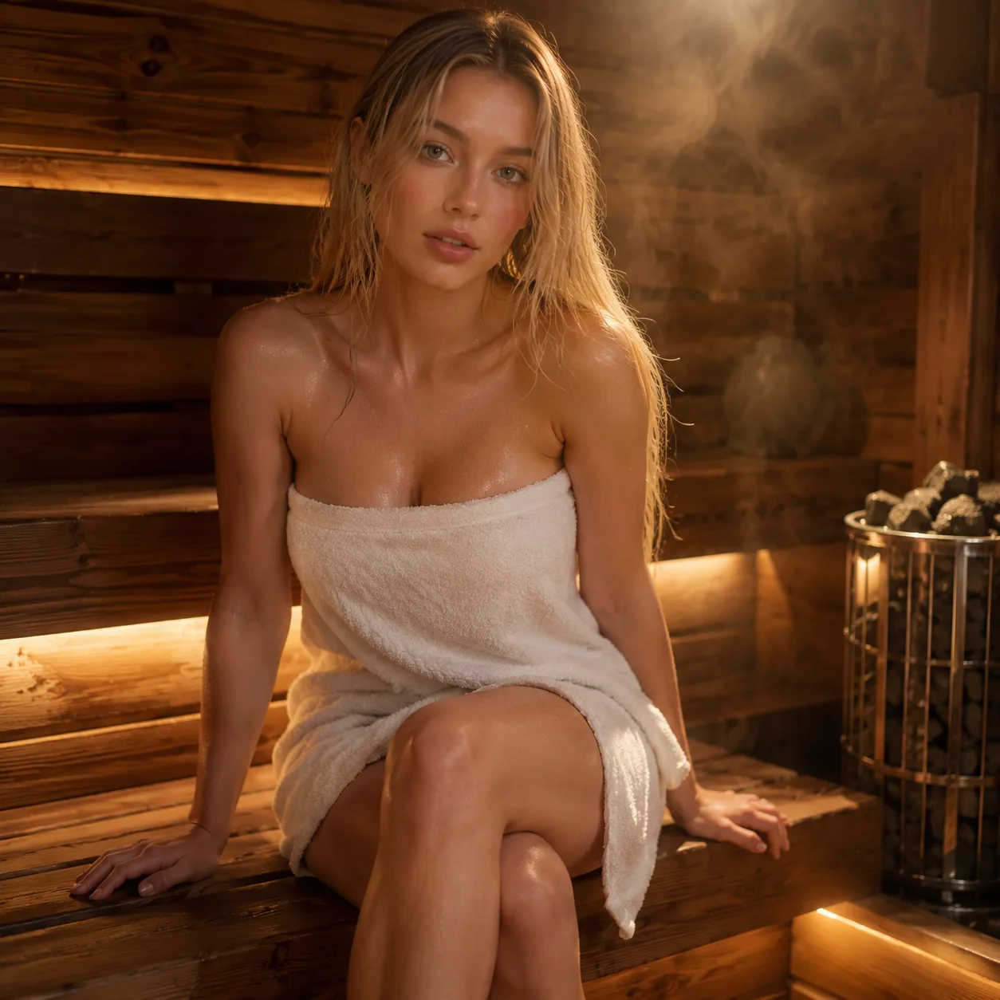

# Realistic, Portrait

[← Back to the collection](../../README.md) · Category: [UI & Graphic](../../gallery/ui-graphic.md) · Model: `Vinano Studio` · ID: `vn-01471`

<a href="https://vinano.ai?utm_source=github&utm_medium=readme&utm_campaign=awesome-image-video-prompts-updating&utm_content=prompt-page-image"></a>

<sub>Preview generated with <a href="https://vinano.ai?utm_source=github&utm_medium=readme&utm_campaign=awesome-image-video-prompts-updating&utm_content=prompt-page-caption">vinano.ai</a></sub>

## Prompt

```text
{
 "project_configuration": {
 "title": "Cinematic Wellness: The Sauna Portrait",
 "version": "2.0_High_Fidelity",
 "output_parameters": {
 "aspect_ratio": "9:16",
 "resolution": "8K UHD",
 "color_space": "DCI-P3",
 "style_preset": "Hyper-realistic Photorealism",
 "rendering_engine": "Octane Render / Unreal Engine 5.4 Path Tracing"
 }
 },
 "subject_composition": {
 "identity": {
 "resemblance": "Sydney Sweeney",
 "age_range": "Early 20s",
 "expression": "Serene, introspective, captivating, direct eye contact",
 "skin_tone": "Fair, ivory, dewy complexion"
 },
 "anatomical_precision": {
 "micro_details": "Visible skin pores, fine vellus hair, realistic skin texture, subcutaneous scattering (SSS), tiny crystalline water droplets on collarbones and forehead.",
 "eyes": "Deep hazel, intricate iris patterns, sharp catchlights reflecting the warm sauna interior.",
 "lips": "Soft pink, moist, slightly parted, high-gloss finish from the humidity.",
 "hair": "Long blonde hair, wet-look styling, damp strands clinging to the skin, dark-blonde roots, high-specularity sheen."
 },
 "attire_and_fabric": {
 "primary_garment": "High-texture white cotton bath towel",
 "fabric_details": "Visible terry cloth loops, heavy fabric weight, damp patches showing darker white tones, intricate weaving patterns, soft frayed edges."
 },
 "pose_and_dynamics": {
 "position": "Seated elegantly on a mid-level cedar bench, legs crossed at the ankles.",
 "body_language": "Leaning slightly forward to create depth, relaxed shoulders, natural posture, hands resting softly on the wood."
 }
 },
 "environment_design": {
 "setting": "Ultra-luxury traditional Finnish sauna",
 "interior_materials": {
 "wood": "Polished Western Red Cedar, horizontal slats, visible grain, knots, and heat-induced oil sheen.",
 "elements": "Hot sauna stones in a stainless steel heater (background), rising heat haze."
 },
 "atmospheric_effects": {
 "steam": "Ethereal swirling mist, volumetric fog, thick humidity, moisture-laden air.",
 "haze": "Soft-focus background, golden-hour glow filtered through steam particles."
 }
 },
 "lighting_and_optics": {
 "lighting_setup": {
 "type": "Warm diffused ambient lighting",
 "primary_source": "Hidden LED strips beneath benches creating a soft under-glow.",
 "secondary_source": "Top-down warm spotlighting (3200K temperature).",
 "shadows": "Soft, diffused, zero harsh edges."
 },
 "optical_settings": {
 "lens": "35mm prime lens, wide angle minimal distortion.",
 "aperture": "f/1.8 for shallow depth of field (bokeh background).",
 "focus": "Sharp focus on the subject's eyes, gradual fall-off on the shoulders and environment."
 }
 },
 "technical_post_processing": {
 "quality_enhancements": ["true-to-life photorealistic masterpiece",
 "Ray-traced reflections",
 "Global illumination",
 "Anamorphic lens flares (subtle)",
 "High Dynamic Range (HDR10+)",
 "16-bit color depth"],
 "color_grading": {
 "palette": "Warm ambers, deep browns, clean whites, soft skin tones.",
 "vibe": "Cinematic, intimate, luxury spa, high-end editorial."
 }
 }
}

Emphasise material texture and natural light so the final frame feels tactile and premium.
```

## Try it on vinano.ai

1. Copy the prompt above.
2. Open **[vinano.ai](https://vinano.ai?utm_source=github&utm_medium=readme&utm_campaign=awesome-image-video-prompts-updating&utm_content=prompt-page-try)**, paste it into the image generator and pick a model.
3. Swap any placeholders (brand, product, city, person…) for your own details, then generate.

More prompts like this: [UI & Graphic gallery](../../gallery/ui-graphic.md) · [all categories](../../README.md#contents)
