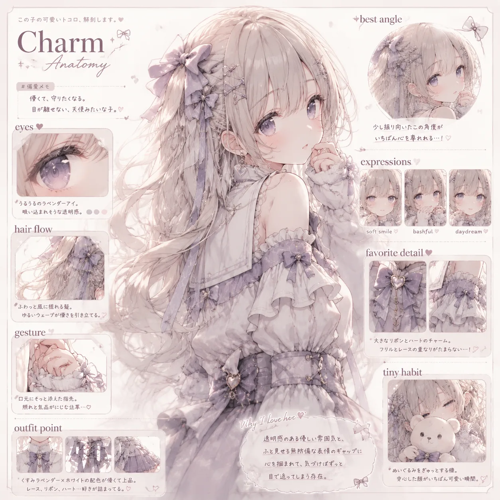

# Anime, Character

[← Back to the collection](../../README.md) · Category: [UI & Graphic](../../gallery/ui-graphic.md) · Model: `Vinano Studio` · ID: `vn-01491`

<a href="https://vinano.ai?utm_source=github&utm_medium=readme&utm_campaign=awesome-image-video-prompts-updating&utm_content=prompt-page-image"></a>

<sub>Preview generated with <a href="https://vinano.ai?utm_source=github&utm_medium=readme&utm_campaign=awesome-image-video-prompts-updating&utm_content=prompt-page-caption">vinano.ai</a></sub>

## Prompt

```text
入力されたキャラクター画像をもとに、
そのキャラクターの「魅力解剖図」を1枚のビジュアルとして作成してください。

これは通常のキャラクター設定資料、三面図、プロフィールシートではありません。
目的は、キャラクターの情報を説明することではなく、
「この子のどこが可愛いのか」「なぜ目を惹かれるのか」「どの部分に好きになる理由があるのか」を、
デザイン的・感情的に分解して見せることです。

入力画像からキャラクターの以下の魅力要素を丁寧に読み取ってください。

・目の形、瞳の色、目線の印象
・髪の流れ、前髪、毛先、シルエットの可愛さ
・表情のクセ、微笑み方、照れ、無表情の中の感情
・手の仕草、指先、袖口との関係
・衣装の好きポイント、リボン、フリル、装飾、小物
・首元、肩、袖、スカート、靴などの見せ場
・そのキャラクターが一番かわいく見える角度
・全体から感じる性格、雰囲気、守りたくなるポイント、惹かれる理由

中央にはキャラクターを大きく配置してください。
キャラクターはただ立たせるのではなく、
その子の魅力が最も伝わる角度、ポーズ、表情で描いてください。
正面すぎる証明写真のような構図は禁止。
少し振り向く、手を口元に添える、袖をつまむ、髪を軽く押さえる、視線を少し外すなど、
“好きになる瞬間”を切り取ったような自然で魅力的なポーズにしてください。

周囲には、キャラクターの魅力ポイントを分解した小さなクローズアップパネルを配置してください。
ただし機械的な設定資料のように並べるのではなく、
雑誌の特集ページ、デザイン解剖図、ファンが作った愛のある分析ボードのように、
美しく、可愛く、少し偏愛を感じるレイアウトにしてください。

配置するパネル例：
・瞳のアップ：この子らしさが宿る目元
・髪の流れ：シルエットを決める毛束
・手元：仕草に出る性格
・表情差分：微笑み、照れ、少し不機嫌、無防備な顔
・衣装の推しポイント：リボン、袖、襟、装飾、素材感
・一番かわいい角度：顔の向き、視線、首の傾き
・小物やモチーフ：その子の世界観を象徴する要素

各パネルは、キャラクターの魅力を強調するための拡大カットとして描いてください。
パーツだけを無機質に切り抜くのではなく、
「ここが好き」と思わせるような温度感のある見せ方にしてください。

画面内には短い注釈風のラベルを入れてもよいですが、
長文説明ではなく、短い見出しや記号的なデザインにしてください。
例：
“eyes”
“hair flow”
“gesture”
“best angle”
“favorite detail”
“charm point”
“soft expression”
“tiny habit”

文字は主役にしすぎず、あくまでデザイン要素として扱ってください。
読ませる資料ではなく、見た瞬間に「この子、可愛い」と伝わるビジュアルにしてください。

デザイン全体は、可愛い研究ノート、キャラクター愛の解剖図、ファッション誌の分析ページ、公式アートブックの特集ページを合わせたような雰囲気。
背景はシンプルで清潔感があり、キャラクターの色に合わせた淡いグラデーション、紙面風の余白、細い罫線、半透明のパネル、手書き風の丸囲み、矢印、ハート、小さな装飾を使ってください。

重要：
キャラクターを単に説明しないこと。
身長、年齢、能力、所属、武器説明などの設定資料的な情報は不要です。
描くべきなのはスペックではなく、
“好きになる理由”です。

キャラクター本人の魅力が最優先。
パネルや注釈が多すぎて主役が埋もれないようにしてください。
中央のキャラクターは必ず最も可愛く、最も完成度高く描いてください。

全体の印象：
cute character charm analysis sheet,
visual breakdown of cuteness,
not a character profile,
not a model sheet,
aesthetic design board,
fan-favorite details,
emotional attraction map,
soft editorial layout,
official artbook style,
clean anime illustration,
beautiful eyes,
expressive hands,
flowing hair,
adorable pose,
best angle,
lovable expression,
fashion detail close-ups,
delicate annotations,
soft pastel panels,
refined graphic design,
premium-quality anime illustration,
commercial-level finish.

Emphasise material texture and natural light so the final frame feels tactile and premium.
```

## Try it on vinano.ai

1. Copy the prompt above.
2. Open **[vinano.ai](https://vinano.ai?utm_source=github&utm_medium=readme&utm_campaign=awesome-image-video-prompts-updating&utm_content=prompt-page-try)**, paste it into the image generator and pick a model.
3. Swap any placeholders (brand, product, city, person…) for your own details, then generate.

More prompts like this: [UI & Graphic gallery](../../gallery/ui-graphic.md) · [all categories](../../README.md#contents)
