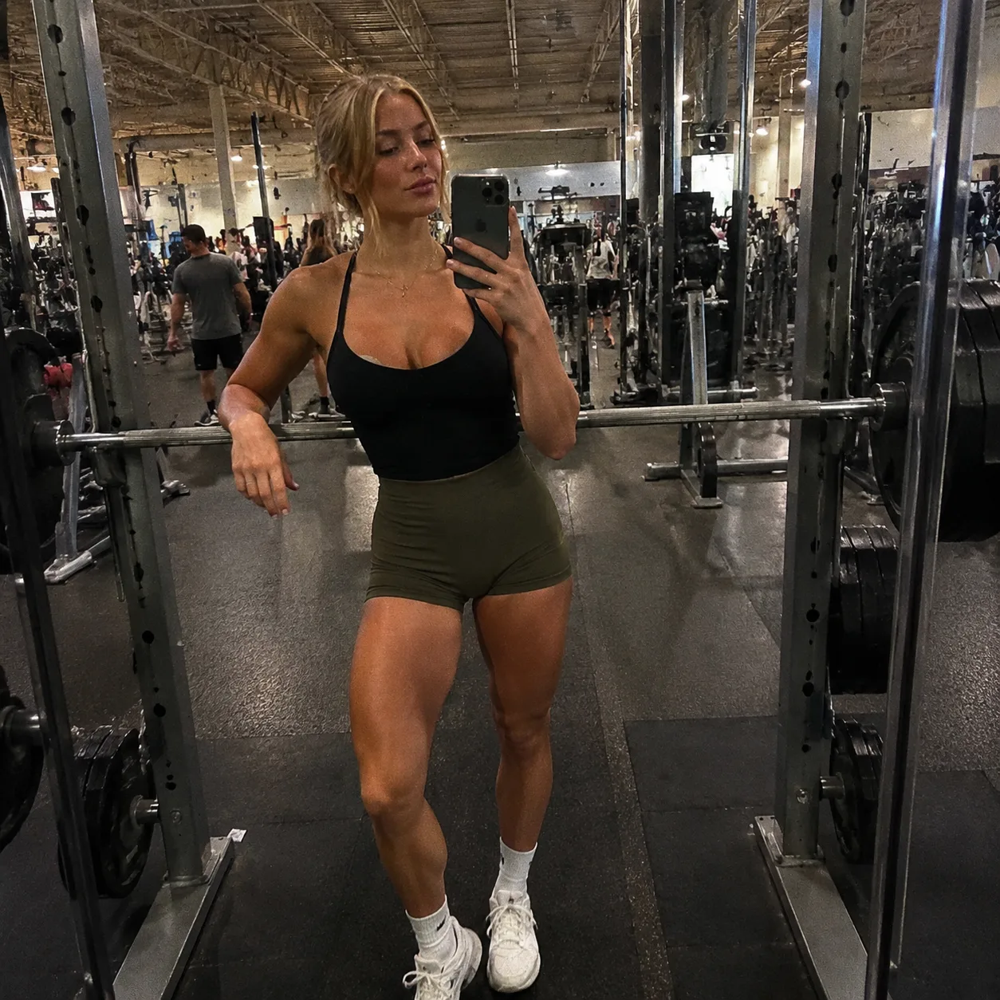

# Realistic, Cinematic

[← Back to the collection](../../README.md) · Category: [UI & Graphic](../../gallery/ui-graphic.md) · Model: `Vinano Studio` · ID: `vn-01497`

<a href="https://vinano.ai?utm_source=github&utm_medium=readme&utm_campaign=awesome-image-video-prompts-updating&utm_content=prompt-page-image"></a>

<sub>Preview generated with <a href="https://vinano.ai?utm_source=github&utm_medium=readme&utm_campaign=awesome-image-video-prompts-updating&utm_content=prompt-page-caption">vinano.ai</a></sub>

## Prompt

```text
A mirror selfie taken inside a commercial gym, photographed a smartphone front camera. The subject is an attractive, athletic woman a curvy, feminine build, strong thighs and hips, toned legs, and a confident stance. She is wearing a black tank top a deep neckline and olive-green high-waisted workout shorts, white socks, and white trainers.

She stands inside a squat rack, one knee slightly bent, hips angled forward, leaning casually against the barbell. The gym environment is clearly visible: metal racks, weight machines, rubber flooring, high industrial ceiling exposed beams, warm overhead lights, and other gym-goers blurred in the background.

Her face is fully visible and resembles Sydney Sweeney — soft facial features, expressive eyes, blonde hair styled naturally, minimal makeup, realistic skin texture — captured casually as if mid-workout. Expression is relaxed and confident, not posed.

The photo has a raw smartphone aesthetic:

noticeable film grain and digital noise

low resolution

mild blur and compression artifacts

imperfect focus

uneven indoor lighting

slightly warm color cast

The image feels candid and unpolished, like a real gym mirror selfie posted online.
true-to-life photorealistic, casual realism, modern lo-fi aesthetic, natural body proportions.

Camera & Style Cues

Smartphone front camera

Mirror selfie

Slight wide-angle distortion

Indoor gym lighting

No studio polish

Negative Prompt;

ultra-high resolution, professional photoshoot, filmic, cinematic lighting, flawless skin, exaggerated curves, plastic look, studio background, cartoon style, text, watermark

Aim for an editorial, design-driven look with deliberate negative space.
```

## Try it on vinano.ai

1. Copy the prompt above.
2. Open **[vinano.ai](https://vinano.ai?utm_source=github&utm_medium=readme&utm_campaign=awesome-image-video-prompts-updating&utm_content=prompt-page-try)**, paste it into the image generator and pick a model.
3. Swap any placeholders (brand, product, city, person…) for your own details, then generate.

More prompts like this: [UI & Graphic gallery](../../gallery/ui-graphic.md) · [all categories](../../README.md#contents)
