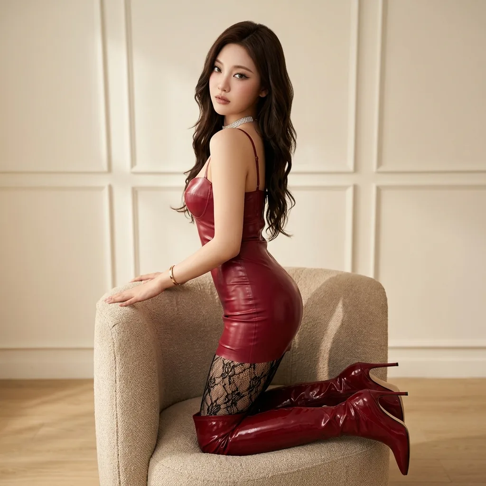

# Realistic, Portrait

[← Back to the collection](../../README.md) · Category: [UI & Graphic](../../gallery/ui-graphic.md) · Model: `Vinano Image Pro` · ID: `vn-01506`

<a href="https://vinano.ai?utm_source=github&utm_medium=readme&utm_campaign=awesome-image-video-prompts-updating&utm_content=prompt-page-image"></a>

<sub>Preview generated with <a href="https://vinano.ai?utm_source=github&utm_medium=readme&utm_campaign=awesome-image-video-prompts-updating&utm_content=prompt-page-caption">vinano.ai</a></sub>

## Prompt

```text
{
  "raw_prompt": "Ultra-realistic high-end smartphone photo of aespa's Ningning in a refined minimalist luxury studio. She has a distinct feline-like eye shape, soft cheeks, and long dark espresso brown hair styled in soft waves. She is wearing a deep ruby red latex mini dress a structured sweetheart neckline and thin straps, paired intricate floral lace patterned tights and ruby red patent leather thigh-high stiletto boots. She is kneeling elegantly on a beige upholstered chair, twisting her torso to look back at the camera an alluring, composed expression. Soft studio lighting warm highlights. --ar 9:16",
  "aspect_ratio": "9:16",
  "subjects": [{
      "name": "Ningning (aespa)",
      "physical_features": "Distinct feline-like eye shape, soft cheeks, fair skin, long dark espresso brown hair soft waves. Polished glam makeup sharp eyeliner and a muted nude lip.",
      "outfit": {
        "garment": "Deep ruby red latex mini dress, tight body-hugging fit, structured sweetheart neckline, thin shoulder straps.",
        "footwear": "Intricate floral lace patterned black tights, ruby red patent leather thigh-high boots a slim pointed toe and tall stiletto heel.",
        "accessories": "Sparkling silver choker, thin gold bracelet on the wrist."
      },
      "pose_and_expression": "Kneeling elegantly on a beige chair, upper body twisted to face the camera over her shoulder. Sultry, composed expression a confident gaze."
    }],
  "environment": "refined minimalist indoor studio, beige upholstered chair, light wooden floor, cream wall decorative panel lines.",
  "photography_and_lighting": {
    "camera_style": "High-end smartphone-style portrait, 8k resolution, high-definition details.",
    "lighting": "Soft studio lighting, even warm lighting soft shadows enhancing skin and fabric textures.",
    "color_grading": "Elegant and glamorous mood, crisp textures, high contrast between the red latex and cream background."
  }
}

Keep edges clean and the overall composition balanced for a polished, gallery-ready result.
```

## Try it on vinano.ai

1. Copy the prompt above.
2. Open **[vinano.ai](https://vinano.ai?utm_source=github&utm_medium=readme&utm_campaign=awesome-image-video-prompts-updating&utm_content=prompt-page-try)**, paste it into the image generator and pick a model.
3. Swap any placeholders (brand, product, city, person…) for your own details, then generate.

More prompts like this: [UI & Graphic gallery](../../gallery/ui-graphic.md) · [all categories](../../README.md#contents)
